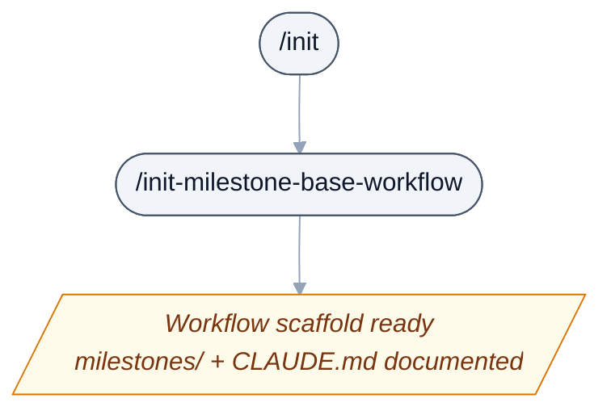
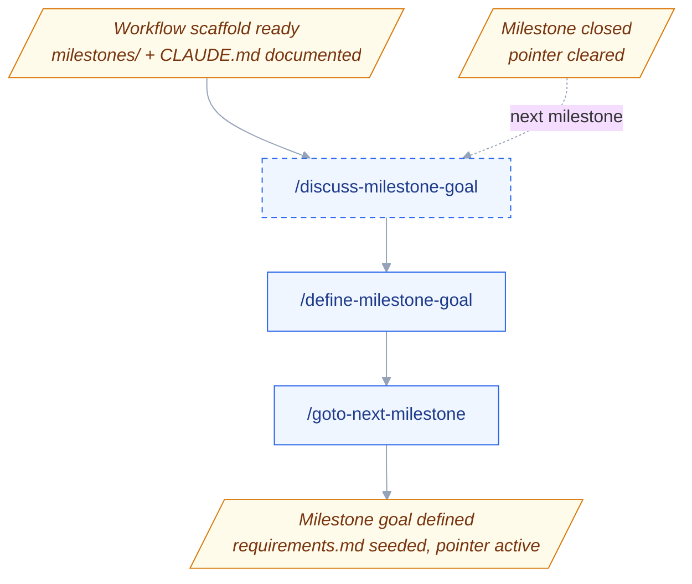
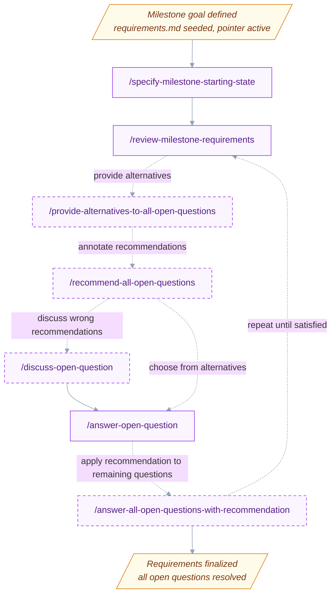
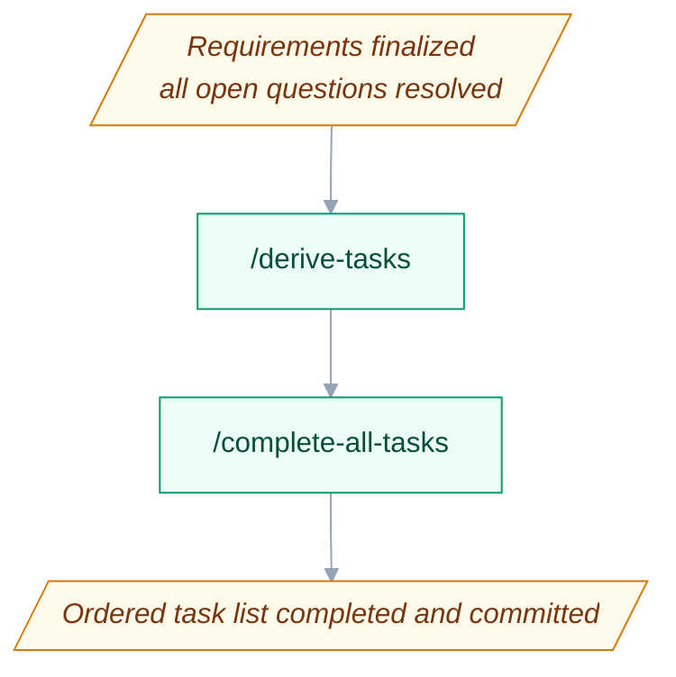
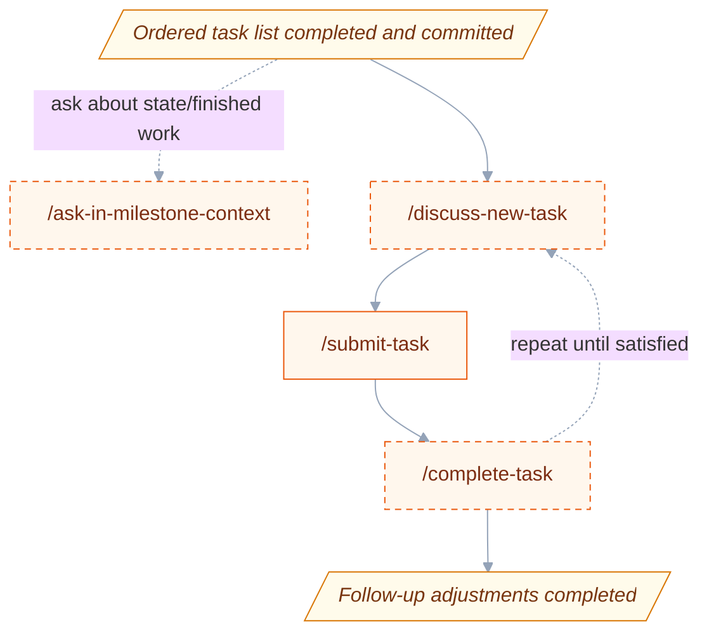
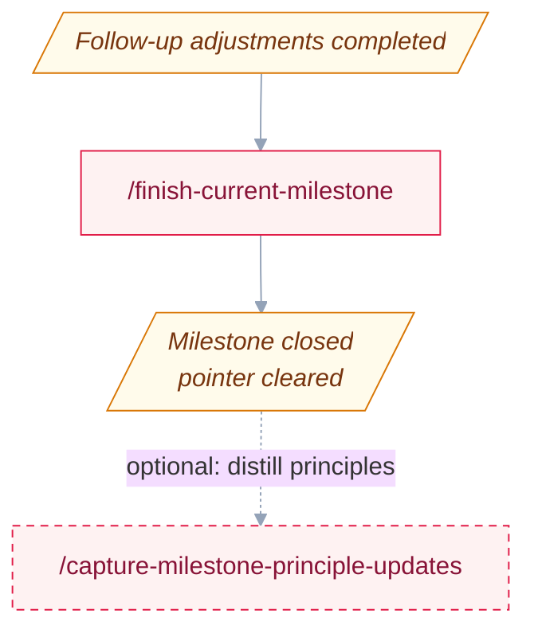

# Workflow

How a milestone moves through Cairn's skills: the six phases of the pipeline, how the skills commit what they change, and how the project learns from every answered question. What each individual skill does is in the [skill reference](skill-reference.md), and how to chain the skills as headless command lines is in [ways of using Cairn](ways-of-using-cairn.md).

## Workflow pipeline

The workflow runs as a stack of six phases. Each phase is its own diagram below, and the amber parallelogram **state** nodes (`D0`–`D5`) are the seams: every phase ends on the state node that the next phase begins with, so the shared node repeats at each boundary and the whole sequence reads top-to-bottom. Node labels are bare skill names — see the [Skill reference](skill-reference.md) for what each one does. Dashed nodes and edges are optional or repeated steps.

### One-time setup

Run once per project, before any milestone work. `/init` records the project's domain context, working conventions, available tools, and how work is verified as done in `CLAUDE.md`; `/init-milestone-base-workflow` first checks the workflow's two runtime prerequisites — git first, a work tree at the project root that every skill commits into, then a Python 3.9 or later interpreter answering as `python3`, which the skills drive the plugin's stdlib-only Python tools with — stopping with the remedy when either is missing, then creates the `milestones/` scaffold, seeds the current-milestone pointer, and commits what it created or edited under `Workflow-bootstrap: milestones` — leaving the workflow scaffold ready and committed.

### Initializing a milestone

From a ready scaffold — or looping back from a just-closed milestone (the dashed **next milestone** entry from `D5`) — shape and open the next milestone. `/discuss-milestone-goal` optionally sharpens a vague idea, `/define-milestone-goal` chooses the milestone's title and has the plugin's milestone-definition tool number the milestone, create its directory, seed `requirements.md`, and write an empty `open_questions.xml` and the two task lists beside it, and `/goto-next-milestone` activates the lowest-numbered undone milestone without asking, stopping only when the pointer does not read `none` or no undone milestone exists — leaving the milestone goal defined.

### Iterating milestone requirements

Drive the milestone's requirements to convergence. The prose — goal, starting state, decisions, out of scope — lives in `requirements.md`; the open questions live beside it in `open_questions.xml`, one `<open-question>` XML block per question under a single `<open-questions>` root. Once `/define-milestone-goal` has created it, that document is written only by the plugin's stdlib-only open-question tool, `tools/open_questions.py`, which every skill runs as `python3` with the milestone directory as its argument. Every deterministic operation over the question set is a tool call — `list`, `locate`, and `lift` to read, `add`, `embed`, `strip`, and `remove` to write, `walk` to order — so the runtime prose keeps only judgment (what a question asks, which questions matter most, what an answer settles), while escaping, indentation, fragment validation, and `<depends-on>` reconciliation are the tool's internals, and every write re-renders the document in one canonical form; a skill reads the file whole only to reason over it, never to find or change a block. `requirements.md` has no sole writer: after the milestone-definition tool creates it, the skills edit its prose directly, except that the answer sweep folds each of its decisions through the plugin's stdlib-only fold tool, `tools/requirements.py`, run the same way, whose one `fold` subcommand splices the decision verbatim at the end of a named `###` subsection of `## Decisions` (creating that subsection when no heading matches) and writes every other byte of the file back unchanged, so a fold's diff is exactly the decision it added. `/specify-milestone-starting-state` fills the starting state from the project's existing state, then `/review-milestone-requirements` runs each pass to reconcile, surface new gaps — authoring every finding it surfaces as an ordinary `<open-question>` block through the tool's `add` — and check convergence (repeat until satisfied). Questions are explored with `/discuss-open-question` and recorded with `/answer-open-question`, which commits each answer with its rationale in the commit body (the reusable principle behind it is distilled later by `/capture-milestone-principle-updates`, naturally once the milestone is finished). When a discussion concludes the milestone goal itself must shift, `/discuss-open-question` offers `/modify-milestone-goal` to revise the `## Goal` (then loop back through review to reconcile). The two optional annotating passes are the batch form of `/discuss-open-question`, split at the seam between enumerating options and picking one. `/provide-alternatives-to-all-open-questions` gives every `<open-question>` block that carries no `<alternative>` children yet its set: it creates one scratch directory for the run with `mktemp -d`, outside the repository, and dispatches one alternatives subagent per such question — all of them together on Claude Code and Antigravity, in rounds of at most the session's thread cap on Codex — passing each its Short Title, the milestone directory, and that scratch directory. Each subagent, read-only toward the project but for that one file, writes its `<alternative>` elements to a scratch file named for its question and ends with the bare token `DONE` (or `FAILED: <reason>`), so the orchestrator gets nothing back but the token. Landed files are then embedded and committed in batches, each batch one fixed shell call that pipes each landed file into the tool's `embed --alternatives` (which validates the fragment before it writes), commits each question that embedded on its own, and moves every piped file aside so none is piped twice — a batch each time a subagent's ending wakes the orchestrator on Claude Code and Antigravity, and one per round on Codex once `wait_agent` has seen every agent of the round finish (how a host waits and repairs reaches the pass only as named slots, so each host's tree describes only its own mechanism and never another host's) — so each alternative set is frozen the moment it is written. A refused file gets one repair, all of a batch's repairs sent together, then a skip; a question whose file never landed is reported as `no annotation landed` by one closing `list --without-alternatives` and left bare for the next run; and the pass deletes nothing, leaving the scratch directory to the system's temp handling. `/recommend-all-open-questions` then picks against those frozen sets **inline, dispatching no agent**: it stops, naming the blocks, while any block still lacks alternatives; otherwise it reads the whole question set at once, forms one `<recommendation>` per block still carrying none, declares each pick that leans on a sibling settling on one of its options as a `<depends-on question="…" option="…"/>` child of the block, naming that sibling and the option assumed, and writes every pick in one fixed shell call, which runs each picked block's own `embed --recommendation` — which never adds, drops, or edits an `<alternative>` — followed by that block's `lift`, commits the call's annotations once with every lifted pick's rationale in the body, and sorts the document so the annotated blocks lead in the order the answer sweep will walk them, committing that reorder separately behind the dirty-path guard. A block the tool refuses prints its own `Error:` line while the rest land and commit; the refused blocks are corrected and re-sent together in at most one more call of the same shape, and a block refused again is skipped and reported with the remedy of re-running the pass. The embedded `<recommendation>` element is what `/answer-open-question-with-recommendation` then lifts and records for a single question — or `/answer-all-open-questions-with-recommendation` records for every annotated question at once, **inline, dispatching no agent**. It views the question set in one fixed shell call — every block's question text, then each annotated block's lifted pick and its picked alternative's what-it-is, in the order the tool's `walk` gives by walking the dependency graph those tags form from its origins, so every target is answered before its dependents — while it reads `requirements.md` whole in the same turn, and it records the whole run in one fixed batched shell call: that call stops before any write while either milestone file holds a change, and its section for each question lifts the pick (a pick an earlier answer's `remove` stripped is skipped silently), folds the decision through the fold tool, removes the block, and commits the answer before the next section runs, the first failure after a lift stopping the call with the tree left as it stands. It records every pick as given, running no mooting cascade and forming no contradiction judgment: the next `/review-milestone-requirements` pass cleans up or flags an entry a decision mooted and authors one open question for each pair of recorded decisions that conflict. To record a *different* embedded option than the recommended one, `/answer-open-question-with-alternative` lifts an `<alternative>` you name by its id instead. However an answer is recorded, the decision is folded into `## Decisions` of `requirements.md` first and the block is then removed by the tool's `remove`, which reconciles the dependents that assumed the answered question's option in the same write: where the recorded option agrees with a dependent's `<depends-on>` tag only that tag is removed, and where it disagrees — or the comparison is in doubt — the dependent loses its pick — its `<recommendation>`, `<depends-on>`, and `<applied-principle>` children — and keeps its `<alternative>` children, transitively, so an override costs only a re-run of the recommendation pass, which re-picks over the kept set (to force a fresh pick on a question yourself, the tool's `strip --recommendation` clears the same children; to force a fresh alternative set, its bare `strip` clears every child and the alternatives pass regenerates it). A wrong recorded answer is corrected by reverting its commit (which reopens the question) and re-recording — repeat until no `<open-question>` block remains in `open_questions.xml`.

### Automated one-shot task derivation and completion

Hands-off execution. Once `/define-milestone-goal` has created them, `TASKS_TODO.md` and `TASKS_DONE.md` are written only by the plugin's stdlib-only task-list tool, `tools/task_list.py`, run like the open-question tool as `python3` with the milestone directory as its argument: every write parses the whole file and renders it again in one canonical layout, so the `##`/`---` section parsing and the `**Verified:**` rendering are the tool's, while every read of the task files stays a whole-file read. `/derive-tasks` converts the finalized `requirements.md` into an ordered `TASKS_TODO.md` — decomposing the milestone into briefs and writing them into the task list itself, in one pass, with no second authoring step — handing the whole ordered list to one `initialize` call that lands it whole or leaves the file unchanged. `/complete-all-tasks` then works through the list, committing after each task: each task's subagent derives and verifies its acceptance bar, then moves the task with the tool's `move`, which appends it to `TASKS_DONE.md` with that bar under the `**Verified:**` label, in the same shell call as its staging — leaving the ordered task list completed.

### Semi-manual follow-up and adjustments

Inline, conversational adjustments after the automated pass. `/ask-in-milestone-context` answers read-only questions about the milestone at any time; `/discuss-new-task` clarifies a mid-flight issue into briefs that hand off to `/submit-task`; and `/complete-task` completes a single task inline (repeat until satisfied) with the conversation kept for follow-up tweaks — leaving the follow-up adjustments completed. `/submit-task` places its task with the task-list tool's `insert` at the end, before, or after a named task, and an anchor that names no task stops the skill with the tool's `Error:` line rather than landing the task anywhere else; `/complete-task` moves its finished task with the same `move` the subagent uses.

### Ending a milestone

Close out. `/finish-current-milestone` records accomplishments and clears the pointer, leaving the milestone closed. `/capture-milestone-principle-updates <milestone_id>` is the **on-demand** principle harvester: given a milestone id, it distills reusable answering principles from that milestone's answer commits into the principle store. It lives in this stage because finish is the natural moment to run it — the milestone's answer set is complete by then — but finish is never a precondition: it runs against any milestone whose `requirements.md` exists, the current one and already-finished ones (backfill) included. From `D5` the loop returns to **Initializing a milestone** for the next one.

## How skills commit

Committing is a property of the skill layer, so the workflow leaves a clean, self-describing git history without you staging anything by hand. **Every user-invoked skill that changes files ends by committing exactly those changes** — staged path-scoped (only the paths it touched, never `git add -A`) under its own distinct `<Marker>: <descriptor>` subject derived from what the skill does (`Manual-answer:`, `Task-completion:`, `Task-submission:`, `Requirements-review:`, `Goal-revision:`, `Milestone-finish:`, and so on). **Dispatched subagents never commit** — they stage their own change set path-scoped and return — and **an orchestrator commits the index its agent staged**: `/complete-all-tasks` commits once per task, under `Task-completion: <task heading>` with no body, the same subject inline `/complete-task` uses. Every write to a task file rides in one shell call with the git step its runner owns, the tool call chained by `&&` to it so git runs only when the write succeeded: the completion subagent chains the task-list tool's `move` with its path-scoped `git add`, inline `/complete-task` chains the same `move` with the commit procedure's three steps, `/submit-task` chains its `insert` and `/derive-tasks` its `initialize` with theirs, so finishing a task's bookkeeping is one turn. The four other batch skills commit their own writes at their own granularity: `/answer-all-open-questions-with-recommendation` — which runs inline and dispatches no agent, recording every answer itself — commits once per answer inside its one batched shell call, each question's section carrying out the commit procedure's three steps itself under `Recommendation-answer: <Short Title>` with the lifted recommendation line as the body, so each answer is committed before the next question is recorded, and each landed commit printing a fixed marker line from which the run's status line is read; `/provide-alternatives-to-all-open-questions` — whose subagent is read-only toward the project, writing only its one scratch file outside the repository and staging nothing, so the orchestrator itself is the writer and stages path-scoped — commits once per annotated question, under `Alternatives-annotation: <Short Title>` with no body, inside the one batch shell call that embeds the landed files, run once per wake-up on Claude Code and Antigravity and once per round of subagents on Codex, plus once for a round's repairs; `/recommend-all-open-questions` — which runs inline and dispatches no agent — commits once per batched shell call, under `Recommendation-annotation: <milestone_id>` with one lifted recommendation line per annotated question as the body, then, inside the same call, under `Question-ordering: <milestone_id>` for its sort, a commit that lands only when the sort moved a block behind the dirty-own-path guard; a run makes one such call plus at most one re-send of the blocks the tool refused, so it lands at most two annotation commits, and each landed commit prints a fixed marker line from which the run's status line is read; `/derive-tasks` commits once at the end of the run. A pass that changes no file (for example a `/review-milestone-requirements` or `/capture-milestone-principle-updates` pass that finds nothing) commits nothing rather than creating an empty commit.

The one-time bootstrap is no exception: `/init-milestone-base-workflow` checks for a git work tree before anything else, stopping with the remedy (`git init`, or installing git) when there is none, and commits the scaffold it created or edited under `Workflow-bootstrap: milestones` with no body — sweeping into that commit any uncommitted changes already present in those paths, such as a `CLAUDE.md` just written by `/init` — so a chain that starts from a fresh repository leaves nothing uncommitted. The purely conversational skills (`/discuss-milestone-goal`, `/discuss-open-question`, `/discuss-new-task`, `/ask-in-milestone-context`) change no files and so never commit. The commit mechanics themselves — the no-op guard, the path-scoped staging, and the commit — live in one shared procedure, `core/shared/commit-procedure.md`, that every committing skill references; `/complete-all-tasks`, the one orchestrator whose agent stages its own change set, stages nothing itself (its agent already did) and simply guards and commits the staged index. One subject family is load-bearing: the three answer subjects are **provenance discriminators**. `/capture-milestone-principle-updates <milestone_id>` walks all three on the named milestone's `open_questions.xml` (every answer removes its block from that file) and reads the subject to tell them apart — `Manual-answer:` and `Alternative-answer:` mark the **override signal** it distills new principles from (prompting you for the override reason where the body records none), while `Recommendation-answer:` marks an accepted recommendation, read only as evidence about principles already in the store and never mined for new ones — so a recommendation-derived answer is never mistaken for hand-authored rationale.

## The answer-principle-learning loop

Open questions get resolved through deliberation, and the project *learns* from every answer that overrides a recommendation. Confirmed answering principles accumulate in `milestones/answer_decision_principles.md` — a single project-wide store at the `milestones/` **root**, above any one milestone, so principles carry across milestones. Each principle is a reusable keep/eliminate directive that, once confirmed, feeds the principle-aware recommendation core `core/shared/recommend-procedure.md` as a **weighted advisory factor**.

- **Teaching flow** — `/discuss-open-question → /answer-open-question` (or `/answer-open-question-with-alternative` to pick a different embedded option). You deliberate a question and record the answer; the answer skill commits the decision — with its rationale in the commit body when one was deliberated — under a subject that marks its provenance. The reusable rule behind it isn't generalized on the spot — it is distilled later by `/capture-milestone-principle-updates <milestone_id>`, an on-demand skill you run for a named milestone (naturally right after finishing it, though that is never a precondition). It walks the milestone's answer commits across all three provenances and reconstructs from each commit's diff the recommendation and cited principles you saw against the answer you recorded: manual and alternative answers that overrode the recommendation are the **override signal**, and where such a commit carries no rationale of yours it asks why you preferred your option (offering its own best guess, with a one-shot accept-all / skip-all choice so backfill over a milestone you no longer remember stays workable); accepted recommendations are evidence only — a cited principle is reinforced, a contradicted one flagged. From the override reasoning it distills the compact guideline the recommender lacked and composes a **whole-store rewrite** — adding, revising, pruning, merging, or generalizing entries, salvaging what it can from a contradicted rule, and keeping each entry as short as it can be while still reading as an intuitive rule — written in place for you to review with `git diff`; one confirmation gates the commit, and a rejection restores the store untouched.
- **Recommendation advisory** — once confirmed, a principle that bears on a question becomes a **weighted advisory factor** in the shared recommendation core `core/shared/recommend-procedure.md` — read in place by both `/discuss-open-question` and `/recommend-all-open-questions`. It is a strong default in favor of the option it supports (merit may override it only for a specifically stated reason), and it is **cited** whenever it steered the recommended pick — the recommendation pass renders each bearing principle as its own `<applied-principle>` element, a sibling of the block's `<recommendation option="...">` element (never baked into the recommendation text, so the lifted answer stays provenance-free). Principles advise recommendations; they never auto-answer.
- **Correction loop** — there is no dedicated correction skill. To correct a wrong recorded answer, revert its commit (which reopens the question) and re-record via `/answer-open-question` (or `/answer-open-question-with-alternative`). Because a confirmed principle is only a weighted advisory factor cited in recommendations — never a binding auto-answer — a principle that steered a recommendation wrong is reconciled the next time `/capture-milestone-principle-updates` is run for that milestone (naturally at its finish): the corrective re-answer is an override commit whose diff still names the principle that was cited, so capture reads the override rationale against it and narrows, generalizes, replaces, or — when nothing survives — prunes the bad entry in the store rewrite you review. For an urgent "this principle is actively wrong" case, hand-edit the plain-Markdown store directly; capture imposes no clean-store precondition and, after a one-line notice, builds its rewrite over your pending edits.
