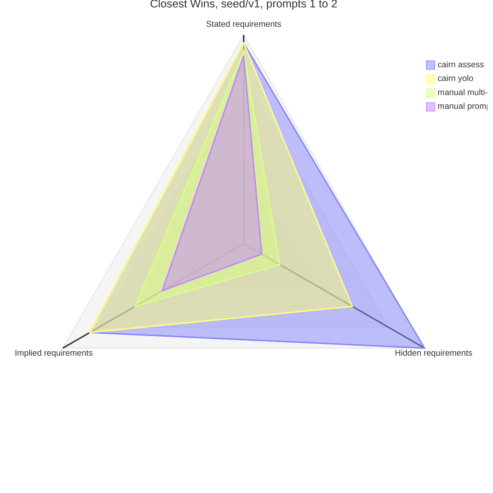

# Benchmark for Cairn

## General idea

### What the benchmark is

The benchmark is a separate project whose only relation to Cairn is that it takes Cairn as an input and measures it. It is not part of Cairn, does not share its repository, and does not track its `main`: each benchmark run records the exact Cairn commit it exercised, and comparing Cairn versions is done by re-running the benchmark with a different pinned commit. Releases are the commits that appear in the published trend; a candidate commit is benchmarked the same way (see "How Cairn development uses the benchmark").

The benchmark executes one project under a set of scenarios, each starting from the same seed repository and the same raw prompt. A scenario is one way of delivering the project paired with one model strategy, and it carries one identifier composed of the two: `cairn_1_8_3_yolo_models_strategy_1` is the YOLO cairn chain of Cairn 1.8.3 run under the model strategy named `models_strategy_1`, and `manual_prompt_opus_5_5_high` is one manual prompt run under Opus 5.5 at high effort. Each scenario delivers its own artifact. Those artifacts are what is measured, on the axes of "Scoring axes", and shown, on the README page: they serve as proof of whether Cairn helps, and as a way to track its behaviour across versions, models, and effort levels.

The framework has to actually help, not just pretend to. A difference between two scenarios is attributed to what differs between their definitions and to nothing else, so a reader always knows what a comparison says: two scenarios that share a model strategy isolate the delivery, two that share a delivery isolate the model strategy, and the headline comparison, Cairn under the model strategy it is meant to be used with against manual prompting under one strong model, differs in both and is read next to its cost. Everything a scenario does not define (the seed, the prompt, the hidden requirements, the operator that stands in for the project's stakeholder, the harness flags) is identical across scenarios, so a difference is never attributed to it.

## The raw prompt

The raw prompt is one fixed text, versioned alongside the benchmark, and placed byte-identical in every scenario's working tree as the project description file `PROJECT.md` at the repository root. It is never passed on the command line: the harness writes it into the clone and commits it as the first commit of the run branch (see "One run"), so the agent finds the task in the repository the way a developer would. Every scenario then receives the same one-sentence pointer message, fixed as part of the delivery definition:

```
Carry out the task described in PROJECT.md.
```

In the manual deliveries that sentence is the whole user message; in the cairn deliveries it is the argument of `/cairn:define-milestone-goal`, which reads the file to fill the milestone's Goal. No scenario gets extra wording, hints, or clarification from the harness, and no planned message differs between prompts: only the file's content changes from prompt 1 to prompt 2. The messages whose text is not fixed are the operator's (see "The operator"): a reply to what a session asked, in any scenario, and the answers the `cairn_<version>_assess_answers_manually` delivery's planned turn records; each is recorded as sent.

The prompt is deliberately underspecified in a few named places (for example team setup, the tie, controls, persistence) so that real open questions exist for Cairn to surface. It is still specific enough that the manual scenarios can produce a working result; the gaps are decisions, not missing instructions. It also leaves unsaid what the kind of project it describes comes with, a way to start over or a score the room can follow, which a builder is expected to know from the category alone; those are the implied requirements, listed per prompt in the project section and scored as an axis of "Scoring axes". And it states nothing about the expectations the seed gives evidence for; those are the hidden requirements of the next section.

## Hidden requirements

A hidden requirement is an expectation the project's stakeholder holds that the prompt does not state and the seed gives evidence for. It differs from the gaps the prompt deliberately leaves open and from the implied requirements: a gap is a decision with several defensible answers, left open so that Cairn has real questions to surface and the scenarios can diverge on what they decided; an implied requirement is what the kind of project comes with, known to any builder from the category alone, and its metric is whether the artifact has it; a hidden requirement has one right answer that only this project's context gives, and its metric is whether the artifact meets it. It exists to test the question-and-answer loop as a whole: a review pass that asks what the prompt did not, a recommendation grounded in the live project, and a decision recorded and carried into the tasks. The loop is tested by its outcome alone, the requirement delivered or not; which step lost it is found by reading the run, case by case, never by a metric of its own.

- **The statement never reaches a run's repository; the evidence does.** The requirement is written down in the inputs area, in the operator's hidden knowledge, and on the rating checklist, and nowhere else. Its evidence lives in the seed, so every scenario gets it byte-identical and a manual scenario can act on it as well as a cairn scenario can. Nothing in `PROJECT.md` points at it. The one way a statement is spoken inside a run is through the operator (see "The operator"), which holds every statement in every scenario and discloses one only in reaction to a question that bears on it, or records it as an answer in the `cairn_<version>_assess_answers_manually` delivery's planned turn: a message, never a file, which the rest of the run sees only through what the session did with it, a decision recorded in the milestone's own files or the model's own work. A requirement with no evidence in the seed would measure luck, so it is not a valid hidden requirement.
- **The evidence is calibrated.** It must make one answer clearly best once the question is asked, while the prompt alone gives no reason to ask it. A seed file that states the requirement outright measures whether the agent read a file; evidence too faint to settle the question measures a guess.
- **One measurement.** *Met*: a line on the rating checklist, applied to the artifact by a rater who does not know the scenario, scored as a count where the requirement allows one; it is the hidden-requirements axis of "Scoring axes". Nothing else about a hidden requirement is measured. Whether a review pass asked about it, whether an alternative covered it, whether the operator recorded it, and whether a manual run's model asked for it are all visible in the run's branch, invocation outputs, and operator record, and when a requirement was not delivered they are read there by hand to find out where it was lost, which differs from case to case. A metric for each of those steps would have to be defined, judged, and kept in step with the chain for every way a requirement can be lost, and would still say less than reading the run does; so they are a record, not a measurement, and the manual scenarios, where the only trace is whether the model asked the operator, lose nothing by comparison.
- **Versioning.** A hidden requirement is tied to the seed tag that carries its evidence and to the prompt blob that leaves it unstated. Changing the evidence is a seed bump, and the analysis groups by both before comparing scenarios.
- **One per prompt**, listed under its own heading in the project section and never in the "deliberately left open" list or the implied-requirement list: it is neither a decision with several answers nor a convention of the category, and a line in either list would score it twice.
- **What each delivery can show.** The YOLO chain accepts its own recommendations, so a met hidden requirement there shows surfacing plus a grounded recommendation, with no planned turn of the operator (a skill that stopped to ask, and was answered, shows in the operator record). The assess chain puts the operator at the answer step, so a met requirement there shows surfacing, an alternative set that covered the right answer, and the operator's decision carried through to the artifact. The gap between the two, under one model strategy, is what a person who reads the questions and answers the ones that matter to them gains, which is the workflow's intended value. A met requirement in a manual delivery shows that the model asked the operator a question that bore on it, or built it from the evidence unasked; the operator record says which.

## The operator

Every scenario runs unattended, so the person a run would otherwise turn to is played by the operator: a stand-in for the project's stakeholder, defined by the benchmark and the same for every scenario. It is a shared input like the seed and the prompt, not part of any scenario, so a difference between two scenarios is never attributed to it. Nothing in the plugin knows it exists, and nothing in a manual run can tell it from a person.

The operator never starts anything. The fixed start of every run, the pointer sentence of a manual delivery or the chain lines of a cairn delivery, is sent by the harness as the delivery states it, so every scenario starts from the same place. The operator acts at two kinds of moment after that:

- **A reactive turn** follows any invocation whose final message cannot proceed without the operator: a question, a request for confirmation, a choice offered. The operator reads that message and replies into the same session, resumed by its id, so the question keeps its context and the reply runs under the pair the session ran under. A message that reports completion, a stop, or an error, or that closes with an offer, gets no reply; the chain goes on to its next planned message or ends. One invocation gets at most three replies, after which the harness goes on and the record shows the cap was reached, so a model that asks without end cannot hold a run open.
- **A planned turn** is one a delivery declares at a fixed position in its list. The assess delivery declares one, the stakeholder's turn, and is the only delivery here that does; its input and the form its output takes are stated with that delivery.

The operator is a model call made by the harness outside the clone, with no tools, under one model and effort pair fixed in its definition and outside every model strategy, so that two strategies differ in the model under test and never in the quality of the person it talks to. Its tokens are recorded apart from the scenario's and never enter the scenario's totals, because they stand for a person's time, which the attentive-session count reports (see "Cost and time reporting"). Its output is routed by the harness and never written to the clone: a reply is sent as a message to the resumed session, and a planned turn's answers are sent as invocations of the commands the turn's delivery names. The one channel from the operator into a run is therefore a message, and what a run keeps of it is what the session did with it.

### The three layers

The operator's definition is composed from three layers, each with one home, so that what it knows and what it may do can be read in one place and changed in one place:

1. **The general guideline** states what the operator is for and how it conducts itself, and is the same in every scenario: it is the person this project is for, it wants the project delivered as `PROJECT.md` describes, and it answers what it is asked. It volunteers nothing. On a question of taste it defers ("your call"), because an answer by taste would make the artifact differ in ways attributable to the operator rather than to the scenario; the operator does not model every user, only the knowledge a user has and the prompt does not. It reviews no artifact and reads no file of its own: its input is always the prompt text as committed, plus the message or document the turn hands it. It names no tool and no workflow, so a manual scenario never hears Cairn's vocabulary from it.
2. **The hidden knowledge** is the statements of the hidden requirements of the prompt being run, one line each, inserted by the harness from the inputs area: those of the current prompt only, so each prompt's measurement stays its own, and the statements only, never the evidence or the rater's check. The operator holds them in every scenario, the YOLO chain and the manual deliveries included, and discloses one only in reaction to a question that bears on it, that is, a question whose answer the statement changes, and then says no more than that question needs. This reactive-only rule is what keeps the hidden-requirements axis a measure of whether the process surfaced the question rather than of the operator's generosity: Cairn reaches the knowledge through its open questions, a manual run reaches it by asking, and a run that never asks never receives it.
3. **The scenario knowledge** is how to act through the delivery's own interface, and it is the one layer held in the delivery definition rather than in the operator's, so it is the one layer allowed to differ between scenarios, and the difference stays attributable to the delivery. For the manual deliveries it says only to reply in plain prose. For the cairn deliveries it says which answer command records which kind of answer and what a stopped skill's advisory means; the assess delivery's planned turn, which reads the question document and records answers, is its fullest use.

The guideline and the operator's model pair are versioned together under the inputs area as one operator definition, recorded in the manifest, because a change to either could change results and must start a new comparison set; the hidden knowledge is versioned with the hidden-requirement entries it is read from, and the scenario knowledge with the delivery that holds it.

### The record

Every operator turn leaves one record file beside the invocation outputs, in chain order: the input the operator was given, its output as sent, and one closing line in a fixed form stating what it was asked and which layer answered (the guideline, the hidden knowledge, or the scenario knowledge). The closing line is what a case-by-case reading of a run starts from when a hidden requirement was not delivered: a manual run whose record shows no bearing question never asked, and an assess run whose turn answered "in my words" had an alternative set that missed. It is never folded into a metric. The record half of a run is unpublished, so the operator's files, which name hidden requirements, never reach the site.

## Scenarios

A scenario is a delivery paired with a model strategy. Both are definitions stored in the benchmark repository's inputs area, one file each under its own id, and the scenario id is the delivery id followed by the model strategy id. A definition is never edited once a run has used it: a change is a new id, so an id names one fixed thing for the life of the benchmark.

### Deliveries

A delivery is the way the project is delivered: a list of fixed messages, in order, each sent as one headless invocation, with at most one planned turn of the operator marked at a fixed position among them, and the scenario knowledge the operator acts on in that delivery (see "The operator"). No message carries prompt text, because the prompt reaches the run as the committed `PROJECT.md`. A cairn delivery also names the plugin commit it runs. The operator's reactive turns are part of no delivery: they may follow any invocation of any delivery, and the record counts them. Four deliveries are defined here; ablations add more (see "How Cairn development uses the benchmark").

#### `manual_prompt`

One invocation, the pointer sentence as the whole message:

```
Carry out the task described in PROJECT.md.
```

Its scenario knowledge is to reply in plain prose. A model that ends the invocation by asking is answered by the operator's reactive turn and continues in the same session; the record shows whether it asked and what it was told, which on a model that asks is this delivery's one route to the hidden knowledge.

#### `manual_multi_prompt_as_<cairn scenario id>`

The control that separates "Cairn's structure helps" from "N turns beat one turn", with the same operator available to both. It has no definition file of its own: it mirrors the cairn scenario its id names and takes from it the planned list, the number of invocations N and the model and effort of each one, line by line, so the two can never drift. The mirror covers the planned messages only: a planned operator turn in the mirrored delivery has no counterpart here, because the turn is not a message of the list, and the operator's reactive turns are counted on both sides and mirrored on neither, since the operator is a constant of the environment and acts wherever a session asks. Its first message is the pointer sentence; every following one is the same fixed continuation message, sent to a fresh process, not a continued session, and its scenario knowledge is the manual one, to reply in plain prose:

```
Carry out the task described in PROJECT.md.
Continue the work in this repository and improve it.   # repeated N-1 times
```

#### `cairn_<version>_yolo`

The YOLO cairn chain is a sequence of the Cairn commands merged together that declares no planned turn of the operator: no step of it is meant to stop for a person, and a step that does stop to ask is answered by a reactive turn like any other invocation's, which the record shows. Its scenario knowledge is the cairn one (see "The operator"). `<version>` is the release the delivery runs (`1_8_3`), or the short commit for a candidate that is not a release. Its first line bootstraps the milestone workflow inside the clone, so every Cairn artifact (the `milestones/` directory, its `README.md` with the pointer reading `none`, and the `## Milestone Workflow` section of `CLAUDE.md`) is created by the run itself: the seed carries none of it, and the manual deliveries never see Cairn's vocabulary or guidance. The bootstrap commits nothing; the files it writes are picked up by the skills that later commit them.

```
/cairn:init-milestone-base-workflow
/cairn:define-milestone-goal Carry out the task described in PROJECT.md.
/cairn:goto-next-milestone
/cairn:specify-milestone-starting-state
/cairn:review-milestone-requirements
/cairn:provide-alternatives-to-all-open-questions
/cairn:recommend-all-open-questions
/cairn:answer-all-open-questions-with-recommendation
/cairn:derive-tasks
/cairn:complete-all-tasks
```

#### `cairn_<version>_assess_answers_manually`

The YOLO chain with the stakeholder put back in at the one step the workflow built for them. It is the YOLO delivery's list with the operator's planned turn marked after `/cairn:recommend-all-open-questions` and a second run of the recommendation pass behind it, which picks again for every question whose pick the turn's answers cleared and picks nothing on a turn that cleared none. It differs from the YOLO list in nothing else, so the two scenarios under one model strategy isolate the turn, the second pass being its consequence. The turn is the operator's one planned turn in any delivery here: the person Cairn's questions are meant to reach, who knows what they want beyond what `PROJECT.md` says and who, in a real project, would read the questions and answer the ones that matter to them. The scenario exists to show what that person gains by investing the time, measured as the hidden requirements the artifact meets.

```
/cairn:init-milestone-base-workflow
/cairn:define-milestone-goal Carry out the task described in PROJECT.md.
/cairn:goto-next-milestone
/cairn:specify-milestone-starting-state
/cairn:review-milestone-requirements
/cairn:provide-alternatives-to-all-open-questions
/cairn:recommend-all-open-questions
<the operator's planned turn>
/cairn:recommend-all-open-questions
/cairn:answer-all-open-questions-with-recommendation
/cairn:derive-tasks
/cairn:complete-all-tasks
```

At the marked position the harness runs the operator once, outside the clone, as "The operator" states. Its input is the prompt text and the current milestone's `requirements.md` and `open_questions.xml` as they stand in the clone, read verbatim, so the operator sees every question with its alternatives and its pick, as a person reading the annotated set does. Its message is composed by the harness from the three layers; below the general guideline's own text, the hidden lines and this delivery's scenario knowledge read in sketch:

```
Below are the project description and the current milestone's open questions
with their alternatives and recommendations. Beyond what the description
says, you want the following:

<one line per hidden requirement of this prompt>

For every open question where one alternative serves what you want and the
others do not, output one line
/cairn:answer-open-question-with-alternative <Short Title>. <Alternative Id>
whether or not it is the recommended one. For every open question that bears
on what you want but none of whose alternatives serves it, output one line
recording what you want in your own words
/cairn:answer-open-question <Short Title>. <answer text>
Output no line for any other question. Then finish with one line per item
above: the question you answered for it and the alternative, or the question
and "in my words" if none of its alternatives served it, or "no question" if
none bore on it.
```

The harness sends each command line the operator output as one headless invocation in the clone, in the order output, under the pair the model strategy assigns to that command; the closing lines stay in the operator's record. What the turn may and may not do follows from what the scenario has to isolate:

- **It answers only where the hidden knowledge decides.** A question the hidden lines say nothing about gets no line, and its recommendation is recorded by the sweep as in the YOLO chain. If the operator also answered by taste, the artifact would differ from the YOLO artifact in ways not attributable to the hidden knowledge, and the comparison would say less; this is the general guideline's deferral rule applied to a turn where deferring means staying silent.
- **It answers from the alternatives where one serves, and in its own words where none does.** `answer-open-question-with-alternative` records one of the enumerated options, so where the alternatives pass laid out an option that meets the requirement the operator carries it through by choosing it; where no option does, it records the requirement itself with `answer-open-question`, as a person who knows what they want would, rather than letting a gap in the set lose it. Cairn's design holds that an alternative set is covering, and this is the scenario where that property has a right answer to check against: every `Manual-answer:` commit the turn adds is a question whose set missed what the stakeholder wanted. The operator's closing lines say which step fell short when one did, "no question" pointing at the review pass and "in my words" at the alternatives pass; they are kept in the turn's record, read by hand when a hidden requirement was not delivered, and never folded into a metric.
- **It runs after the recommendation pass.** The operator sees every question with its alternatives and its pick and acts only where the hidden knowledge decides: skimming the picks and stopping where one is wrong or no alternative serves is the shorter session, and it is the one Cairn's workflow is built for. Each hand answer clears, in the same write, the picks on other questions it undermines, those a `<depends-on>` tag declared and those the answering skill names, transitively, so no standing pick is left assuming an outcome the turn decided otherwise. The second run of the recommendation pass then picks again for exactly those questions, with the operator's decisions already recorded in `requirements.md`, which is the grounding Cairn gives a recommendation formed after a person has decided some of the siblings, and the sweep records every pick that stands.
- **The hidden lines leave no trace but decisions.** They are given to the operator outside the clone and never to a session inside it; what enters the clone is each answer line, as a skill invocation, and what the rest of the chain sees is the decision that invocation recorded in the milestone's own files, the later invocations being fresh processes. After the turn the harness asserts that the work tree is clean and that every commit the turn's invocations added is an `Alternative-answer:` or `Manual-answer:` commit. A failed assertion stops the chain there, recorded like any early stop, because an answer that landed by another route makes the run attributable to nothing.
- **Recorded as sent.** The operator's input and output and each answer invocation's message are in the run's record, since these are the messages of the delivery whose text the definition does not fix verbatim. The model strategy keys each answer invocation by its command.

The scenario is read against the YOLO scenario of the same version and model strategy, which differs from it by the operator's planned turn and the second recommendation pass that turn needs. Its multi-prompt control is derived like any other: it mirrors the planned list, which has no counterpart to the turn, so that comparison folds the turn in with Cairn's structure, and only the comparison against YOLO isolates it.

### Model strategies

A model strategy assigns one model and one effort level to every message of the delivery it is paired with, keyed by the message (for an answer invocation the operator's planned turn produces, by its command, since the rest of the line varies), and is written in its own file in the inputs area under its id. Nothing in a run picks a model: every invocation runs under the pair its strategy assigns, and the harness refuses a scenario whose strategy leaves one of the delivery's messages or planned-turn commands unassigned. A reactive reply resumes the session that asked and runs under that session's pair, so it needs no key, and the operator's own pair is fixed in its definition outside every strategy (see "The operator"). The file holds the exact `--model` value, never an alias such as `opus`, because an alias moves between host releases and the strategy must mean the same thing for the life of the trend. A strategy's id is a name when it holds several pairs (`models_strategy_1`) and the pair itself when it holds one (`opus_5_5_high`).

Cairn is meant to be used under a mixed strategy, because its skills differ in what they need: the bootstrap and pointer steps are mechanical, the review and recommendation passes are where the reasoning happens, and task completion is where the code gets written. The strategy Cairn is used with is therefore documented in the benchmark repository as an input like any other, and the reference one, `models_strategy_1`, is written from Cairn's own usage snippets, so that the benchmark measures Cairn as it is used, not under an allocation it was never meant for. As a sketch, with the host's model names abbreviated:

| message | model | effort |
|---|---|---|
| `/cairn:init-milestone-base-workflow` | Sonnet 5.5 | medium |
| `/cairn:define-milestone-goal …` | Sonnet 5.5 | medium |
| `/cairn:goto-next-milestone` | Sonnet 5.5 | medium |
| `/cairn:specify-milestone-starting-state` | Fable 5.1 | xhigh |
| `/cairn:review-milestone-requirements` | Fable 5.1 | xhigh |
| `/cairn:provide-alternatives-to-all-open-questions` | Opus 5.5 | high |
| `/cairn:recommend-all-open-questions` | Fable 5.1 | xhigh |
| `/cairn:answer-all-open-questions-with-recommendation` | Fable 5.1 | high |
| `/cairn:derive-tasks` | Fable 5.1 | xhigh |
| `/cairn:complete-all-tasks` | Opus 5.5 | high |
| `/cairn:answer-open-question-with-alternative …` and `/cairn:answer-open-question …` (the planned turn's answers, assess delivery) | Fable 5.1 | high |

The planned turn's answer invocations, which no Cairn snippet covers, get the pair of the answer sweep, because recording an answer and reconciling the picks it undermines is the same kind of work; the reading and choosing is the operator's, under its own fixed pair. The recommendation pass appears twice in the assess delivery, before the turn and after it, and runs under its one pair both times, since the strategy keys by message.

Comparing models or efforts is not a separate experiment: it is the comparison of two scenarios that share a delivery, and the cost difference between them is the price of the strategy. A scenario whose strategy mixes models is a valid scenario, because the mix is its definition. What is not a valid run of this benchmark is one whose invocations depart from the strategy the scenario names, since its result cannot be attributed to any scenario.

## Scoring axes

Every quality result of the benchmark is a score on one of the axes listed here, and nothing else is scored. The hidden-requirements section, the evaluation area, the README page, and the project section refer to this list rather than defining measurements of their own, so each axis has one definition and a reader of any table or chart can look it up in one place.

### The rater

Rating is a step of the harness with no person in it. The rater is a rating agent, the browser it drives, and the test scripts it writes, run once per run id after the run's snapshot is committed. It is a shared input like the operator: one rater definition (model and effort, the browser and test runner, the turn and time budget, and the fixed rating guideline) serves every scenario of a comparison set and is named in every rating file, so a change to the rater is a rating version the analysis groups by, like a seed tag, and never mixes with ratings made under another.

The rater is handed the artifact and nothing else of the run: a copy of the entry file and the files it loads, taken from `runs/<id>/` and served by the harness over a local address and, where a line asks for disk, as a file, with no `milestones/` directory, no git history, no manifest, and no word about the scenario. Blindness is therefore a property of what the harness hands over, not of any discipline. The other input is the prompt's checklist, whose lines are of two kinds, the kind written on each line in the project section:

- **Test lines.** The line names a behaviour. The rater writes one browser test for it against the served artifact, in the harness's fixed test runner, and the harness then runs that test itself in a fresh browser; the line passes only when the harness's own run passes. What the rater saw while driving the artifact counts for nothing: a behaviour it could not put into a passing test is not proved. The test is committed with the rating as the line's evidence, so any pass can be re-run later and a disputed line is settled by running it. Every stated and implied line is a test line, and so is a hidden requirement whose check is a behaviour (the second prompt's, which prepares a set in one browser profile and plays it from another).
- **Reading lines.** The line names a fact about content the artifact carries that a test cannot check without understanding it, such as whether a question is about an animal. The rater reads the items out of the artifact, by playing through it or from its source, and records each item with one verdict; the score is the passing items over the items. The recorded items and verdicts are the evidence, and a reader checks a verdict against the item it is about. A reading line is the one place a model judges, kept to a classification with one defensible answer per item; a line that would need a judgment of degree is not a reading line and is not a line (see "Taste is not an axis").

A test line for which the rater produced no passing test within its budget fails, and the rating records why: *absent* when the rater's test drove the artifact to the case and the behaviour was missing, *not proved* when the rater reports that it could not drive the artifact to the case at all. Both score zero, since a host who cannot reach the restart has no restart either, but the analysis reports the not-proved count beside each axis, so a fail that is the rater's rather than the artifact's is visible instead of folded into the score. The rater's own tokens, cost, and duration are recorded in the rating file and never added to the scenario's cost, because every scenario is rated the same way.

### The axes

Every axis is scored on the artifact alone, by the rater of "The rater", which knows nothing of the scenario, so every scenario has a value on it, the manual ones included, and nothing a run's process left behind enters a score. Every axis is a count of checklist lines, and every line is a check with one answer: a test the harness runs passes or fails, or a reading of the artifact's content yields a count. No line asks how good something is, so a second rating of the same artifact gets the same number, and a disagreement over a line is settled by running its test or reading its items rather than by argument. Each axis is a number from 0 to 100, scored per prompt from that prompt's artifact, so that the axes share one scale and can be read on one chart and averaged into one rank.

- **Stated requirements.** Whether the artifact does what the prompts so far say. The sentences of every prompt up to and including the one rated become the checklist, one test line each (for prompt 1: one file that opens from disk; the host sets the team count at the start; ten questions of the game's own, each answered by a number, asked one at a time; the answer hidden until the host reveals it; the point given by the host to the closest team; the standings after the last question; for prompt 2, those six lines again and the editor's sentence), each tested afresh against the artifact rated. An earlier prompt's sentence stays on the checklist because the stakeholder still holds it: the second prompt asks for an editor for the game, not for an editor instead of the game, and the artifact is rated as the product it is, not as the delta the run was asked for. The score is the lines passed over the lines. This is the axis that reads alignment with the provided requirements, and it is the floor under the others: an artifact that fails it is not a worse game but a different one.
- **Hidden requirements.** Whether the artifact meets the expectation the prompt never stated: the *met* measurement of "Hidden requirements", applied through the check line of the prompt's entry. A count becomes the count over its maximum (ten animal questions score 100, seven score 70); a yes-or-no check scores 100 or 0. It is the one axis with a right answer nobody was told, so a difference on it is the clearest evidence the benchmark produces.
- **Implied requirements.** Whether the artifact has what the kind of project it is comes with, though the prompt never asked for it. A host-run quiz has a way to start over, a score the room can follow between questions, a tie it can settle, an award it can take back, and so on; a builder is expected to know that from the category alone, so the prompt does not say it and a manual scenario can supply it as well as a cairn scenario can. The project section lists every such feature per prompt, as complete a list as the category allows, and each item becomes a test line, a later prompt's checklist carrying every earlier prompt's list as well as its own, for the reason the stated axis carries every earlier sentence; the rater's test drives the artifact into the case the line covers and passes when the artifact has the feature or gives the host a way through without leaving the game. What the way is does not matter: a tie broken by a rule or handed to the host, an undo or a confirmation, a resume or a clean restart all count, while breaking, ignoring the case, or sending the host to paper does not. The score is the lines present over the lines, so the axis reads how exhaustively the artifact covers what went without saying, never how well each feature is done, because which behaviour is best is taste, and taste is scored by no axis (see "Taste is not an axis"). The list is not the prompt's "deliberately left open" list: that list names the decisions the prompt leaves to the builder so that Cairn has real questions to surface, and is kept few on purpose, while this one is meant to be complete; the two overlap wherever a gap is about such a feature, and a left-open item that names a quality rather than a feature (the questions' difficulty, how the reveal and the standings look, legibility across the room) becomes no line at all: it is a decision for Cairn to surface, not a check the artifact passes or fails.

Cost is not an axis. It is reported in the same row as every quality result (see "Cost and time reporting"), but it is never ranked or drawn, because its scale is dollars rather than a fraction and its direction is the reader's to weigh against the quality difference, which this document refuses to weigh for them. A radar axis must read "more is better" from 0 to 100, and cost reads neither.

Taste is not an axis. How the artifact looks and feels to drive (legibility from across the room, the presentation of the hidden question, the reveal, and the standings, the difficulty of the questions, how the flow feels under the host's hands) is a judgment, and a judgment on a scale, a person's or a model's, ranks scenarios by whoever rated them: it moves between raters and between runs of the same rater, its anchors are words that two readers read differently, and no one can re-apply it to the artifact to check it. Every axis here is a count of checks with one answer, so every number on the page can be re-derived by opening the artifact, which is what makes a difference between scenarios a finding rather than an opinion. What this costs the benchmark is one difference it cannot show: two artifacts passing the same lines score the same, and the better-looking one is seen by opening both from the Pages index, which the "experienceable" requirement keeps possible and which the page may point at but never scores. An objective proxy (a minimum font size, a count of clicks per question) would score a rule nobody stated and reward the scenario that happened to match it, so none is added; a quality the stakeholder does hold is a hidden requirement, with seed evidence and a check line, or it is not measured.

Continuity is not an axis. Whether a later prompt's artifact keeps what the earlier one did is measured, but through the stated and implied axes, which carry every earlier prompt's lines into the later prompt's checklist, each tested afresh against the artifact rated (never by re-running the earlier prompt's tests, which were written against another artifact's structure, so a selector that no longer matches would read as a lost behaviour). A regression at prompt 2 therefore lowers the prompt-2 stated or implied score, where a reader comparing scenarios looks for it. An earlier draft held a separate axis, the prompt-1 lines still passing over the lines that had passed on the scenario's own prompt-1 artifact, and it was dropped for three reasons: its denominator was the parent artifact's rating, which is no property of the artifact rated, so it broke the rule that every axis is scored on the artifact alone; a fixed line count is the only denominator that compares across scenarios, since under the ratio a scenario that passed ten lines and kept ten scored 100 while one that passed nineteen and kept eighteen scored 95, and one that passed none had no score at all; and an artifact with nothing to lose would score 100 on it for free, lifting the weakest scenarios in the overall mean. What the axis was for survives as a tally. Because a line keeps its id from one prompt's checklist to the next, the analysis sorts each prompt-1 line of a prompt-2 run into one of four states against the parent run's rating: kept, lost (passed on the parent, failed here), gained, or missing. The lost count is reported beside the prompt-2 columns the way the not-proved count is, because it is the number that sends a developer to the run record, and it enters no score. It is where recorded decisions are expected to pay: a scenario that recorded how its questions are stored and what persists extends those decisions in prompt 2, and one that did not rediscovers or contradicts its own behaviour, which shows as lost lines and as a lower prompt-2 score on the carried lines.

### The record is not an axis

There are no process axes. What a cairn run's branch and invocation outputs show (where a chain stopped, the question blocks each review pass added, the annotation skips and sweep anomalies the passes reported, the operator's closing lines, tasks derived, cost per skill) is kept as the run's record and read by hand when a score asks for an explanation: a hidden requirement not delivered, an implied requirement missing, a prompt-1 line lost at prompt 2. It is never folded into a metric, because the step that lost a requirement differs from case to case, a metric per step would have to be defined and kept in step with the chain for every way a requirement can be lost, and it would still say less than reading the run does; and it would have no value for a manual scenario, where the same steps leave no trace beyond the operator's record, so a chart that drew it would show the manual curve at zero where the truth is "not measured". The record explains a cairn run and compares nothing across approaches (see "How Cairn development uses the benchmark").

### The checklist and the rank

Each prompt's rating checklist is derived from its section of this document and nothing else: one line per stated sentence and one per implied requirement, of that prompt and of every earlier one, and the hidden requirement's check line, each line marked with its axis and its kind (test or reading) and keeping its id from one prompt's checklist to the next, so that the analysis can tell a line lost since the parent run from one never passed. A rating file holds those lines keyed by run id, each with its verdict and its evidence (the test the harness ran, or the items read and their verdicts), and no axis or overall score; the analysis computes the scores, so the rater never blends axes and the fold is reproducible from the lines. A run that stopped early is rated on the tree it left, so a chain that never finished scores what it built rather than nothing.

The analysis aggregates within one comparison set (one seed tag and one version of each prompt): an axis's score for a scenario is the mean over that scenario's runs of each prompt, one or more, then over the prompts; every axis is defined for every prompt, so no prompt is left out of any axis. The overall score is the unweighted mean of the three axes, and the rank orders scenarios by it, cost breaking a tie in favour of the cheaper one. Equal weights are the only weights nobody has to argue for, and they hide nothing because the per-axis scores stand beside the overall wherever it is shown; a reader who weighs the axes differently recomputes the rank from the columns.

## Cost and time reporting

Every run of every scenario records, from the JSON output of each invocation:

- total input and output tokens, and cost in dollars,
- wall-clock duration,
- number of invocations actually made (a chain that stops early reports fewer),
- the operator's turns, planned and reactive, its replies, and the answer invocations its planned turn produced, with the operator's own tokens and cost kept apart from the totals,
- attentive sessions, counted from the operator's turns, and the wall-clock of each unattended stretch between them.

These are reported per scenario next to the quality results, in the same row of the ranking table (see "The README page"), never omitted. Cairn is expected to cost more; the benchmark states by how much and lets the reader weigh it against the quality difference. A quality win that is not accompanied by its cost is not a reportable result of this benchmark.

An attentive session is one stretch of the stakeholder's attention: it begins when the run stops until a person has read it and decided, and it ends when that person launches the next chain, with a wait long enough to leave the keyboard separating two sessions. The count is what Cairn's batching exists to keep small, gathering every question into one turn and running unattended on both sides of it. It is measured from the operator's record, one session for the launch of each prompt plus one per operator turn, planned or reactive, because the operator is the person a run would otherwise wait for: a delivery with no planned turn under a model that never asks reads one per prompt, the assess delivery reads two per prompt, and every reply to a model that stopped to ask adds one, which is the cost of interactive use that the fixed messages alone would hide. The result review counts for no scenario, since every scenario has exactly one and it is rated rather than operated. Beside the count the analysis reports the wall-clock of each unattended stretch, the sum of the invocations between two sessions, from the per-invocation durations, so a reader sees how long each chain ran on its own. The count is not an axis: it is a cost of the delivery, read next to what the extra session bought on the hidden-requirements axis. The operator's own tokens are reported beside the scenario's cost and never added to it, because they stand for the person's time that the session count already reports, and adding them would charge a scenario for being asked.

## Repository layout and isolation

The benchmark is its own repository, separate from the cairn repository, and it references cairn only as a pinned input. Four things in this design require that separation: the seed is an orphan commit and every run pushes a branch, which would litter the plugin repository with unrelated history; the plugin under test must be a fixed version recorded by commit, which it cannot be when it is whatever the plugin repository's `main` happens to hold; publishing is per repository and must cover the snapshot directory and nothing else; and the records grow by one full tree snapshot per run, which does not belong next to distribution trees guarded by a drift gate. The earlier eval pilot placed cases inside the cairn repository, which is fine for a small unpublished suite and wrong for this one.

Within that repository, each run executes on its own branch and its result is recorded on `main`; there is no repository per run. Three conditions make that sound:

- **Every run branches from a fixed seed tag or from its parent run, never from `main`.** The seed commit holds the seed repository (git initialised, a `CLAUDE.md` that names no Cairn concept, and a `README.md` stating what the project is for, which carries the evidence of the hidden requirements; the milestone bootstrap is not run, because the cairn chain runs it itself and the manual deliveries must not read its workflow guidance), is built from `seed/` as an orphan commit with no ancestor on `main`, and is tagged once. A first-prompt run branches from that tag; a second-prompt run branches from the tip of the first-prompt run it continues. Once `main` carries results, a branch taken from it would put earlier runs' output into the agent's working tree, so `main` is never a branch point.
- **Every run works in a clone that cannot see the other branches.** Cairn's starting-state skill and a manual agent may both read git history or the branch list, so in a shared checkout run 5 could read run 1's solution. Each run starts as a fresh single-branch clone of its branch point, with no tags and with the remote removed after cloning, at a path unique to that run; on completion the run script adds the remote back and pushes the branch to the canonical repository as `run/<id>`. The clone is not shallow: a second-prompt run legitimately sees its own first-prompt history, and that history is the same for every scenario's second prompt.
- **Run branches are never git-merged into `main`.** Every run edits the same files, so merges would conflict and the merged tree would mean nothing. The branches stay as the record of each run (its history and commit subjects are what a case-by-case reading of a run starts from). `main` receives a snapshot of each run's deliverable under `runs/<id>/`, written with a read-tree prefix from the run branch, plus one manifest per run under `results/<id>/`. Publishing `runs/` through GitHub Pages then makes every artifact playable by URL.

### Structure of `main`

`main` holds four kinds of content. Each kind lives in its own top-level area, and the kind decides the rules the area follows; the concrete file names follow from the rules.

```
inputs       what a run is given        seed source, raw prompts, hidden requirements, the operator definition, scenario definitions (deliveries, model strategies), the plugin under test
harness      how a run is executed      the run procedure, the seed builder, the index generator, the analysis
records      what a run produced        per id: a published snapshot, and an unpublished manifest with the invocation outputs
evaluation   what the rater concluded   blind ratings keyed by id, each line with its test or reading, and the analysis output
```

Root-level housekeeping (the README, the instructions for working on the harness, the publishing workflow) is a fifth, incidental kind: it is never part of the seed and no run ever sees it. The README's results section is the one part of it the harness writes (see "The README page").

**Inputs** are of two kinds. The shared inputs (the seed source, the raw prompts, the hidden requirements, the operator definition) are what a difference between scenarios must never be attributed to, so they are byte-identical across scenarios and recorded by content. The scenario definitions (the deliveries, the model strategies, and the plugin commits the cairn deliveries name) are what a difference is attributed to, so each is stored under its id and read back from there by the analysis.

- Every shared input is versioned by content, not by name: a run's manifest records the seed as a tag and each prompt as a blob hash. Changing any shared input starts a new comparison set; the analysis groups runs by their shared-input versions before it compares scenarios.
- The seed source is the one input a run does not read in place. The harness turns it into an orphan commit and tags it; runs branch from the tag, never from the source directory. It contains nothing produced by Cairn: any Cairn artifact a run needs is created by the cairn chain's own bootstrap line, so the seed is the same for all scenarios without leaking the plugin's guidance into the manual ones. Its README is the one place the hidden requirements' evidence lives, and nothing in it states them.
- The plugin under test is an input like any other: each cairn delivery names one commit (a release or a candidate), which the harness checks out into a plugin checkout used by that delivery's runs only, loaded per invocation and never installed at user level, so the manual scenarios cannot see its skills. Several cairn deliveries may name several commits, one checkout each.
- A delivery definition is a list of fixed messages, the position of its planned operator turn if it has one, its scenario knowledge for the operator, and, for a cairn delivery, the plugin commit, nothing else. A model strategy is the model and effort per message, and per command for the planned turn's answer invocations. Every other flag (permissions, output format, plugin directory) is added by the harness, so each setting a run executes under is set in exactly one place: the strategy for model and effort, the harness for the rest. The multi-prompt control is the one definition not stored: it is derived from the cairn scenario its id names at run time, so the two can never drift.
- A hidden requirement is an input too: one entry per prompt stating the requirement, the seed evidence it rests on, and the check a rater applies, keyed to the seed tag and the prompt blob. No run sees the entry; the operator receives its statement line, and the rating instructions carry its check line.
- The operator definition (see "The operator") is a shared input: the general guideline and the operator's model and effort pair, versioned together under one id the manifest records. The hidden lines the operator receives are read from the hidden-requirement entries of the prompt being run, so that knowledge is versioned by them, and the scenario knowledge it acts on is versioned with the delivery that holds it.

**The harness** is the only writer of the record areas. It sees the whole repository; a run sees only its clone. A harness change must not change what a run sees or is given; a change that would (a different flag, a different continuation message) is an input change and is versioned as one.

**Records** are append-only: one directory per id in each record area, one commit per run, never hand-edited except for the manifest's entry-point field. The published half is exactly the snapshot of the run's tree (the `runs/<id>/` of the three conditions above); the unpublished half is everything that ties the id to a scenario, cost, or branch (the `results/<id>/` manifest and the per-invocation outputs). The two halves are separate top-level directories so that publishing is "this directory and nothing else".

**Evaluation** is keyed by id only. The rater is handed the artifact and nothing else of the run (see "The rater"), rating files carry no scenario, and the join between ratings and manifests lives in the harness's analysis step, so blindness is a property of what the rater is handed and of where the join is allowed to happen, not of anyone's discipline. A rating file carries one line per item of the prompt's rating checklist, each marked with its axis and kind (see "Scoring axes") and carrying its verdict and evidence, and no axis or overall score: the fold into per-axis scores and one rank happens in the analysis step, where the per-axis columns always stand beside the overall, so a rater never weighs one line against another and no reader sees a rank without its parts.

### Git objects

- `main` is linear and holds the harness plus the records. Each completed run adds one commit touching only `runs/<id>/` and `results/<id>/`, under the fixed subject `Run: <id>`; harness changes are separate commits.
- `seed/v<K>` tags point at orphan commits built from the seed source. They share no history with `main`, so a run's clone contains nothing but the seed tree and its own work.
- `run/<id>` branches are rooted at a seed tag (prompt 1) or at the tip of the parent run's branch (prompt 2). They are never merged, rebased, or deleted. A cairn scenario's history is one commit per skill or task under Cairn's own subjects; a manual scenario's history is whatever the agent chose to commit, which is itself a result.
- The canonical repository is the GitHub remote. Working clones live outside it, under one scratch directory with one subdirectory per id, and are deleted once the run's commit on `main` exists.

### One run

The run procedure, invoked with a scenario id, a prompt index, and for a second prompt the parent run's id, is the whole procedure; nothing about a run is done by hand.

1. **Id.** Draw an opaque id (eight characters from a random source). Refuse it if `runs/<id>` or `run/<id>` already exists.
2. **Pre-flight.** Assert: the benchmark checkout is on `main` and clean; the scenario id resolves to a stored delivery and a stored model strategy (or, for the multi-prompt control, to the cairn scenario it mirrors) and the strategy assigns a pair to every message of the delivery and, where it declares a planned turn, to each answer command; `--from` is given exactly when `<n>` is greater than 1, and the parent's manifest is for prompt `<n>-1` and the same scenario; the cairn plugin is not installed at user level (so the manual scenarios cannot see its skills); the operator definition resolves and a hidden-requirement entry exists for the prompt; no memory directory exists for the clone path (see "Clearing memory").
3. **Clone.** Single-branch, no tags, from the seed tag or from `run/<parent-id>`, into the run's unique path. Remove the remote. Create `run/<id>` from the checked-out commit.
4. **Prompt.** Write the prompt `<n>` text over `PROJECT.md` at the clone root, replacing whatever the file held (for prompt 1 the seed has none; for prompt 2 it holds prompt 1, which stays readable in the branch history), and commit it under the fixed subject `Prompt: <n>`. This commit is identical across scenarios and is the first commit of every run branch after its branch point; the harness makes it, so the agent never sees the prompt outside the repository.
5. **Invocations.** For each message of the delivery's list, in order, run from the clone, with `<model>` and `<effort>` the pair the strategy assigns to that message:

   ```
   claude -p "<message>" --dangerously-skip-permissions --model "<model>" --effort "<effort>" --output-format json
   ```

   A cairn delivery's lines add `--plugin-dir` pointing at the checkout of the commit the delivery names. After each invocation the harness hands its final message to the operator, as "The operator" states; a reply is sent into the same session, under the same pair and flags, at most three times per invocation:

   ```
   claude -p "<reply>" --resume "<session id>" --dangerously-skip-permissions --model "<model>" --effort "<effort>" --output-format json
   ```

   At a delivery's planned turn the harness runs the operator with the input its delivery states and sends each command line it outputs as one invocation of the first form, under the pair the strategy assigns to that command, then runs the turn's assertions. Every operator turn writes its record file beside the invocation outputs. Stdout is written to the run's invocation outputs under `results/<id>/`, one file per invocation in chain order, the operator-driven ones included, with stderr and the model and effort the invocation ran under beside it. A non-zero exit stops the chain; the run is still recorded, with the manifest stating how many invocations were made, because an early stop is a result, not a failed measurement.
6. **Push.** Add the remote back and push `run/<id>`.
7. **Snapshot.** On the benchmark checkout, read the run branch's tree into `runs/<id>/` with a prefixed read-tree and check the files out.
8. **Manifest.** Write the manifest under `results/<id>/` from the invocation outputs and the environment.
9. **Memory.** Delete the memory directory keyed by the clone path and assert it is gone.
10. **Commit.** Regenerate the index page, then commit `runs/<id>/`, the index page, and `results/<id>/` on `main` as `Run: <id>`. Delete the clone.

### The manifest

The manifest is the only place that ties an id to its scenario. Everything the analysis needs is in it or in the invocation files beside it:

```json
{
  "id": "k7f3q2xd",
  "scenario": {
    "id": "cairn_1_8_3_yolo_models_strategy_1",
    "delivery": "cairn_1_8_3_yolo",
    "model_strategy": "models_strategy_1"
  },
  "prompt": { "index": 1, "file": "PROJECT.md", "blob": "<git blob sha of the committed PROJECT.md>" },
  "parent": null,
  "seed": "seed/v1",
  "branch": { "name": "run/k7f3q2xd", "tip": "<sha>", "commits": 23 },
  "host": { "binary": "claude", "version": "2.1.283" },
  "plugin": { "path": "<plugin checkout>", "commit": "<sha>", "version": "1.8.3" },
  "user_config": { "claude_md_sha256": "<sha>", "settings_sha256": "<sha>" },
  "entry": "index.html",
  "started": "<iso timestamp>",
  "finished": "<iso timestamp>",
  "invocations": { "planned": 10, "made": 10, "stopped_early": false },
  "operator": { "version": "operator/v1", "model": "<model>", "effort": "xhigh", "turns": 1, "replies": 1, "answers": 0, "input_tokens": 0, "output_tokens": 0, "cost_usd": 0.0 },
  "totals": { "input_tokens": 0, "output_tokens": 0, "cost_usd": 0.0, "duration_ms": 0 }
}
```

- `scenario.id` is the scenario the run executed, and its two parts are the keys the analysis groups by. `plugin` is null for a manual delivery. `parent` is the id of the first-prompt run a second-prompt run continues, always of the same scenario.
- The model and effort of each invocation live in the invocation records, as the strategy assigned them; the manifest names the strategy and does not restate them. `totals` are sums over the per-invocation JSON files, which keep the per-invocation figures; the manifest never restates those either.
- `invocations` counts the delivery's own list, so `made` over `planned` still reads how far the chain got. `operator` names the operator definition the run used and counts its turns (planned and reactive), its replies, and the answer invocations its planned turn produced, with the operator's own tokens and cost; `totals` sums every invocation made in the clone, replies and answer invocations included, and never the operator's own figures. The attentive-session count of "Cost and time reporting" is one plus `operator.turns`.
- `entry` is the path the rater is served and a reader opens, relative to `runs/<id>/`. The run script detects a root `index.html`; a run that put its entry point elsewhere gets the value by hand, and that edit is the one hand-written field.
- `user_config` records digests of the user-level `CLAUDE.md` and settings that applied to the run, so a later re-run can check it ran under the same configuration.

### Hosting and blindness

- The Pages workflow uploads `runs/` and nothing else. The unpublished record half and the evaluation area exist only on `main`, so the mapping from id to scenario is never on the site.
- The index page under `runs/` is generated from the manifests and lists ids with their entry links, in an order shuffled once and fixed. It names no scenario or prompt.
- The README's results section names scenarios and aggregate scores and never an id, and it is regenerated only once a comparison set's ratings are complete (see "The README page"), so nothing on the landing page of `main` joins an id to a scenario while a rater is working.
- The rater is run by the harness against each snapshot's artifact copy and writes one rating file per run id in the evaluation area (see "The rater"); the index page is for a reader who wants to play an artifact, never for rating. The join with the manifests happens only in the analysis step.
- The snapshot is the whole tree, so a reader who browses past the entry point can see a cairn run's `milestones/` directory. That touches no rating, since the rater is never given the tree; the index stays shuffled and nameless so that a reader comparing two artifacts is not told which came from where.

### Clearing memory

Clearing the assistant's memory is a step of every benchmark run, not a manual chore:

- Claude Code keeps an auto-memory directory keyed by the working directory path. The unique clone path gives each run a fresh memory directory, and the run script deletes that directory after the run completes, so no run can inherit from another and reused paths cannot leak.
- The run script also asserts, before the first invocation, that no memory directory exists for the run's path.
- User-level configuration (`~/.claude/CLAUDE.md`, settings) applies to every scenario equally and is not cleared, but its content is recorded with the results so a later re-run can reproduce it.

## The README page

The repository's README is the benchmark's one page of results, the page a reader lands on. Besides what the benchmark is and how to run it, it carries one results section holding exactly two things, a ranking table and a radar chart, both generated by the analysis step from the manifests and the ratings of the current comparison set, written between fixed markers, never hand-edited, and committed with the analysis output they are read from, never in a `Run:` commit. The section is regenerated only when every rating of a comparison set is in, the condition under which per-scenario aggregates may be published at all (the published trend under "How Cairn development uses the benchmark"); until then it shows the last complete set, or states that none is complete yet. The two things answer two different questions, which is why there are two and not one.

### The ranking table

The table shows that Cairn beats the other approaches as a family of configurations, not as one tuned winner. A configuration of Cairn is a version under a model strategy, that is, one cairn scenario. The table has one row per scenario of the four primary deliveries (`manual_prompt`, the multi-prompt controls, `cairn_<version>_yolo`, `cairn_<version>_assess_answers_manually`) that has complete ratings in the current comparison set, ordered by rank, and the columns are the rank, the scenario id, the overall score, the three axes, the lost count (the mean over the scenario's prompt-2 runs of prompt-1 lines lost since the parent run, a count and never a score, see "Continuity is not an axis" under "The axes"), cost in dollars, wall-clock time, invocations made over planned, attentive sessions, and the number of runs behind the row. The reading it exists to give is several Cairn rows, under different versions and model strategies, standing above the best manual row; so every rated Cairn configuration appears, the ones that lose included, because a table filtered to the best Cairn row would show one configuration and say nothing about configurations. Cost sits in the same row as the scores, so the rule that a quality win is reported with its cost holds on the page itself, and a reader who finds the margin not worth the price finds that out in the same line. Ablation deliveries and candidate commits are development inputs; they appear in the analysis output and never on the page. The shape, with the cells left to the analysis:

| # | scenario | overall | stated | hidden | implied | lost | cost | time | invocations | sessions | runs |
|---|---|---|---|---|---|---|---|---|---|---|---|
| 1 | `cairn_1_8_3_assess_answers_manually_models_strategy_1` | … | … | … | … | … | $… | … | 22/22 | … | … |
| 2 | `cairn_1_8_3_yolo_models_strategy_1` | … | … | … | … | … | $… | … | 20/20 | … | … |
| 3 | `manual_multi_prompt_as_cairn_1_8_3_yolo_models_strategy_1` | … | … | … | … | … | $… | … | 20/20 | … | … |
| 4 | `manual_prompt_opus_5_5_high` | … | … | … | … | … | $… | … | 2/2 | … | … |

### The radar

The radar shows how much better, and where. It is one Mermaid `radar-beta` block, which needs Mermaid 11.6 or later in the host that renders the README (checked on the first regeneration, since a host that lags shows the block as text), so there is no image file to regenerate or commit, and the chart is the text the analysis writes. Its axes are the scoring axes, in a fixed order so that charts compare across regenerations, from 0 to 100; its curves are one per delivery family, each drawn from that family's highest-ranked scenario in the table and labelled with the family's short name, because the legend has no room for a scenario id; the id behind each curve is written in the line under the chart. Drawing each family's best is what makes the comparison fair and the margin honest: every approach is shown at its best configuration, so Cairn's margin is read against the strongest manual configuration rather than a weak one, and the gap between the two Cairn curves is what the stakeholder's turn buys. The per-axis reading is the point: the area between the Cairn curves and the manual ones shows where the gain is (hidden requirements, and at prompt 2 the stated and implied lines carried over from prompt 1, are where it is expected) and where there is none, which the overall score alone would hide. Four curves and never more: a curve per scenario would be unreadable, and the table already lists them; a comparison between Cairn versions is the trend, not the radar, so the radar carries the best Cairn version with the rest. The chart is drawn whatever it shows: a Cairn curve inside a manual one on an axis is a finding, and the page states no claim the curves do not. Every value it draws is a cell of the ranking table, so nothing depends on the chart rendering.



The values above are placeholders showing the shape; the analysis writes the real ones, followed by one line per curve naming the scenario it was drawn from (`cairn assess` is `cairn_1_8_3_assess_answers_manually_models_strategy_1`, and so on). A comparison set rated for prompt 1 only draws the same three axes from the prompt-1 artifacts alone, since every axis is defined for every prompt; an axis can never be missing for some curves and not others, and the lost count, defined only from prompt 2 on, is a table column and never an axis.

The page lives on `main`, which carries the unpublished record half as well, so it reveals nothing a reader of `main` could not compute. The rater never reads it, since it is handed the artifact alone, so no blindness depends on the page; it names scenarios and aggregate scores and never a run id all the same, so that a reader who plays two artifacts from the Pages index is not told which came from where, and it is regenerated only once a comparison set's ratings are complete, so that it never shows aggregates a landing run would move. A comparison set in progress is not on the page at all.

## How Cairn development uses the benchmark

The benchmark measures Cairn, and Cairn's development reads the measurement. That is the whole relation, and it runs through two channels only: a plugin commit goes in as an input, and scores and a run record keyed by that commit come out. The benchmark never imports Cairn's test suite or build tooling, and Cairn never imports the harness; neither repository has the other as a dependency, and a change on either side that would need one is a design error.

Four uses are adopted now:

- **Any commit is a valid plugin input.** A cairn delivery names a commit, not a release, and the manifest records it as such. A Cairn branch is benchmarked before it merges by defining a cairn delivery whose version segment is that branch's short commit; the analysis groups runs by plugin commit, so a candidate and the release it would follow are compared like any two versions, under the same model strategy. Nothing else in the run procedure changes.
- **A cairn scenario alone yields a rating and a record.** Rating is automated, so a single run is rated the moment its snapshot lands, at the cost of one rater run and no one's time; beside the rating, the invocation outputs and the run branch of a cairn run carry what the harness collects without judging: whether the chain completed or where it stopped, the question blocks each review pass added, the alternatives and recommendations the annotating passes reported as skipped, the anomalies the answer sweep reported, the tasks derived, the token cost per skill, and the operator's record, with the closing lines of the assess delivery's planned turn. A development check runs one cairn scenario only, with no manual scenarios, and puts its rating, its record, and the artifact in front of the developer, who reads the rating to see which lines the artifact failed, the hidden requirement first, and the record to see where each was lost. This is the fast loop: it costs one chain and one rater run per candidate commit and gives an answer the same day. None of the record is scored (see "The record is not an axis"); the case-by-case reading is the method, because the reason a requirement was lost differs each time and a count defined in advance would miss most of them.
- **Cairn's design claims are read through the axes.** Cairn's `docs/design-claims.md` lists its claims, each with a named metric, and states that only one is tested. The benchmark implements none of those metrics: most of them count a step of the chain (planted gaps found, review passes to convergence, recommendations without a clear option), and a step count is the kind of record this document refuses to score. What it gives a claim instead is an outcome. The "deliberately left open" list under each prompt is the planted gaps of claim 1, so the review pass has gaps to find, and the hidden requirements put claims 1 and 4 to the test together, as the one case where a question asked and a project-grounded answer have a right outcome to check against; whether the claims held on a run is read off the hidden-requirements and implied-requirements axes, and when they did not, off the run's record, by hand. A Cairn milestone that changes behaviour names the axis it expects to move, and the next run against its commit confirms or refutes it. The link between the repositories is this document on one side and the analysis on the other, never code.
- **Ablation deliveries attribute value to single skills.** A delivery is a message list, so a chain without the starting-state skill, a chain without the recommendation pass, or a chain with two review passes is one more delivery under its own id (`cairn_1_8_3_yolo_no_starting_state`), paired with the same model strategy, which assigns by message and so covers whichever lines the ablation keeps. Comparing an ablated chain to the full chain under one strategy says whether one skill earns its cost, which the primary scenarios cannot say. An ablation that needs the turn-count control gets its own multi-prompt scenario, derived as always from the cairn scenario it mirrors.

Two uses are the intended ones once ratings exist:

- **Release gate.** Before a version is cut, the candidate's cairn scenario and its manual controls run on the same inputs and are compared to the previous release's scenarios under the same model strategy. This is the slow loop. It becomes a gate rather than a report only once a baseline and a threshold are stated; until then the comparison is published next to the release notes.
- **Published trend.** Once all ratings for a comparison set are in, the per-scenario aggregates per plugin commit can be published, because the join is complete and the aggregates will not move. The README page shows the current comparison set's ranking and radar (see "The README page"); the trend is the same per-scenario aggregates followed across comparison sets and plugin commits, in the analysis output, and the page links to it. Cairn's changelog links to the trend for each release.

Two more are deferred as conventions rather than design: triaging a bad cairn run into a Cairn milestone goal that cites the run id, and dispatching a benchmark run from Cairn's release workflow. Both cost money or process on every use and wait until the fast loop is stable.

## Benchmark project requirements

The selected project is Closest Wins, described in the next section. It was chosen against these requirements, which any replacement project has to meet as well:

- **Experienceable.** The result must be something a browser can drive end to end and a person can open and play in a few minutes, not only read about. Every test line is a browser test the rater writes and the harness runs, so a deliverable the browser cannot drive (a native application, a second device, an account) cannot be rated; and two artifacts opened side by side show a reader what no axis scores (see "Taste is not an axis"), which is the one place the benchmark lets a difference be seen rather than counted. One example is a browser mini game that people can quickly play and compare, but any deliverable a browser can drive and a person can use in a few minutes qualifies. The rater plays every role alone, so the deliverable must have no role that needs a second participant.
- **Zero-install delivery.** Experiencing an artifact costs one click or one command with no build step, no dependency install, and no account. Each snapshot under `runs/<id>/` must be usable as it is, so it can be hosted or opened directly.
- **Two sequential prompts.** The benchmark consists of at least two raw prompts run in order: the first builds the project, the second extends or changes it. Each scenario runs both prompts, the second starting from that scenario's own result of the first. A single-shot build is where Cairn's advantage is smallest; the second prompt is where recorded decisions and starting-state analysis are expected to show. Both prompts follow the "raw prompt" rules above.
- **Real decisions, no canned solution.** The project must not be one whose complete solution is a well-known exercise that a model reproduces from memory. Its rules or behaviour must require genuine design decisions in the places the raw prompt leaves underspecified, so that the scenarios can diverge on what they decided, not only on how well they typed.
- **One milestone per prompt.** Each prompt must be completable within one Cairn milestone under every model strategy the benchmark pairs with a cairn delivery, so that a cairn scenario's chain runs once per prompt and the scenarios stay comparable in size.
- **Room for a hidden requirement.** Each prompt must have at least one place where an unstated expectation becomes visible in the artifact, and the seed must be able to carry evidence for it that reads as a natural description of the project rather than as a planted instruction.

## Benchmark project: Closest Wins

Closest Wins is a host-run quiz for one big screen, made for this benchmark. Its fixed part is a short flow the host drives from team setup to final standings, so every scenario builds against the same specification and the rater's tests can drive it; everything around the flow is left open, and the questions the game asks are each scenario's own to write, which is where the hidden requirement of each prompt shows.

### Rules

- One host runs the game on one screen that the whole room sees, so the host's controls are visible to everyone and the answer must stay hidden until the host reveals it.
- At the start the host sets the number of teams.
- The game comes with ten questions of its own, each with a number as its answer, and asks them one at a time. Teams answer out loud; the host keeps track of what each team said, and the game records no guesses.
- After the reveal the host gives the question's point to the team closest to the answer and moves on. After the last question the game shows the standings.

A game is ten questions and takes under two minutes with one player as host, so a test drives every artifact from setup to standings well inside the rater's budget and a reader can play two side by side.

### Why it was chosen

- **A flow to check against.** The rater's tests check that the artifact passes through team setup, hidden question, reveal, award, next question, and standings. The hard check is the hidden answer: a test that finds the answer in the rendered page before the reveal fails the line, because on a screen the whole room sees that ruins the round.
- **Visible by the naked eye, from across a room.** The whole game fits on one screen, so a test asserts on one view, with nothing to scroll to or open; legibility at a distance is a decision the prompt leaves open, not a line.
- **Open-ended beyond the flow.** Team naming, a tie on closeness, undoing an award, skipping a question, showing progress, keyboard control, persistence, a place to note guesses, and the reveal and standings presentation are all decisions the prompt does not make.
- **A category with known conventions.** A host-run quiz is a kind of thing everyone has seen, so what one comes with beyond its stated flow (a way to start over, a running score, a settled tie) can be listed completely, which is what the implied-requirements axis needs, and each item is one browser test.
- **Not a canned solution, with a caveat.** The exact flow, with no answer entry and a host-judged award, matches no named exercise. It does sit nearer the common quiz-app genre than a novel ruleset would, so the manual scenarios may produce more uniform output, and the planted gaps and the hidden requirements carry more of the comparison than the rules do.
- **Room for hidden requirements.** The questions are the scenario's to write and the storage of a prepared set is the scenario's to choose, so each prompt has a place where an unstated expectation shows in the artifact.
- **Solo-ratable.** The rater's browser plays the host; the game needs no second participant and hides nothing from the host, so one test reaches every state.

### The seed README

The seed's `README.md` states what the project is for. It is the evidence for both hidden requirements and states neither:

```
# Zoo members' evening

Games for the Riverside Zoo's yearly members' evening. The host prepares
everything at home and runs the games from the community hall's laptop on the
big screen.
```

The seed's `CLAUDE.md` stays an environment description that names no Cairn concept and may point at the README.

### Prompt 1: the game

The first raw prompt, the content of `PROJECT.md` for prompt 1, builds the quiz:

```
Build a browser party game called Closest Wins as a single self-contained HTML
file that opens directly from disk with no build step, no dependencies, and no
server. One host runs it on one big screen that the whole room can see. At the
start the host sets the number of teams. The game comes with ten questions of
its own, each with a number as its answer, and asks them one at a time. Teams
answer out loud and the host keeps track of what each team said. The answer
stays hidden until the host reveals it. After the reveal the host gives the
point for that question to the team closest to the answer and moves on to the
next question. After the last question the game shows the final standings.
```

Deliberately left open: whether teams get names or only numbers and what team counts are allowed, the difficulty of the questions, whether the game offers a place to note each team's answer, what the host does when two teams are equally close, whether an award can be undone, whether a question can be skipped or revisited, whether progress through the list is shown, mouse versus keyboard for the host, whether a reload loses the game, how the reveal and the standings are presented, and legibility from across a room.

Implied requirements, what any host-run quiz comes with beyond the stated flow, one test line each:

- the host can start a new game, from the standings or mid-game, without reloading the file;
- starting over mid-game asks first, or can be undone;
- the teams can be given names;
- the team count is bounded to what the screen can show, and an entry outside the bound or not a number is refused with a message;
- a tie on closeness is settled, by a rule or by the host's choice;
- an award can be taken back or corrected before the game moves on;
- a question can be skipped without losing its place in the list;
- the host can see where the game is in the list, the question's number out of ten;
- the score so far is visible or reachable between questions, not only at the end;
- the host can drive the flow from the keyboard as well as the mouse;
- an accidental reload or closed tab does not lose the game, or the host is warned before it would;
- the standings show a shared place as shared rather than ordered by chance;
- the game can be ended before the last question with the standings so far.

Hidden requirement: every question is about an animal. Evidence: the README's zoo evening. Check, a reading line: the rater reads the ten questions out of the artifact and records, per question, whether it is about an animal; the score is the count out of ten.

### Prompt 2: the host's own questions

The second raw prompt, written over `PROJECT.md` for prompt 2, extends each scenario's own result of the first:

```
Let the host write their own questions for Closest Wins and keep them for the
next party.
```

Deliberately left open: whether the editor is part of the same file, whether the built-in questions stay and whether the host chooses a set at the start, how answers stay off the big screen while the host edits, what validation an answer gets, and whether a set can be changed between questions. This is where the recorded decisions from the first milestone are expected to matter: a scenario that recorded how its questions are represented and whether anything persists extends those decisions; a scenario that did not has to rediscover or contradict its own behaviour, which shows as prompt-1 lines lost at prompt 2 and as a lower prompt-2 score on the carried lines.

Implied requirements, what any question editor of such a quiz comes with, one test line each:

- the editor is reachable from the game and the game from the editor;
- a question can be added, changed, removed, and reordered;
- an answer is checked to be a number, and an empty question or answer is refused;
- edits are not lost silently: they are saved on an action the host can see or kept automatically, and leaving with unsaved changes warns;
- the built-in questions survive the host's writing, a written set sitting beside them and never over them;
- the host chooses which set to play when a game starts and can see which one is loaded;
- a set can be named, and more than one can be kept;
- a set can be deleted, with a guard against deleting it by mistake;
- a set of other than ten questions is either playable as it is or refused with the reason;
- the editor never shows an answer over a running game: it cannot be opened mid-game, or opening it ends the game first;
- a written set plays through the same flow as the built-in one.

Hidden requirement: a set prepared on one computer plays on another. Evidence: the README's host who prepares at home and plays from the hall's laptop. Check, a test line: the rater's test prepares a set in one browser profile, carries what the artifact gives the host to carry (a file it saved, or the artifact itself when the set lives inside it) to a fresh profile, and plays the set there; a set kept only in browser storage fails.

### Fit with the run rules

Each prompt is one milestone: the game is a single file with a six-step flow and ten questions, and the editor is one feature on top of it. Both reach every scenario as the same committed `PROJECT.md` and are versioned as its blob hash in the manifest; the hidden requirements are keyed to that hash and the seed tag. The artifact is one HTML file, so `entry` is the root `index.html` whenever the scenario named it that, and the snapshot under `runs/<id>/` is playable from GitHub Pages with one click. Each prompt's rating checklist is derived from its section above as "Scoring axes" states: its stated sentences, its implied-requirement list, and its hidden requirement's check line, with prompt 1's stated and implied lines carried into prompt 2's checklist under the same two axes and tested afresh against the prompt-2 artifact.
