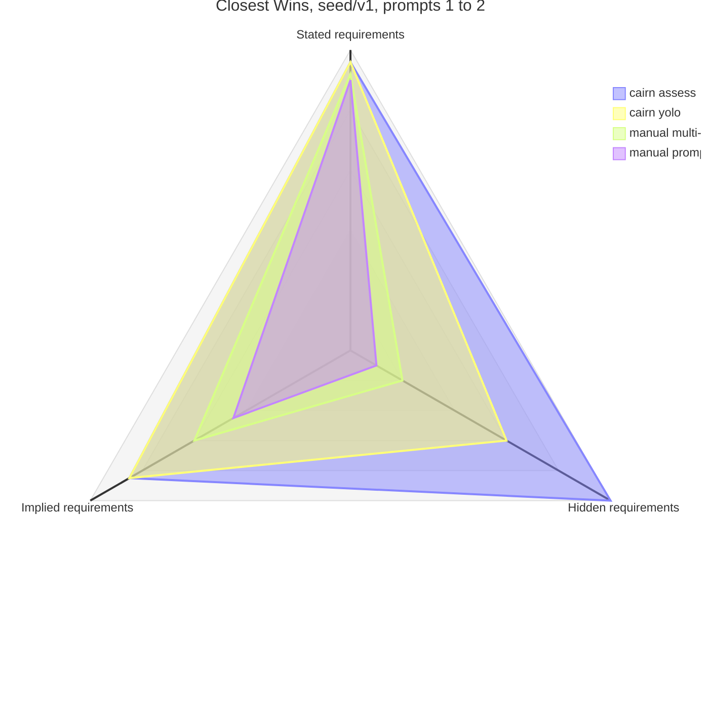

# Benchmark for Cairn

## General idea

### What the benchmark is

The benchmark is a separate project whose only relation to Cairn is that it takes Cairn as an input and measures it. It is not part of Cairn, does not share its repository, and does not track its `main`: each benchmark run records the exact Cairn commit it exercised, and comparing Cairn versions is done by re-running the benchmark with a different pinned commit. Releases are the commits that appear in the published trend; a candidate commit is benchmarked the same way (see "How Cairn development uses the benchmark").

The benchmark executes one project under a set of scenarios, each starting from the same seed repository and the same raw prompt. A scenario is one way of delivering the project paired with one model strategy, and it carries one identifier composed of the two: `cairn_1_8_3_yolo_models_strategy_1` is the YOLO cairn chain of Cairn 1.8.3 run under the model strategy named `models_strategy_1`, and `manual_prompt_opus_5_5_high` is one manual prompt run under Opus 5.5 at high effort. Each scenario delivers its own artifact. Those artifacts are what is measured, on the axes of "Scoring axes", and shown, on the README page: they serve as proof of whether Cairn helps, and as a way to track its behaviour across versions, models, and effort levels.

The framework has to actually help, not just pretend to. A difference between two scenarios is attributed to what differs between their definitions and to nothing else, so a reader always knows what a comparison says: two scenarios that share a model strategy isolate the delivery, two that share a delivery isolate the model strategy, and the headline comparison, Cairn under the model strategy it is meant to be used with against manual prompting under one strong model, differs in both and is read next to its cost. Everything a scenario does not define (the seed, the prompt, the hidden requirements, the operator that stands in for the project's stakeholder, the host configuration a run starts from and the machine it runs on, the harness flags) is identical across scenarios, so a difference is never attributed to it.

## The raw prompt

The raw prompt is one fixed text, versioned alongside the benchmark, and placed byte-identical in every scenario's working tree as the project description file `PROJECT.md` at the repository root. Every scenario reaches it through that file: the harness writes it into the clone and commits it as the first commit of the run branch (see "One run"), so the agent finds the task in the repository the way a developer would, and the one place its text is also sent on a command line is the cairn deliveries' definition line, below. Every manual delivery then receives the same one-sentence pointer message as its instruction to build, fixed as part of the delivery definition:

```
Carry out the task described in PROJECT.md.
```

In `manual_prompt` that sentence is the whole user message, in the multi-prompt control it is the first, and in `manual_clarify_then_build` it is the build message that follows the planned turn. In the cairn deliveries the argument of `/cairn:define-milestone-goal` is instead the text of `PROJECT.md` as the current phase committed it, substituted into the line by the harness, which the skill records verbatim as the milestone's Goal; that substitution is the one exception to the rule that no message carries prompt text, and its reason is stated with the cairn chain (see "`cairn_<version>_yolo`" under "Deliveries"). No scenario gets extra wording, hints, or clarification from the harness, and no planned message differs between prompts but that definition line, whose difference is the file's own: only the file's content changes from phase 1 to phase 2 (see "The two phases"). The messages whose text is not fixed are the operator's (see "The operator"): a reply to what a session asked, in any scenario, and what a planned turn sends, the answers the `cairn_<version>_assess_answers_manually` delivery's turn records and the answers the `manual_clarify_then_build` delivery's turn gives to the questions its listing invocation asked; each is recorded as sent.

The prompt is deliberately underspecified in a few named places (for example team setup, the tie, controls, persistence) so that real open questions exist for Cairn to surface. It is still specific enough that the manual scenarios can produce a working result; the gaps are decisions, not missing instructions. It also leaves unsaid what the kind of project it describes comes with, a way to start over or a score the room can follow, which a builder is expected to know from the category alone; those are the implied requirements, listed per prompt in the project section and scored as an axis of "Scoring axes". And it states nothing about the expectations the seed gives evidence for; those are the hidden requirements of the next section.

## Hidden requirements

A hidden requirement is an expectation the project's stakeholder holds that the prompt does not state and the seed gives evidence for. It differs from the gaps the prompt deliberately leaves open and from the implied requirements: a gap is a decision with several defensible answers, left open so that Cairn has real questions to surface and the scenarios can diverge on what they decided; an implied requirement is what the kind of project comes with, known to any builder from the category alone, and its metric is whether the artifact has it; a hidden requirement has one right answer that only this project's context gives, and its metric is whether the artifact meets it. It exists to test the question-and-answer loop as a whole: a review pass that asks what the prompt did not, a recommendation grounded in the live project, and a decision recorded and carried into the tasks. The loop is tested by its outcome alone, the requirement delivered or not; which step lost it is found by reading the run, case by case, never by a metric of its own.

- **The statement never reaches a run's repository; the evidence does.** The requirement is written down in the inputs area, in the operator's hidden knowledge, and on the rating checklist, and nowhere else. Its evidence lives in the seed, so every scenario gets it byte-identical and a manual scenario can act on it as well as a cairn scenario can. Nothing in `PROJECT.md` points at it. The one way a statement is spoken inside a run is through the operator (see "The operator"), which holds every statement in every scenario and discloses one only in reaction to a question that asks about something in its bearing scope: a question a session asked, one the `manual_clarify_then_build` delivery's listing invocation listed for its planned turn, or an open question the `cairn_<version>_assess_answers_manually` delivery's planned turn records an answer to. What it discloses is a message, never a file, which the rest of the run sees only through what the session did with it, a decision recorded in the milestone's own files or the model's own work. A requirement with no evidence in the seed would measure luck, so it is not a valid hidden requirement.
- **A bearing scope.** Each entry carries, beside its statement, one line naming the decision or decisions a question must ask about to receive the disclosure: for prompt 1 the topic or theme of the questions, for prompt 2 where a prepared set is stored or how it is carried to another computer. The scope is part of the entry and versioned with it. The harness inserts it with the statement into the operator's hidden knowledge, and the operator discloses the statement only when a question asks about something in the scope; a catch-all question ("anything else I should know before I start?") or a question outside the scope gets nothing beyond what `PROJECT.md` says. The same scope governs the "bears on" lines of both planned turns: which open questions the assess delivery's turn may answer, which listed questions the clarify delivery's turn answers with a statement, and when either turn's closing line for an item reads "no question". The test is a written scope rather than whether the statement would change a question's answer, because a catch-all passes that test for every statement, so the hidden axis would partly measure whether a model happened to end on a vague question rather than whether the process surfaced the right one, and because whether a question bears on a requirement would otherwise be the operator's private reading; with the scope written beside the statement, every disclosure is checkable against written text.
- **The evidence is calibrated.** It must make one answer clearly best once the question is asked, while the prompt alone gives no reason to ask it. A seed file that states the requirement outright measures whether the agent read a file; evidence too faint to settle the question measures a guess. Both halves are checked by the calibration pilot below before any scored run.
- **One measurement.** *Met*: a line on the rating checklist, applied to the artifact by a rater who does not know the scenario, scored as a count where the requirement allows one; it is the hidden-requirements axis of "Scoring axes". Nothing else about a hidden requirement is measured in a scored run. Whether a review pass asked about it, whether an alternative covered it, whether the operator recorded it, and whether a manual run's model asked for it are all visible in the run's branch, invocation outputs, and operator record, and when a requirement was not delivered they are read there by hand to find out where it was lost, which differs from case to case. A metric for each of those steps would have to be defined, judged, and kept in step with the chain for every way a requirement can be lost, and would still say less than reading the run does; so they are a record, not a measurement, and the manual scenarios, where the only trace is whether the model asked the operator, lose nothing by comparison.
- **Versioning.** A hidden requirement is tied to the seed tag that carries its evidence and to the prompt blob that leaves it unstated. Changing the evidence is a seed bump, and the analysis groups by both before comparing scenarios.
- **One per prompt**, listed under its own heading in the project section and never in the "deliberately left open" list or the implied-requirement list: it is neither a decision with several answers nor a convention of the category, and a line in either list would score it twice.
- **What each delivery can show.** The YOLO chain accepts its own recommendations, so a met hidden requirement there shows surfacing plus a grounded recommendation, with no planned turn of the operator (a skill that stopped to ask, and was answered, shows in the operator record). The assess chain puts the operator at the answer step, so a met requirement there shows surfacing, an alternative set that covered the right answer, and the operator's decision carried through to the artifact. The gap between the two, under one model strategy, is what a person who reads the questions and answers the ones that matter to them gains, which is the workflow's intended value. A met requirement in `manual_prompt` or the multi-prompt control shows that the model asked the operator a question within its bearing scope, or built it from the evidence unasked; the operator record says which. In `manual_clarify_then_build` the asking is planned: a met requirement there shows that the model, told to list its questions before building, listed one within the bearing scope and built what the answer said, or built it from the evidence unasked, so the gap between it and `manual_prompt` under one pair is what a planned turn buys without Cairn, and the gap between the assess delivery and it is what Cairn adds when both have one.

### The calibration pilot

Whether a requirement's evidence is calibrated is a claim about how models behave on the seed and the prompt, and reading the text cannot settle it. Prompt 1's "ten questions of its own" invites the question of their topic, and from a zoo evening to animal questions is one step a model may take without asking, which would make the hidden axis measure whether the model read the README, the case the calibration rule excludes; prompt 2's "keep them for the next party" already points at keeping a set, and exporting one is a common convention, so its requirement sits close to an implied one. Each prompt's hidden requirement is therefore calibrated before any scored run by a pilot with two arms, one for each half of the calibration rule, each arm run a small number of times fixed before the pilot starts, under the strongest manual model pair, the most capable model the host offers at its highest effort level, because that is the pair most likely to reach the requirement unasked:

- **The unasked arm** checks that the prompt alone gives no reason to ask. It runs `manual_prompt` with the operator's hidden knowledge withheld, so every question a session asks still gets a reply but no reply discloses anything, for prompt 2 from the arm's own prompt-1 runs, and rates each artifact on the entry's check line alone. It measures whether the prompt and the seed lead to the requirement with no disclosure, and its acceptance rule is a met-rate ceiling: the arm's met rate, the runs' mean score on the check line, is at most the ceiling the pilot declares before its first run.
- **The asked arm** checks that the evidence settles the question once it is asked. It gives a model the seed tree and the prompt plus one fixed bearing question written by the maintainer from the entry's bearing scope ("What should the questions be about?" for prompt 1, "Where should a written set live?" for prompt 2), with no operator, and checks whether its answer, grounded in the evidence alone, is the hidden requirement. Its acceptance rule is a hit-rate floor: the share of the arm's answers that are the requirement is at least the floor the pilot declares before its first run.

A requirement passes only when both arms pass. A failed ceiling is fixed by weakening the evidence or the prompt's invitation, and a failed floor by strengthening the evidence, each as a seed bump or a prompt revision followed by another pilot of both arms, since a fix for one half can break the other. Pilot runs are never scored. The pilot has two arms rather than a few bare manual runs alone because bare runs check only the first half: a requirement they never meet may have evidence too faint to settle the question or a question no run happened to ask, and the two call for opposite fixes, which the asked arm tells apart by asking the question itself.

## The operator

Every scenario runs unattended, so the person a run would otherwise turn to is played by the operator: a stand-in for the project's stakeholder, defined by the benchmark and the same for every scenario. It is a shared input like the seed and the prompt, not part of any scenario, so a difference between two scenarios is never attributed to it. Nothing in the plugin knows it exists, and nothing in a manual run can tell it from a person.

The operator never starts anything. The fixed start of every run, the first message of a manual delivery or the chain lines of a cairn delivery, is sent by the harness as the delivery states it, so every scenario starts from the same place. The operator acts at two kinds of moment after that:

- **A reactive turn** follows any invocation whose final message cannot proceed without the operator: a question, a request for confirmation, a choice offered. Which messages those are is decided by the reply-need classifier, not by the operator (see "The reply-need classifier"). On a reply verdict the operator reads that message and replies into the same session, resumed by its id, so the question keeps its context and the reply runs under the pair the session ran under. A message that reports completion, a stop, or an error, or that closes with an offer, gets no reply; the invocation ends there, classified as "How a run ends" under "Repository layout and isolation" states, and the chain goes on to its next planned message or, on a stop or a void, ends. One invocation gets at most three replies, after which the harness takes the last final message as the invocation's end and the record shows the cap was reached, so a model that asks without end cannot hold a run open.
- **A planned turn** is one a delivery declares at a fixed position in its list, the stakeholder's turn. Two deliveries here declare one: the assess delivery, whose turn answers Cairn's open questions, and the clarify delivery, whose turn answers the questions its listing invocation asked; each states the turn's input and the form its output takes. Where a turn's input is the final message of the invocation before it, as the clarify delivery's is, the turn is that message's reply, so the reply-need classifier is not run on it and no reactive turn follows it.

The operator is a model call made by the harness outside the clone, with no tools, under one model and effort pair fixed in its definition and outside every model strategy, so that two strategies differ in the model under test and never in the quality of the person it talks to. Its tokens are recorded apart from the scenario's and never enter the scenario's totals, because they stand for a person's time, which the attentive-session count reports (see "Cost and time reporting"). Its output is routed by the harness and never written to the clone: a reply is sent as a message to the resumed session, the assess turn's answers as invocations of the commands that delivery names, and the clarify turn's answers as one message to the resumed listing session. The one channel from the operator into a run is therefore a message, and what a run keeps of it is what the session did with it.

### The three layers

The operator's definition is composed from three layers, each with one home, so that what it knows and what it may do can be read in one place and changed in one place:

1. **The general guideline** states what the operator is for and how it conducts itself, and is the same in every scenario: it is the person this project is for, it wants the project delivered as `PROJECT.md` describes, and it answers what it is asked. It volunteers nothing. On a question of taste it defers ("your call"), because an answer by taste would make the artifact differ in ways attributable to the operator rather than to the scenario; the operator does not model every user, only the knowledge a user has and the prompt does not. It reviews no artifact and reads no file of its own: its input is always the prompts up to the current phase, plus the message or document the turn hands it. In phase n those are prompts 1 to n, taken byte-identical from the versioned prompt texts the manifest records, at every reactive turn and at both planned turns alike, the earlier prompts marked as the stakeholder's earlier requests and prompt n as the current one. A stakeholder making a second request still knows the first, and with the committed text alone, which in phase 2 is prompt 2 only, a phase-2 question about the game's existing flow would reach a person who does not know the game they asked for. Its hidden knowledge stays phase n's alone (the next layer), so each prompt's measurement stays its own, and no versioning changes, because a revision of prompt 1 already invalidates both phases (see "One versioning" under "The two phases"). It names no tool and no workflow, so a manual scenario never hears Cairn's vocabulary from it.
2. **The hidden knowledge** is the statements of the hidden requirements of the prompt being run, one line each with its bearing scope beside it (see "A bearing scope" under "Hidden requirements"), inserted by the harness from the inputs area: those of the current prompt only, so each prompt's measurement stays its own, and the statements and their scopes only, never the evidence or the rater's check. The operator holds them in every scenario, the YOLO chain and the manual deliveries included, and discloses one only in reaction to a question that asks about something in its bearing scope, and then says no more than that question needs. A catch-all question, one that asks what else the builder should know without naming anything in a scope, and a question outside every scope get nothing beyond what `PROJECT.md` says, because a catch-all would otherwise draw every statement out of the operator and reward a model for ending on a vague question rather than for surfacing the right one. This reactive-only rule is what keeps the hidden-requirements axis a measure of whether the process surfaced the question rather than of the operator's generosity: Cairn reaches the knowledge through its open questions, a manual run reaches it by asking, and a run that never asks never receives it.
3. **The scenario knowledge** is how to act through the delivery's own interface, and it is the one layer held in the delivery definition rather than in the operator's, so it is the one layer allowed to differ between scenarios, and the difference stays attributable to the delivery. For the manual deliveries, the clarify delivery's planned turn included, it says only to reply in plain prose. For the cairn deliveries it says which answer command records which kind of answer and what a stopped skill's advisory means; the assess delivery's planned turn, which reads the question document and records answers, is its fullest use.

The guideline, the operator's model pair, and the reply-need classifier's rule and model pair are versioned together under the inputs area as one operator definition, recorded in the manifest, because a change to any of them could change results and must start a new comparison set; the hidden knowledge is versioned with the hidden-requirement entries it is read from, and the scenario knowledge with the delivery that holds it.

### The reply-need classifier

Whether a final message gets a reply is decided before the operator is reached, by a distinct model call the harness makes outside the clone: the reply-need classifier, with no tools, under one model and effort pair fixed in the operator definition and outside every model strategy. It runs on the final message of every invocation and of every reply, but for a message a planned turn takes as its input and answers instead (see "A planned turn" above), reads that message and nothing else, never the prompt or the hidden knowledge, and applies one stated rule:

```
A message that asks a question, asks for a confirmation, or offers a choice
gets a reply. A message that reports completion, a stop, or an error, or that
closes with an offer, gets none.
```

It outputs its verdict, reply or no reply, and a one-clause reason. Only a reply verdict invokes the operator, as a reactive turn. A no-reply verdict is not an operator turn: nothing is sent, no attentive session is added (see "Cost and time reporting"), and the chain goes on to its next planned message or ends. Every verdict and its reason go into the invocation's record file, whichever way the verdict went, and the classifier's tokens and cost are recorded beside the operator's, apart from the scenario's totals.

The call is separate because the choice between replying and staying silent is a model judgment that decides whether a run hears anything from the operator at all. Made by the operator, it would be made by a call that holds the prompt and the hidden knowledge, so a message ending on a vague offer could be read as a question worth answering, and it would leave no record. A call that sees only the final message cannot be swayed by what the operator knows, its fixed pair keeps it the same in every scenario, so a difference in replies is attributable to what the sessions said, and its recorded verdict and reason make every reply and every silence checkable against the stated rule. Its tokens stay out of the totals because the classifier is a constant of the environment, run the same way in every scenario, rather than work the scenario did, and they stand beside the operator's rather than inside them because the call is the harness's and stands for no person's time.

### The record

Every operator turn leaves one record file beside the invocation outputs, in chain order: the input the operator was given, its output as sent, and one closing line in a fixed form stating what it was asked and which layer answered (the guideline, the hidden knowledge, or the scenario knowledge). Every invocation's record file, beside its output, carries the reply-need classifier's verdict and reason on its final message, so a run's silences are on record beside its replies. The closing line is what a case-by-case reading of a run starts from when a hidden requirement was not delivered: a manual run whose record shows no question within a bearing scope never asked, and an assess run whose turn answered "in my words" had an alternative set that missed. It is never folded into a metric. The record half of a run is unpublished, so the operator's files, which name hidden requirements, never reach the site.

## Scenarios

A scenario is a delivery paired with a model strategy. Both are definitions stored in the benchmark repository's inputs area, one file each under its own id, and the scenario id is the delivery id followed by the model strategy id. A definition is never edited once a run has used it: a change is a new id, so an id names one fixed thing for the life of the benchmark.

### Deliveries

A delivery is the way the project is delivered: a list of fixed messages, in order, each sent as one headless invocation, in a fresh session unless the delivery marks the message as continuing the session of the invocation before it; at most one planned turn of the operator, marked at a fixed position among them; at most one bounded loop, below; and the scenario knowledge the operator acts on in that delivery (see "The operator"). No message carries prompt text, because the prompt reaches the run as the committed `PROJECT.md`, with one stated exception: the cairn deliveries' definition line carries the text that file holds in the current phase (see "`cairn_<version>_yolo`"). A cairn delivery also names the plugin commit it runs. The operator's reactive turns are part of no delivery: they may follow any invocation of any delivery, and the record counts them. Five deliveries are defined here, the primary ones; ablations add more (see "How Cairn development uses the benchmark").

A bounded loop is a named span of consecutive lines of the list, repeated up to a count K that the delivery's definition declares, so a delivery with another K is another definition under its own id. The definition names one line of the span as its exit line and, as its exit signal, one fixed line that the exit line's skill prints, and may mark lines of the span as run in the first pass only. After each run of the exit line the harness matches the invocation's final message, after any replies, against the signal: when a line of that message is the signal, the harness skips the rest of the span and goes on to the first line after it, and when K passes end with no match it goes on to that line all the same. A delivery's length is its list with the loop unrolled to K passes, the most invocations a run of it can make; a run's planned count is its list with the loop resolved, as many passes as the loop took when the signal matched and K otherwise (see "The manifest").

#### `manual_prompt`

One invocation, the pointer sentence as the whole message:

```
Carry out the task described in PROJECT.md.
```

Its scenario knowledge is to reply in plain prose. A model that ends the invocation by asking is answered by the operator's reactive turn and continues in the same session; the record shows whether it asked and what it was told, which on a model that asks is this delivery's one route to the hidden knowledge.

#### `manual_multi_prompt_as_<cairn scenario id>`

The control that separates "Cairn's structure helps" from "N turns beat one turn", with the same operator available to both. It has no definition file of its own: it mirrors the cairn scenario its id names and takes from it the planned list, the number of invocations N and the model and effort of each one, line by line, so the two can never drift. It takes the cairn delivery's bounded loop unrolled to its bound, K passes with every first-pass-only line counted once, so N is the cairn delivery's length and the control has no loop of its own: its line count stays fixed for every run, rather than following how early one cairn run's loop happened to exit, and is never below the count any cairn run of the mirrored scenario makes, so a gap between the two is never a gap in the number of turns. The mirror covers the planned messages only: a planned operator turn in the mirrored delivery has no counterpart here, because the turn is not a message of the list, and the operator's reactive turns are counted on both sides and mirrored on neither, since the operator is a constant of the environment and acts wherever a session asks. Its first message is the pointer sentence; every following one is the same fixed continuation message, sent to a fresh process, not a continued session, and its scenario knowledge is the manual one, to reply in plain prose:

```
Carry out the task described in PROJECT.md.
Continue the work in this repository and improve it.   # repeated N-1 times
```

#### `cairn_<version>_yolo`

The YOLO cairn chain is a sequence of the Cairn commands merged together that declares no planned turn of the operator: no step of it is meant to stop for a person, and a step that does stop to ask is answered by a reactive turn like any other invocation's, which the record shows. Its scenario knowledge is the cairn one (see "The operator"). `<version>` is the release the delivery runs (`1_8_3`), or the short commit for a candidate that is not a release. Its first line bootstraps the milestone workflow inside the clone, so every Cairn artifact (the `milestones/` directory, its `README.md` with the pointer reading `none`, and the `## Milestone Workflow` section of `CLAUDE.md`) is created by the run itself: the seed carries none of it, and the manual deliveries never see Cairn's vocabulary or guidance. The bootstrap commits what it wrote under its own subject, and at phase 2, where the scaffold already exists, it changes nothing. Its last line closes the milestone the chain opened and clears the current-milestone pointer; without it the phase-2 chain would find milestone 1 still current and stop at its activation line (see "The two phases").

```
/cairn:init-milestone-base-workflow
/cairn:define-milestone-goal <the text of PROJECT.md as this phase committed it>
/cairn:goto-next-milestone
/cairn:specify-milestone-starting-state
loop review, up to K passes, exit when the review line prints the convergence line:
  /cairn:review-milestone-requirements
  /cairn:provide-alternatives-to-all-open-questions
  /cairn:recommend-all-open-questions
  /cairn:answer-all-open-questions-with-recommendation
end loop
/cairn:derive-tasks
/cairn:complete-all-tasks
/cairn:finish-current-milestone
```

The definition line's argument is the text of `PROJECT.md` as the current phase's `Prompt: <n>` commit holds it, which the harness substitutes into the line before sending it, whole and with its line breaks, within the quoting rule Cairn's usage documentation states for a goal written inside `claude -p "…"`, which both prompts of the project section meet and a revision of either must keep. It is the one message of any delivery that carries prompt text, so each milestone records its own prompt verbatim under its Goal, and that record stays true after the file is overwritten; the line as sent is in its invocation's record, and its text is the prompt blob the manifest already records. The exception exists because a milestone's Goal is what every later line reads as the milestone's objective, and in a later phase the starting-state pass reads the earlier milestones' Goals as the record of what each one was for. A Goal holding the pointer sentence would point at a file the next phase overwrites: at phase 2 milestone 1's Goal would name prompt 2, and the starting-state pass, the one step of the chain with no counterpart in a manual run and the one where the phase-2 margin is expected to open (see "What phase 2 is expected to show"), would read a milestone whose goal no longer describes what it built. A goal that points at a file is also not how Cairn is used, since a goal is written as its content, so the pointer would measure the chain under a use it was never meant for. No scenario gains anything by the substitution: `PROJECT.md` is still written and committed under `Prompt: <n>` in every scenario, every manual delivery's build message stays the pointer sentence and no manual message carries prompt text, and every run finds the same committed text, a cairn chain in its definition line as every scenario in the file.

The review, alternatives, recommendation, and answer lines form the delivery's bounded loop, `review`, repeated up to K passes. Its exit line is the review line and its exit signal is the fixed convergence line Cairn's review skill prints when no open question is left standing, as Cairn's skill reference lists it, held verbatim in the delivery's definition for the plugin commit the delivery names. A review pass that prints the signal ends the loop, the rest of its pass skipped, and the chain goes on to the derivation line; when K passes end without it the chain goes on to the derivation line all the same, with no escalation pass, and that line derives when no open question stands and otherwise stops, recorded as any stop is. Both primary cairn deliveries carry the loop under the same K, so that the two of one version still differ by the planned turn alone. The loop exists because Cairn's usage documentation runs the review pass, its annotation, and the sweep again until the review reports convergence, which a fixed list run once cannot express, so a chain that reviewed once would measure Cairn under a use it was never meant for. It is bounded because a repeat with no bound would let one run's cost and invocation count grow without limit and leave the multi-prompt control no fixed length to mirror. Past K the chain derives rather than escalating, because the usage documentation's escalation for a stuck milestone, one more pass with the review line under a stronger pair, is a person's call on a milestone they judged stuck, and a model strategy keys by message, so a second review line could not run under another pair than the first; a chain with an escalation line is an ablation under its own id. The usage documentation's other repeat, running the completion line again once the account's usage window resets, answers an interruption of the environment rather than a step of the work, so it belongs to how a run ends, never to a delivery, and there an interruption voids the run rather than resuming it (see "How a run ends" under "Repository layout and isolation").

#### `cairn_<version>_assess_answers_manually`

The YOLO chain with the stakeholder put back in at the one step the workflow built for them. It is the YOLO delivery's list with the operator's planned turn marked after `/cairn:recommend-all-open-questions` and a second run of the recommendation pass behind it, which picks again for every question whose pick the turn's answers cleared and picks nothing on a turn that cleared none, both inside the bounded loop and both marked as run in the first pass only. It differs from the YOLO list in nothing else, its K included, so every later pass is the YOLO pass line for line and the two scenarios under one model strategy isolate the turn, the second pass being its consequence. The turn is the stakeholder's one planned turn in this delivery: the person Cairn's questions are meant to reach, who knows what they want beyond what `PROJECT.md` says and who, in a real project, would read the questions and answer the ones that matter to them. The scenario exists to show what that person gains by investing the time, measured as the hidden requirements the artifact meets.

```
/cairn:init-milestone-base-workflow
/cairn:define-milestone-goal <the text of PROJECT.md as this phase committed it>
/cairn:goto-next-milestone
/cairn:specify-milestone-starting-state
loop review, up to K passes, exit when the review line prints the convergence line:
  /cairn:review-milestone-requirements
  /cairn:provide-alternatives-to-all-open-questions
  /cairn:recommend-all-open-questions
  <the operator's planned turn>                  # first pass only
  /cairn:recommend-all-open-questions            # first pass only
  /cairn:answer-all-open-questions-with-recommendation
end loop
/cairn:derive-tasks
/cairn:complete-all-tasks
/cairn:finish-current-milestone
```

The turn stays in the first pass because it is the stakeholder's one sitting: a turn on every pass would make the attentive-session count, the delivery's cost in a person's time, depend on how many passes the loop took, and a person who has answered the questions that mattered to them leaves the passes after it to the chain, whose later review passes surface what those answers opened and whose sweeps record the picks. The second recommendation pass goes with the turn because it is the turn's consequence; on a later pass, with no turn before it, it would have nothing to pick. A first review pass that prints the convergence line skips the turn with the rest of its pass, since there is no question for the turn to read.

At the marked position the harness runs the operator once, outside the clone, as "The operator" states. Its input is the prompts up to the current phase, as the general guideline states, and the current milestone's `requirements.md` and `open_questions.xml` as they stand in the clone, read verbatim, so the operator sees every question with its alternatives and its pick, as a person reading the annotated set does. Its message is composed by the harness from the three layers; below the general guideline's own text, the hidden lines and this delivery's scenario knowledge read in sketch:

```
Below are your requests so far, the earlier ones marked as earlier and the
current one last, and the current milestone's open questions with their
alternatives and recommendations. Beyond what your requests say, you want the
following, each item with the decisions it bears on:

<one line per hidden requirement of this prompt: its statement and its bearing scope>

For every open question that asks about something in an item's scope, where
one alternative serves what you want and the others do not, output one line
/cairn:answer-open-question-with-alternative <Short Title>. <Alternative Id>
whether or not it is the recommended one. For every open question that asks
about something in an item's scope but none of whose alternatives serves it,
output one line recording what you want in your own words
/cairn:answer-open-question <Short Title>. <answer text>
Output no line for any other question. Then finish with one line per item
above: the question you answered for it and the alternative, or the question
and "in my words" if none of its alternatives served it, or "no question" if
no question asked about anything in its scope.
```

The harness sends each command line the operator output as one headless invocation in the clone, in the order output, under the pair the model strategy assigns to that command; the closing lines stay in the operator's record. What the turn may and may not do follows from what the scenario has to isolate:

- **It answers only where the hidden knowledge decides.** A question that asks about nothing in any hidden line's bearing scope gets no line, by the same scope that governs a reactive disclosure (see "A bearing scope" under "Hidden requirements"), and its recommendation is recorded by the sweep as in the YOLO chain. If the operator also answered by taste, the artifact would differ from the YOLO artifact in ways not attributable to the hidden knowledge, and the comparison would say less; this is the general guideline's deferral rule applied to a turn where deferring means staying silent.
- **It answers from the alternatives where one serves, and in its own words where none does.** `answer-open-question-with-alternative` records one of the enumerated options, so where the alternatives pass laid out an option that meets the requirement the operator carries it through by choosing it; where no option does, it records the requirement itself with `answer-open-question`, as a person who knows what they want would, rather than letting a gap in the set lose it. Cairn's design holds that an alternative set is covering, and this is the scenario where that property has a right answer to check against: every `Manual-answer:` commit the turn adds is a question whose set missed what the stakeholder wanted. The operator's closing lines say which step fell short when one did, "no question" pointing at the review pass and "in my words" at the alternatives pass; they are kept in the turn's record, read by hand when a hidden requirement was not delivered, and never folded into a metric.
- **It runs after the recommendation pass.** The operator sees every question with its alternatives and its pick and acts only where the hidden knowledge decides: skimming the picks and stopping where one is wrong or no alternative serves is the shorter session, and it is the one Cairn's workflow is built for. Each hand answer clears, in the same write, the picks on other questions it undermines, those a `<depends-on>` tag declared and those the answering skill names, transitively, so no standing pick is left assuming an outcome the turn decided otherwise. The second run of the recommendation pass then picks again for exactly those questions, with the operator's decisions already recorded in `requirements.md`, which is the grounding Cairn gives a recommendation formed after a person has decided some of the siblings, and the sweep records every pick that stands.
- **The hidden lines leave no trace but decisions.** They are given to the operator outside the clone and never to a session inside it; what enters the clone is each answer line, as a skill invocation, and what the rest of the chain sees is the decision that invocation recorded in the milestone's own files, the later invocations being fresh processes. After the turn the harness asserts that the work tree is clean and that every commit the turn's invocations added is an `Alternative-answer:` or `Manual-answer:` commit. A failed assertion stops the chain there, recorded like any early stop, because an answer that landed by another route makes the run attributable to nothing.
- **Recorded as sent.** The operator's input and output and each answer invocation's message are in the run's record, since these are the messages of the delivery whose text the definition does not fix verbatim. The model strategy keys each answer invocation by its command.

The scenario is read against the YOLO scenario of the same version and model strategy, which differs from it by the operator's planned turn and the second recommendation pass that turn needs. Its multi-prompt control is derived like any other: it mirrors the planned list, which has no counterpart to the turn, so that comparison folds the turn in with Cairn's structure, and only the comparison against YOLO isolates it.

#### `manual_clarify_then_build`

The manual counterpart of the assess delivery: a manual run asked for its questions before it builds, with one planned turn of the operator to answer them, so that a planned question-and-answer turn with the stakeholder is no longer something only a cairn delivery has. It is three messages in one session, the planned turn between the first two, each later one continuing the session of the one before it:

```
Read PROJECT.md and list the questions you need answered before building it. Build nothing yet.
<the operator's planned turn>                    # into the same session
Carry out the task described in PROJECT.md.      # into the same session
```

The listing invocation reads the tree and `PROJECT.md` and ends on its list. Its final message is the planned turn's input rather than the reply-need classifier's, since the turn is that message's reply (see "A planned turn" under "The operator"). At the marked position the harness runs the operator once, outside the clone, as "The operator" states. Its input is the prompts up to the current phase, as the general guideline states, and the listing invocation's final message, verbatim, and it answers under the same disclosure rule as every other turn: a listed question that asks about something in a hidden line's bearing scope gets that line's statement, a question of taste gets "your call", and a catch-all or off-scope question gets nothing beyond what `PROJECT.md` says. Its scenario knowledge is the manual one, to reply in plain prose. Its message is composed by the harness from the three layers; below the general guideline's own text, the hidden lines and this delivery's scenario knowledge read in sketch:

```
Below are your requests so far, the earlier ones marked as earlier and the
current one last, and the questions the builder asked before building.
Beyond what your requests say, you want the following, each item with the
decisions it bears on:

<one line per hidden requirement of this prompt: its statement and its bearing scope>

Answer the builder's questions in plain prose, as one message. Where a
question asks about something in an item's scope, say what you want. Answer
any other question from your requests, or say it is the builder's call.
Then finish with one line per item above: the question you answered for it,
or "no question" if no question asked about anything in its scope.
```

The harness sends the answer, without its closing lines, as one message into the listing session, resumed by its id under the pair the listing invocation ran under, as a reply is sent; the closing lines stay in the operator's record, read by hand as the assess turn's are and never folded into a metric. A listing that asked no question still gets the turn, whose closing lines then read "no question" for every item, and nothing is sent. The build message, `manual_prompt`'s pointer sentence, then continues the same session, so the build runs with the questions and their answers in its context. The listing message's "Build nothing yet" keeps the three steps apart, so the answers reach the session before any code exists and the build starts from the same sentence as `manual_prompt`'s. After the answer and after the build, the reply-need classifier reads the final message as after any invocation.

The delivery exists because the assess delivery's advantage over the manual deliveries would otherwise mix two causes: Cairn surfacing the right question, and the run having a planned turn with the stakeholder at all. The multi-prompt control mirrors the planned messages only and has no counterpart to the turn, so its comparison with the assess delivery folds the turn in with Cairn's structure, and the reactive turn is no counterpart either, because a headless session seldom ends by asking, so a manual run's route to the hidden knowledge through it is mostly theoretical. With only those, the assess delivery and every manual one would differ in two things at once, and the rule that a difference is attributed to what differs between two definitions would break at the comparison the benchmark exists to make. With this delivery added, comparing it against `manual_prompt` under one pair isolates the planned turn without Cairn, and comparing the assess delivery against it shows what Cairn adds when both have one, read next to its cost like the headline comparison, since the two differ in model strategy as well. It is a family of its own, with its own rows in the ranking table and its own curve on the radar (see "The README page"), because no other family answers what a planned turn buys without Cairn.

### Model strategies

A model strategy assigns one model and one effort level to every message of the delivery it is paired with, keyed by the message (for an answer invocation the operator's planned turn produces, by its command, since the rest of the line varies), and is written in its own file in the inputs area under its id. Nothing in a run picks a model: every invocation runs under the pair its strategy assigns, and the harness refuses a scenario whose strategy leaves one of the delivery's messages or planned-turn commands unassigned. A reactive reply resumes the session that asked and runs under that session's pair, so it needs no key; nor does the clarify delivery's planned-turn answer, sent into the listing session as a reply is. The operator's own pair is fixed in its definition outside every strategy (see "The operator"). The file holds the exact `--model` value, never an alias such as `opus`, because an alias moves between host releases and the strategy must mean the same thing for the life of the trend. A strategy's id is a name when it holds several pairs (`models_strategy_1`) and the pair itself when it holds one (`opus_5_5_high`).

Cairn is meant to be used under a mixed strategy, because its skills differ in what they need: the bootstrap and pointer steps are mechanical, the review and recommendation passes are where the reasoning happens, and task completion is where the code gets written. The strategy Cairn is used with is therefore documented in the benchmark repository as an input like any other, and the reference one, `models_strategy_1`, is written from Cairn's own usage snippets, so that the benchmark measures Cairn as it is used, not under an allocation it was never meant for. As a sketch, with the host's model names abbreviated:

| message | model | effort |
|---|---|---|
| `/cairn:init-milestone-base-workflow` | Sonnet 5.5 | medium |
| `/cairn:define-milestone-goal …` | Sonnet 5.5 | medium |
| `/cairn:goto-next-milestone` | Sonnet 5.5 | medium |
| `/cairn:specify-milestone-starting-state` | Fable 5.1 | xhigh |
| `/cairn:review-milestone-requirements` | Fable 5.1 | xhigh |
| `/cairn:provide-alternatives-to-all-open-questions` | Opus 5.5 | high |
| `/cairn:recommend-all-open-questions` | Fable 5.1 | xhigh |
| `/cairn:answer-all-open-questions-with-recommendation` | Fable 5.1 | high |
| `/cairn:derive-tasks` | Fable 5.1 | xhigh |
| `/cairn:complete-all-tasks` | Opus 5.5 | high |
| `/cairn:finish-current-milestone` | Sonnet 5.5 | medium |
| `/cairn:answer-open-question-with-alternative …` and `/cairn:answer-open-question …` (the planned turn's answers, assess delivery) | Fable 5.1 | high |

The planned turn's answer invocations, which no Cairn snippet covers, get the pair of the answer sweep, because recording an answer and reconciling the picks it undermines is the same kind of work; the reading and choosing is the operator's, under its own fixed pair. The recommendation pass appears twice in the assess delivery, before the turn and after it, and runs under its one pair both times, since the strategy keys by message; for the same reason every line of a bounded loop runs under its one pair on every pass.

Comparing models or efforts is not a separate experiment: it is the comparison of two scenarios that share a delivery, and the cost difference between them is the price of the strategy. A scenario whose strategy mixes models is a valid scenario, because the mix is its definition. What is not a valid run of this benchmark is one whose invocations depart from the strategy the scenario names, since its result cannot be attributed to any scenario.

## The two phases

A phase is one raw prompt carried through every scenario and rated: phase 1 opens with prompt 1 on the seed and builds the project; phase 2 opens with prompt 2 on each scenario's own phase-1 result and adds a feature to it. The benchmark defines exactly these two, in that order, and every scenario runs both, so a scenario's result is a pair of artifacts and its scores are means over the pair (see "The checklist and the rank"). "Prompt n" names the text; "phase n" names the stage that text opens, from the harness writing it into a clone to the rating of what came out. The phases exist because a single-shot build is where Cairn's advantage is smallest: a strong model given one clear prompt writes a working game, with or without a workflow around it. What a workflow records, the starting state it analyses, the decisions it writes down, the tasks it closes, pays only when work continues on top of it, and phase 2 is the one point in the benchmark where work continues. It is the stakeholder's second request, made the way a second request is made in practice: a short sentence to a project that already exists, with no restatement of what the first one asked for.

### What the two phases share

- **One procedure.** Both phases are "One run" with a different prompt index: the same clone, the same `PROJECT.md` write and `Prompt: <n>` commit, the same delivery list, the same model strategy, the same operator, and the same rater. Nothing in a delivery or a strategy knows which phase it runs in (a delivery is a fixed list of messages whose one substitution, the cairn definition line's, takes whatever `PROJECT.md` holds, and a strategy keys by message), so the only two things that differ between a scenario's phases are the tree the first invocation finds and the content of `PROJECT.md`. A difference between a scenario's phase-1 and phase-2 results is attributable to those two and to nothing else.
- **One set of messages.** Every fixed message is the same in both phases: the manual deliveries' pointer sentence, `Carry out the task described in PROJECT.md.`, the clarify delivery's listing message, the multi-prompt control's continuation message, and every cairn line but the definition line, which carries whatever the phase's committed `PROJECT.md` holds, as "The raw prompt" states. That is on purpose: phase 2 does not tell the run that there is a phase 1 behind it, that the file has changed, or what is already built, and the definition line says only what the file says. The run finds that out the way a developer would, from the tree and from the history.
- **One versioning.** Each phase's prompt is recorded as its blob hash in the manifest, and each phase's hidden requirement is keyed to that blob and the seed tag. A phase-1 run never sees prompt 2, so its manifest carries no prompt-2 blob: a revision of prompt 2 starts a new comparison set for phase 2 and leaves every phase-1 run under the unchanged seed and prompt 1 a valid parent, while a revision of prompt 1 or of the seed invalidates both phases. The analysis groups runs by the versions they carry before it compares scenarios.
- **One rating per phase.** Each phase is rated from its own artifact by the rater of "The rater", against the checklist of that phase, which carries every earlier phase's stated and implied lines beside its own (see "The axes"), so each phase has a value on every axis and a hidden requirement is scored only in the phase that planted it. Rating is not on the path between the phases: a phase-2 run starts from a phase-1 run's branch, never from its rating, and the two ratings can land in any order.

### Phase 1: building the project

Phase 1 starts from the seed and nothing else. The tree the first invocation finds holds the seed's `README.md` (what the project is for, which is the evidence for both hidden requirements), the seed's `CLAUDE.md` (an environment description naming no Cairn concept), the harness's `PROJECT.md` holding prompt 1, and two commits: the orphan seed commit and `Prompt: 1`. There is no code, no `milestones/` directory, and no mention of a workflow. Every scenario's phase-1 artifact is therefore built from a description alone, and everything in the run's tree beyond those files is the run's own.

What each delivery does with that tree:

- **`manual_prompt`** makes one invocation. The model reads what it finds, builds the game, and commits as it chooses, or does not; whether it asked the operator anything, and what it was told, is the phase's only trace beyond the branch.
- **`manual_clarify_then_build`** makes its three messages in one session. The listing invocation reads what it finds, the README, the prompt, and no code, and lists its questions; the operator's planned turn answers them, with a hidden statement only where a question asks about something in its bearing scope; the build invocation then builds the game with those questions and answers in its context and commits as it chooses. The list, the answers, and the turn's closing lines are the phase's trace beyond the branch.
- **`manual_multi_prompt_as_<cairn scenario id>`** makes N invocations, N being the length of the mirrored chain with its loop unrolled to K passes, each a fresh process over the tree the previous one left. Its phase-1 tree is a game built in N sittings with no record of a decision between them beyond the code and the commit messages.
- **The cairn chain** builds its own scaffolding before it builds anything, line by line. The bootstrap line creates `milestones/` and `milestones/README.md` with the pointer reading `none`, appends the `## Milestone Workflow` section to the seed's `CLAUDE.md`, and commits them under `Workflow-bootstrap: milestones`. The definition line creates `milestones/milestone_01_<slug>/` with its four files; its Goal is prompt 1's text, substituted into the line from the committed `PROJECT.md` and recorded verbatim, the same text a manual run reads in the file. The activation line points `milestones/README.md` at it. The starting-state pass then reads the seed's `CLAUDE.md` and explores the tree, and finds the README, the prompt, and no code, which makes phase 1 the one phase where its section is short: what the project is for, from the README, and that nothing exists yet. The review pass raises the questions the prompt leaves open, the alternatives and recommendation passes annotate them, and the sweep records every pick into `## Decisions` (in the assess delivery's first pass, after the operator's planned turn has recorded some by hand and the second recommendation pass has re-picked what those answers cleared). The loop then runs the review again, which reconciles the open questions against what was decided and surfaces the gaps the decisions opened, and repeats the pass until a review prints the convergence line or K passes are made. The derivation line writes `TASKS_TODO.md`, and the completion line builds the game one task at a time, each landing as a `Task-completion:` commit with its acceptance bar recorded in `TASKS_DONE.md`. The chain's last line closes the milestone: it writes milestone 1's entry under `## Milestone History`, clears the pointer to `none`, and edits `CLAUDE.md` where the milestone changed the project's environment, which is the state the chain has to find at phase 2. A phase-1 cairn tree therefore ends with the game, a closed milestone whose `requirements.md` records what was decided and whose `TASKS_DONE.md` records what was verified, and a `CLAUDE.md` that describes the project as it now is.

The phase ends when the last planned invocation returns, or earlier at the chain's first stop, an invocation that exits non-zero or a cairn line whose final message carries none of the lines its delivery expects of it (see "How a run ends" under "Repository layout and isolation"); either way the run is pushed, snapshotted, and recorded, and the artifact is rated against phase 1's checklist: the six stated lines of prompt 1, the eleven implied lines of a host-run quiz, and the animal-question reading line (see "Prompt 1: the game"). A chain that meets an infrastructure failure instead ends the phase there with its run voided: recorded but never rated, never a parent, and replaced by a fresh run of the same scenario.

### Phase 2: adding a feature

Phase 2 starts from a phase-1 run of the same scenario, the parent, and from the whole of it. The clone is taken from the tip of `run/<parent-id>`, not shallow, so the first invocation finds the phase-1 artifact, the full phase-1 history with its `Prompt: 1` commit (prompt 1 stays readable there, and in a cairn parent also as milestone 1's Goal, since the harness writes prompt 2 over `PROJECT.md` and commits `Prompt: 2`), and whatever else the parent left: for a manual parent the code and its commits; for a cairn parent the closed milestone 1 (its `requirements.md` with prompt 1 as its Goal and the decisions, its `TASKS_DONE.md` with the verified bars, its history entry in `milestones/README.md`) and the `CLAUDE.md` the finish line edited. No parent carries a principle store: `/cairn:capture-milestone-principle-updates` is in no delivery here, because it gates its one commit on a confirmation, which in a headless chain would be an operator turn and an attentive session, and because the YOLO chain's answers are all accepted recommendations, from which it distils nothing. A delivery that adds it, in the assess chain where hand answers exist, is an ablation (see "How Cairn development uses the benchmark"), and what the store then carries into phase 2 is attributable to that line.

Every phase-1 run of a scenario that was neither voided nor marked contaminated is the parent of exactly one phase-2 run, and no phase-1 run is a parent twice, so a scenario has as many runs in each phase and no phase-1 result weighs more at phase 2 than another. A voided or contaminated phase-1 run's replacement is a parent in its place, and a voided phase-2 run is replaced by a fresh one from the same parent, so the parent keeps its one child (see "How a run ends" under "Repository layout and isolation"). The parent is taken as it stands, a chain that stopped early included: a stakeholder's second request does not wait for the first to have gone well, and what a delivery does with an unfinished tree is its result. For a cairn parent whose chain stopped after its activation line and before its last, the pointer still names milestone 1, because a stop, a non-zero exit or one detected in the final message alike, ends the chain before its finish line (a parent that stopped earlier left the pointer at `none`, and its phase-2 activation line activates the lowest-numbered milestone not yet finished). The phase-2 chain's definition line still creates milestone 2, and its activation line then stops, since `goto-next-milestone` activates nothing while the pointer names an unfinished milestone; that stop ends the phase-2 chain as any stop does, with `first_stop` naming the activation line. The run is recorded as any run is, and the rating reads the tree it left: the parent's artifact under prompt 2, with milestone 2 defined and never activated.

What each delivery does with the parent's tree:

- **`manual_prompt`** makes one invocation. The model finds a `PROJECT.md` that asks for the host's own questions and says nothing about the game beyond keeping it reachable from `index.html`, the artifact that is the game, and a history whose first commit after the seed holds the sentences the artifact was built from. What it keeps of phase 1 it keeps because it read the artifact and the history; there is no other record of why the game is the way it is.
- **`manual_clarify_then_build`** makes the same three messages on the parent's tree. The listing invocation finds the artifact, the history, and a `PROJECT.md` holding prompt 2, so what it asks is asked against a game that exists; the operator, reading prompts 1 and 2, answers; the build extends the game in the same session. What it keeps of phase 1 it keeps, as `manual_prompt` does, from the artifact and the history, beside whatever its questions brought out.
- **`manual_multi_prompt_as_<cairn scenario id>`** makes the same N invocations as at phase 1, since the mirrored list, its loop unrolled to the same K, is the same in both phases.
- **The cairn chain** runs the same list on a tree that already carries its scaffolding, and each line meets that tree differently from phase 1. The bootstrap line finds the scaffold complete, changes nothing, and commits nothing. The definition line creates `milestone_02_<slug>` beside the closed milestone 1, its Goal prompt 2's text, while milestone 1's Goal still holds prompt 1's, so each milestone states what it was for although `PROJECT.md` now holds only the second. The activation line finds milestone 1 under `## Milestone History` and activates milestone 2 without asking. The starting-state pass now has a project to describe: it reads the edited `CLAUDE.md`, the artifact, and milestone 1's `requirements.md`, whose Goal says what milestone 1 was asked to build, and its `TASKS_DONE.md`, and writes under `## Relevant starting state` how the game stores its questions, what it persists, how its flow is driven, and what milestone 1 decided about each, which is the grounding the rest of the chain works from. The review pass raises prompt 2's questions against that starting state, so a question milestone 1 settled (whether anything persists, how a question is represented) is asked as whether to extend or change what exists rather than from nothing; the recommendation pass picks with milestone 1's decisions in front of it, through the starting state and the live code, and with an empty principle store, as in every run; the sweep records, and the loop repeats the pass until a review prints the convergence line or K passes are made; the derivation line writes tasks against the existing artifact; the completion line extends it; the finish line closes milestone 2. A phase-2 cairn tree ends with two closed milestones, and the second's `requirements.md` is where a reader checks whether the chain extended the first's decisions or contradicted them.

The operator reads prompts 1 and 2, prompt 1 marked as the earlier request, so a question about the game's existing flow reaches a stakeholder who knows the game they asked for; it holds prompt 2's hidden statement only, that a set prepared on one computer plays on another, and nothing of prompt 1's: the animal requirement was scored at phase 1 and its line is not carried. The artifact is rated against phase 2's checklist: prompt 1's six stated and eleven implied lines, tested afresh against the phase-2 artifact; prompt 2's stated line and eleven implied lines; and the carry-between-profiles test line (see "Prompt 2: the host's own questions"). Each phase-1 line keeps its id, so the analysis sorts it into kept, lost, gained, or missing against the parent's rating, and the lost count stands beside the phase-2 columns (see "Continuity is not an axis" under "The axes").

### What phase 2 is expected to show

Phase 2 is where the benchmark expects Cairn's margin to open, and the expectation is specific enough to be refuted. On the carried lines, a scenario that recorded how its questions are represented and whether anything persists extends those decisions, and one that did not rediscovers or contradicts its own behaviour, which shows as lost lines and as a lower phase-2 score on the stated and implied axes. On the phase-2 hidden requirement, a chain whose review pass asks where a written set lives, with a starting state that says what already persists, has the question the hidden knowledge answers, and a manual run has it only if the model asks. And the starting-state pass, which had almost nothing to read at phase 1, is at phase 2 the one step of the chain with no counterpart in a manual run: a phase-2 cairn run whose `## Relevant starting state` misreads the artifact is where a lost line is first looked for in the record. A phase-2 radar in which the cairn curves sit inside the manual ones on the carried lines refutes the expectation, and the page draws it all the same.

### Running the phases

Phase 1 is run for every scenario of the comparison set, as many times as the set calls for; phase 2 is run once from each of those runs, from its own parent. Runs are strictly sequential (see "One run"), so the set's runs are worked through as one queue, and what this rule fixes is their order, never parallelism: a phase-2 run may be queued once its parent's `Run:` commit exists, with no wait on any rating or on the phase-1 runs still queued for other scenarios, and a voided run's replacement is queued in its place. The comparison set is complete, and the README page regenerated, once both phases of every scenario are rated. The procedure generalises to a third prompt (an index and a parent are all it takes, plus a third section under the project carrying that prompt's lists and hidden requirement), and the project requirements ask for at least two; this benchmark defines two, because the second is already the measurement and each further phase costs every scenario one more run per parent.

## Scoring axes

Every quality result of the benchmark is a score on one of the axes listed here, and nothing else is scored. The hidden-requirements section, the evaluation area, the README page, and the project section refer to this list rather than defining measurements of their own, so each axis has one definition and a reader of any table or chart can look it up in one place.

### The rater

Rating is a step of the harness with no person in it. The rater is a rating agent, the browser it drives, and the test scripts it writes, run by the harness on each run id once the run's snapshot is committed, with a sample of runs rated a second time as "The repeat rating" below states. It is a shared input like the operator: one rater definition (model and effort, the browser and test runner, the turn and time budget, and the fixed rating guideline) serves every scenario of a comparison set and is named in every rating file, so a change to the rater is a rating version the analysis groups by, like a seed tag, and never mixes with ratings made under another. No rater version rates a comparison set before it has passed "The calibration gate" below.

**What the rater is handed.** The rater is handed the artifact and nothing else of the run: the entry file the manifest names, plus every file in the run's tree reachable from it by load or by link, followed transitively, and nothing else of the tree. A reference reaches a file when it names, relative to the file it stands in, a file present in the tree: a `src` or `href` attribute, a script or style import, or a fetch target. Each file reached is read for its own references in turn, until no new file is reached, and the files are copied from `runs/<id>/` and served by the harness over a local address and, where a line asks for disk, as a file. A linked editor page and the assets it loads therefore reach the rater as the game's own files do, while every file the artifact never points at stays out, process files included: the `milestones/` directory, `CLAUDE.md`, `PROJECT.md`, a notes file a manual model chose to keep, and whatever else a run's process left in the tree, with no git history, no manifest, and no word about the scenario beside them. Blindness is therefore a property of what the harness hands over, not of any discipline, and the scope is defined by the artifact itself, so blindness needs no exclusion list.

The scope follows the artifact's own references because the two simpler scopes each fail a rule. The entry file and the files it loads, the scope an earlier draft gave, would miss every page an artifact reaches by a link only: prompt 2 leaves open whether the editor shares the game's file, and an editor page the game links to but never loads would not be handed over, so every editor line would fail as not proved for a reason of the harness's rather than the artifact's. The whole tree minus a list of process files would close that and open a leak instead, since a list names the process files of the deliveries known when it is written: a plan file a manual model wrote, a scratch directory, or a directory a later Cairn version adds would pass it and tell the rater which approach built the artifact, while the reachable set needs no knowledge of any delivery. What the scope costs is stated with it: a file the artifact reaches only through a path it assembles while running names no file and is not handed over, and a process file the artifact itself links reaches the rater with it, since a host opening the page could follow the same link. A set file is never taken from the tree for a line about it: a line that saves or carries a set has its test make the file while it drives the artifact (see the hidden requirement under "Prompt 2: the host's own questions"), so a set file lying in the tree that the artifact names nowhere loses no line.

The other input is the prompt's checklist, whose lines are of two kinds, the kind written on each line in the project section:

- **Test lines.** The line names a behaviour. The rater writes one browser test for it against the served artifact, driving the artifact into the case the line's specification names and asserting the outcome it names (see "The checklist and the rank"), in the harness's fixed test runner, and the harness then runs that test itself in a fresh browser; the line passes only when the harness's own run passes. What the rater saw while driving the artifact counts for nothing: a behaviour it could not put into a passing test is not proved. The test is committed with the rating as the line's evidence, so any pass can be re-run later and a disputed line is settled by running it. Every stated and implied line is a test line, and so is a hidden requirement whose check is a behaviour (the second prompt's, which prepares a set in one browser profile and plays it from another).
- **Reading lines.** The line names a fact about content the artifact carries that a test cannot check without understanding it, such as whether a question is about an animal. The rater reads the items out of the artifact, by playing through it or from its source, and records each item with one verdict; the score is the passing items over the items. The recorded items and verdicts are the evidence, and a reader checks a verdict against the item it is about. A reading line is the one place a model judges, kept to a classification with one defensible answer per item; a line that would need a judgment of degree is not a reading line and is not a line (see "Taste is not an axis").

**Absent and not proved.** A test line for which the rater produced no passing test within its budget fails, and the rating records why: *absent* when the rater's test drove the artifact to the case and the behaviour was missing, *not proved* when the rater reports that it could not drive the artifact to the case at all. An absent verdict stands as given, since the harness's own run of the rater's test is its evidence. A not-proved verdict does not stand on the rater's first report: the harness gives that line one more attempt, by a fresh rater session under the same rater definition, its budget included, handed the same artifact and that one line with its specification and nothing of the first session, and the second attempt's verdict is the line's. A line the second attempt proves passes, one it finds absent is absent, and only a second not-proved stands, scoring zero as an absent line does, since a host who cannot reach the restart has no restart either. The line counts in the fixed denominator whatever its verdict, and the analysis reports the not-proved count beside each axis, counting only the not-proved verdicts that survived the re-attempt, so a fail that is the rater's rather than the artifact's is visible instead of folded into the score. The rating file keeps both attempts as the line's evidence. A first rating together with its re-attempts is the rating path, the one way an artifact is rated, which the repeat rating and the calibration gate below run unchanged.

A not-proved verdict is the one verdict that is the rater's account of itself rather than a test the harness ran, and one session's failure to drive a hard interface, a canvas-drawn game or a control it never found, may be the session's rather than the artifact's; a fresh second session tells the two apart, at the cost of one more rater session on the lines that failed to prove and on no others. Leaving a surviving not-proved line out of the denominator was set aside: it would score each artifact over a number of lines of its own, which the fixed line count exists to prevent (see "Continuity is not an axis" under "The axes"), and it would raise an artifact's score for being hard to drive. A deliverable the browser cannot drive cannot be rated at all (see "Benchmark project requirements"), so a case that two fresh sessions could not reach keeps its zero, and the pass-or-fail line and the fixed denominator are kept.

The rater's own tokens, cost, and duration, its re-attempts and repeat ratings included, are recorded in the rating files and never added to the scenario's cost, because every scenario is rated the same way.

**The repeat rating.** Every line has one answer, but every rating writes its tests afresh, so whether a second rating of an artifact gets the same number is a property of the rater to be measured, not assumed. For every scenario of a comparison set and for each prompt, the harness draws one of the scenario's rated runs at random and rates it a second time, blind, through the rating path under the same rater version: fresh rater sessions handed the same artifact and checklist and nothing of the first rating, its tests included. The sample grows with the roster, one repeat per scenario per prompt, so every row of the ranking table has a repeat of its own, and a comparison set's ratings are complete only once its repeats are in. Scores use the first rating only: the repeat is kept beside it in the evaluation area, keyed by the same run id and marked as a repeat, and enters no score. From the pairs the analysis computes the per-line verdict agreement, the share of lines both ratings gave the same verdict (for a reading line, item by item over the items both read), and the per-axis score difference between the two ratings, both reported in one line beside the ranking table, and the lost count's noise floor: the expected number of lines a prompt-2 run loses by rater disagreement alone, computed from the rate at which a line passing in one rating of an artifact fails in the other, taken over the set's pairs, and the number of carried lines the runs' parents passed, reported beside the mean lost count (see "The README page"). The noise floor exists because the lost count compares two independent ratings, the parent's and the child's, so a line can be lost by the rater as well as by the artifact. No threshold is applied, and a low agreement is published as it is beside the scores it qualifies: a set refused for low agreement would make its results disappear once they were seen, while a published agreement tells a reader how far to trust the margins next to it, and refusing a rater is the calibration gate's work, done before any rating.

**The calibration gate.** A calibration set per prompt version is a shared input, kept in the inputs area beside the rater definition: one reference artifact that meets every line of the prompt's checklist, plus deliberately broken variants of it, each built to fail a known set of lines, so that every test line is failed by at least one variant, and, for each reading line the checklist carries, reference items with clear-cut verdicts standing in the artifacts as content (for prompt 1's animal line, questions plainly about an animal beside questions plainly about something else, one asking the zoo's visitor count among them). Every calibration artifact has a recorded verdict for every line, pass or absent for a test line and one per item for a reading line, never not proved, since every calibration artifact is built so that a browser can drive it into every case; and the set is frozen beside the checklist version a comparison set uses, so it covers the lines that version holds. Before it may rate that set, a rater version rates every calibration artifact once through the rating path, as it rates a run's artifact, writing fresh tests that the harness runs. The acceptance rule is exact: every verdict the rating path returns must match the recorded one, a not-proved verdict counts as a mismatch, and a single mismatch refuses the version. A refused version is changed, in its guideline, model, effort, or budget, and calibrated again as a new rater version, never as the same version given another try. The calibration ratings and their tests are committed in the evaluation area as the version's evidence, keyed by the rater version and the calibration set, so any reader can re-run them.

The gate is what makes the repeat rating's agreement a measure of noise rather than of a rater wrong the same way twice. A variant fails its lines in a way only a test asserting the line's specified outcome catches (for the award line, a control that appears to take an award back while the score stays as it was), so a weak test that passes on a control that exists is a mismatch on the variant built to fail it, and the reference, where nothing is missing, catches a test too strict to pass and a case the rater cannot drive. The rule is exact rather than a tolerance because every case of the set has one known answer by construction, so a mismatch is a defect the rater would carry into every scored rating, and a tolerance would be one more parameter to argue for; a not-proved verdict is a mismatch because every case of the set can be driven, so failing to drive one is the rater's failure. The gate calibrates the rater; the calibration pilot of "Hidden requirements" calibrates a requirement's evidence, and neither stands in for the other.

### The axes

Every axis is scored on the artifact alone, by the rater of "The rater", which knows nothing of the scenario, so every scenario has a value on it, the manual ones included, and nothing a run's process left behind enters a score. Every axis is a count of checklist lines, and every line is a check with one answer: a test the harness runs passes or fails, or a reading of the artifact's content yields a count. No line asks how good something is, so a second rating of the same artifact is meant to get the same number; how often it does is measured rather than assumed, by "The repeat rating" under "The rater", and a disagreement over a line is settled by running its test or reading its items rather than by argument. Each axis is a number from 0 to 100, scored per prompt from that prompt's artifact, so that the axes share one scale and can be read on one chart and averaged into one rank.

- **Stated requirements.** Whether the artifact does what the prompts so far say. The sentences of every prompt up to and including the one rated become the checklist, one test line each (for prompt 1: one file, `index.html` at the repository root, that opens from disk; the host sets the team count at the start; ten questions of the game's own, each answered by a number, asked one at a time; the answer hidden until the host reveals it; the point given by the host to the closest team; the standings after the last question; for prompt 2, those six lines again and the editor's sentence), each tested afresh against the artifact rated. An earlier prompt's sentence stays on the checklist because the stakeholder still holds it: the second prompt asks for an editor for the game, not for an editor instead of the game, and the artifact is rated as the product it is, not as the delta the run was asked for. The score is the lines passed over the lines. This is the axis that reads alignment with the provided requirements, and it is the floor under the others: an artifact that fails it is not a worse game but a different one.
- **Hidden requirements.** Whether the artifact meets the expectation the prompt never stated: the *met* measurement of "Hidden requirements", applied through the check line of the prompt's entry. A count becomes the count over its maximum (ten animal questions score 100, seven score 70); a yes-or-no check scores 100 or 0. It is the one axis with a right answer nobody was told, so a difference on it is the clearest evidence the benchmark produces.
- **Implied requirements.** Whether the artifact has what the kind of project it is comes with, though the prompt never asked for it. A host-run quiz has a way to start over, a score the room can follow between questions, a tie it can settle, a mistaken award it can put right, and so on; a builder is expected to know that from the category alone, so the prompt does not say it and a manual scenario can supply it as well as a cairn scenario can. The project section lists every such feature per prompt, as complete a list as the category allows, and each item becomes a test line, a later prompt's checklist carrying every earlier prompt's list as well as its own, for the reason the stated axis carries every earlier sentence; the rater's test drives the artifact into the case the line covers and passes when the artifact has the feature or gives the host a way through without leaving the game. What the way is does not matter: a tie broken by a rule or handed to the host, an undo or a confirmation, a resume or a warning before a reload all count, while breaking, ignoring the case, or sending the host to paper does not. The score is the lines present over the lines, so the axis reads how exhaustively the artifact covers what went without saying, never how well each feature is done, because which behaviour is best is taste, and taste is scored by no axis (see "Taste is not an axis"). The list is not the prompt's "deliberately left open" list: that list names the decisions the prompt leaves to the builder so that Cairn has real questions to surface, and is kept few on purpose, while this one is meant to be complete. A left-open item that names a quality rather than a feature (the questions' difficulty, how the reveal and the standings look, legibility across the room) becomes no line at all: it is a decision for Cairn to surface, not a check the artifact passes or fails. Where a feature appears in both lists, two rules keep one decision from standing in both. Where a choice remains among ways through the item's case, and the case is one no stated line already tests, the item is split: the implied line scores only that some way through exists, and the choice among the ways stays a left-open item that no line scores (that a mistaken award can be put right is the line; whether by an undo after it or a confirmation before it counts is left open). An item with no such choice left goes to exactly one list by one test: it is implied when a host-run quiz lacking it would be called broken or unfinished by any builder, and left open when lacking it is a defensible product choice. The verdict is recorded per item under each prompt's lists in the project section, and neither list is thinned by a blanket rule, because moving every shared item to the implied list would score features the prompt calls open, and moving every one to the left-open list would drop conventions any quiz has. The rules exist because an item in both lists contradicted itself: the left-open list called it a decision with several defensible answers, which the operator answers "your call", while the implied line scored one of those answers, so the axis rewarded more features, scored taste, and cost a run that sensibly took the minimal answer (a mouse-only host, a confirmation in place of an undo) a line for a preference the stakeholder declined to state; and because both lists are written by Cairn's author, who knows which questions Cairn's review pass raises, a left-open item scored as a line would read as tilting the axis toward Cairn. They carry the hidden requirement's one-list rule (see "Hidden requirements") to the other two lists: a decision planted as a gap and scored as a line is counted twice.

Cost is not an axis. It is reported in the same row as every quality result (see "Cost and time reporting"), but it is never ranked or drawn, because its scale is dollars rather than a fraction and its direction is the reader's to weigh against the quality difference, which this document refuses to weigh for them. A radar axis must read "more is better" from 0 to 100, and cost reads neither.

Taste is not an axis. How the artifact looks and feels to drive (legibility from across the room, the presentation of the hidden question, the reveal, and the standings, the difficulty of the questions, how the flow feels under the host's hands) is a judgment, and a judgment on a scale, a person's or a model's, ranks scenarios by whoever rated them: it moves between raters and between runs of the same rater, its anchors are words that two readers read differently, and no one can re-apply it to the artifact to check it. Every axis here is a count of checks with one answer, so every number on the page can be re-derived by opening the artifact, which is what makes a difference between scenarios a finding rather than an opinion. What this costs the benchmark is one difference it cannot show: two artifacts passing the same lines score the same, and the better-looking one is seen by opening both from the Pages index, which the "experienceable" requirement keeps possible and which the page may point at but never scores. An objective proxy (a minimum font size, a count of clicks per question) would score a rule nobody stated and reward the scenario that happened to match it, so none is added; a quality the stakeholder does hold is a hidden requirement, with seed evidence and a check line, or it is not measured.

Continuity is not an axis. Whether a later prompt's artifact keeps what the earlier one did is measured, but through the stated and implied axes, which carry every earlier prompt's lines into the later prompt's checklist, each tested afresh against the artifact rated (never by re-running the earlier prompt's tests, which were written against another artifact's structure, so a selector that no longer matches would read as a lost behaviour). A regression at prompt 2 therefore lowers the prompt-2 stated or implied score, where a reader comparing scenarios looks for it. An earlier draft held a separate axis, the prompt-1 lines still passing over the lines that had passed on the scenario's own prompt-1 artifact, and it was dropped for three reasons: its denominator was the parent artifact's rating, which is no property of the artifact rated, so it broke the rule that every axis is scored on the artifact alone; a fixed line count is the only denominator that compares across scenarios, since under the ratio a scenario that passed ten lines and kept ten scored 100 while one that passed nineteen and kept eighteen scored 95, and one that passed none had no score at all; and an artifact with nothing to lose would score 100 on it for free, lifting the weakest scenarios in the overall mean. What the axis was for survives as a tally. Because a line keeps its id from one prompt's checklist to the next, the analysis sorts each prompt-1 line of a prompt-2 run into one of four states against the parent run's rating: kept, lost (passed on the parent, failed here), gained, or missing. The lost count is reported beside the prompt-2 columns the way the not-proved count is, because it is the number that sends a developer to the run record, and it enters no score; since it compares two independent ratings, it is read against the noise floor the repeat rating measures (see "The repeat rating" under "The rater"). It is where recorded decisions are expected to pay (see "What phase 2 is expected to show" under "The two phases").

### The record is not an axis

There are no process axes. What a cairn run's branch and invocation outputs show (where a chain stopped, the question blocks each review pass added, the annotation skips and sweep anomalies the passes reported, the operator's closing lines, tasks derived, cost per skill) is kept as the run's record and read by hand when a score asks for an explanation: a hidden requirement not delivered, an implied requirement missing, a prompt-1 line lost at prompt 2. It is never folded into a metric, because the step that lost a requirement differs from case to case, a metric per step would have to be defined and kept in step with the chain for every way a requirement can be lost, and it would still say less than reading the run does; and it would have no value for a manual scenario, where the same steps leave no trace beyond the operator's record, so a chart that drew it would show the manual curve at zero where the truth is "not measured". The record explains a cairn run and compares nothing across approaches (see "How Cairn development uses the benchmark").

### The checklist and the rank

Each prompt's rating checklist is derived from its section of this document and nothing else: one line per stated sentence and one per implied requirement, of that prompt and of every earlier one, and the hidden requirement's check line, each line marked with its axis and its kind (test or reading) and keeping its id from one prompt's checklist to the next, so that the analysis can tell a line lost since the parent run from one never passed. Each test line carries a specification, written beside it in the project section: the case its test must drive the artifact into and the observable outcome the test must assert there, stated as an outcome rather than a means, so that the rule that any way through counts (see "Implied requirements" under "The axes") still holds; the award line's, for one, is to award a point, take it back, and assert the score is back to its earlier value, a confirmation that keeps the award from counting passing as well. The specification is part of the checklist, derived from this document with its line and from nothing else, and the line keeps its id: a specification is no line of its own, and a line carried into a later prompt's checklist carries its specification with it. It exists because every rating writes its tests afresh, so without it two ratings of one artifact could test one line differently, a weak test passing on a control that exists where a strict one checks that the award was actually reversed, and the difference would read as the artifact's in a repeat rating, in a calibration, and in the lost count, which compares two ratings. A rating file holds those lines keyed by run id, each with its verdict and its evidence (the test the harness ran, or the items read and their verdicts), and no axis or overall score; the analysis computes the scores, so the rater never blends axes and the fold is reproducible from the lines. A run that stopped early is rated on the tree it left, so a chain that never finished scores what it built rather than nothing; a voided run, which ended on the infrastructure rather than on its own work, is not rated at all (see "How a run ends").

The analysis aggregates within one comparison set (one seed tag and one version of each prompt): an axis's score for a scenario is the mean over that scenario's runs of each prompt, one or more, then over the prompts; every axis is defined for every prompt, so no prompt is left out of any axis. The overall score is the unweighted mean of the three axes, and the rank orders scenarios by it, cost breaking a tie in favour of the cheaper one. Equal weights are the only weights nobody has to argue for, and they hide nothing because the per-axis scores stand beside the overall wherever it is shown; a reader who weighs the axes differently recomputes the rank from the columns.

## Cost and time reporting

Every run of every scenario records, from the JSON output of each invocation:

- total input and output tokens, and cost in dollars,
- wall-clock duration,
- number of invocations actually made (a chain that stops early reports fewer),
- the operator's turns, planned and reactive, its replies, and the answer invocations its planned turn produced, with the operator's own tokens and cost, and the reply-need classifier's beside them, kept apart from the totals,
- attentive sessions, counted from the operator's turns, and the wall-clock of each unattended stretch between them.

These are reported per scenario next to the quality results, in the same row of the ranking table (see "The README page"), never omitted. A voided run's figures stay in its own manifest and enter no scenario's row (see "How a run ends"). Cairn is expected to cost more; the benchmark states by how much and lets the reader weigh it against the quality difference. A quality win that is not accompanied by its cost is not a reportable result of this benchmark.

An attentive session is one stretch of the stakeholder's attention: it begins when the run stops until a person has read it and decided, and it ends when that person launches the next chain, with a wait long enough to leave the keyboard separating two sessions. The count is what Cairn's batching exists to keep small, gathering every question into one turn and running unattended on both sides of it. It is measured from the operator's record, one session for the launch of each prompt plus one per operator turn, planned or reactive, because the operator is the person a run would otherwise wait for: a delivery with no planned turn under a model that never asks reads one per prompt, the assess and clarify deliveries read two per prompt, and every reply to a model that stopped to ask adds one, which is the cost of interactive use that the fixed messages alone would hide. The result review counts for no scenario, since every scenario has exactly one and it is rated rather than operated. Beside the count the analysis reports the wall-clock of each unattended stretch, the sum of the invocations between two sessions, from the per-invocation durations, so a reader sees how long each chain ran on its own. The count is not an axis: it is a cost of the delivery, read next to what the extra session bought on the hidden-requirements axis. The operator's own tokens are reported beside the scenario's cost and never added to it, because they stand for the person's time that the session count already reports, and adding them would charge a scenario for being asked.

## Repository layout and isolation

The benchmark is its own repository, separate from the cairn repository, and it references cairn only as a pinned input. Four things in this design require that separation: the seed is an orphan commit and every run pushes a branch, which would litter the plugin repository with unrelated history; the plugin under test must be a fixed version recorded by commit, which it cannot be when it is whatever the plugin repository's `main` happens to hold; publishing is per repository and must cover the snapshot directory and nothing else; and the records grow by one full tree snapshot per run, which does not belong next to distribution trees guarded by a drift gate. The earlier eval pilot placed cases inside the cairn repository, which is fine for a small unpublished suite and wrong for this one.

Within that repository, each run executes on its own branch and its result is recorded on `main`; there is no repository per run. Three conditions make that sound:

- **Every run branches from a fixed seed tag or from its parent run, never from `main`.** The seed commit holds the seed repository (git initialised, a `CLAUDE.md` that names no Cairn concept, and a `README.md` stating what the project is for, which carries the evidence of the hidden requirements; the milestone bootstrap is not run, because the cairn chain runs it itself and the manual deliveries must not read its workflow guidance), is built from `seed/` as an orphan commit with no ancestor on `main`, and is tagged once. A first-prompt run branches from that tag; a second-prompt run branches from the tip of the first-prompt run it continues. Once `main` carries results, a branch taken from it would put earlier runs' output into the agent's working tree, so `main` is never a branch point.
- **Every run works in a clone that cannot see the other branches.** Cairn's starting-state skill and a manual agent may both read git history or the branch list, so in a shared checkout run 5 could read run 1's solution. Each run starts as a fresh single-branch clone of its branch point, with no tags and with the remote removed after cloning, at a path unique to that run; on completion the harness takes the branch out of the clone and pushes it to the canonical repository as `run/<id>` from the benchmark checkout, so the clone never gets the remote back and the user a run executes as never holds a credential for the repository. The clone is not shallow: a second-prompt run legitimately sees its own first-prompt history, and that history is the same for every scenario's second prompt.
- **Run branches are never git-merged into `main`.** Every run edits the same files, so merges would conflict and the merged tree would mean nothing. The branches stay as the record of each run (its history and commit subjects are what a case-by-case reading of a run starts from). `main` receives a snapshot of each run's deliverable under `runs/<id>/`, written with a read-tree prefix from the run branch, plus one manifest per run under `results/<id>/`. Publishing `runs/` through GitHub Pages then makes every artifact playable by URL.

Those three isolate a run within git. What it can reach beyond git, on the machine's disk, in the host's own configuration, and on the network, is closed or recorded by the rules of "What a run can reach" below.

### Structure of `main`

`main` holds four kinds of content. Each kind lives in its own top-level area, and the kind decides the rules the area follows; the concrete file names follow from the rules.

```
inputs       what a run is given        seed source, raw prompts, hidden requirements, the operator definition, the host configuration template, the environment definition, scenario definitions (deliveries, model strategies), the plugin under test, the rater definition and its calibration sets
harness      how a run is executed      the run procedure, the seed builder, the index generator, the analysis
records      what a run produced        per id: a published snapshot, and an unpublished manifest with the invocation outputs
evaluation   what the rater concluded   blind ratings keyed by id, each line with its test or reading, the repeat ratings, each rater version's calibration evidence, and the analysis output
```

Root-level housekeeping (the README, the instructions for working on the harness, the publishing workflow) is a fifth, incidental kind: it is never part of the seed and no run ever sees it. The README's results section is the one part of it the harness writes (see "The README page").

**Inputs** are of two kinds. The shared inputs (the seed source, the raw prompts, the hidden requirements, the operator definition, the host configuration template, the environment definition) are what a difference between scenarios must never be attributed to, so they are byte-identical across scenarios and recorded by content. The scenario definitions (the deliveries, the model strategies, and the plugin commits the cairn deliveries name) are what a difference is attributed to, so each is stored under its id and read back from there by the analysis.

- Every shared input is versioned by content, not by name: a run's manifest records the seed as a tag, each prompt as a blob hash, the host configuration template as a tree hash, and the operator and environment definitions by their ids, each id naming one fixed content. Changing any shared input starts a new comparison set; the analysis groups runs by their shared-input versions before it compares scenarios.
- The seed source is the one input a run does not read in place. The harness turns it into an orphan commit and tags it; runs branch from the tag, never from the source directory. It contains nothing produced by Cairn: any Cairn artifact a run needs is created by the cairn chain's own bootstrap line, so the seed is the same for all scenarios without leaking the plugin's guidance into the manual ones. Its README is the one place the hidden requirements' evidence lives, and nothing in it states them.
- The plugin under test is an input like any other: each cairn delivery names one commit (a release or a candidate), which the harness checks out into a plugin checkout used by that delivery's runs only, loaded per invocation through `--plugin-dir` and never installed in a run's host configuration, which the template keeps free of plugins, so the manual scenarios cannot see its skills. Several cairn deliveries may name several commits, one checkout each. A plugin checkout lies outside the benchmark checkout, readable by the benchmark user and writable only by the maintainer, so a run can load the plugin and cannot change it for the runs after it.
- A delivery definition is a list of fixed messages, each marked where it continues the session before it, the position of its planned operator turn if it has one, its bounded loop if it has one (the span, the exit line and its signal, the first-pass-only lines, and K), its scenario knowledge for the operator, and, for a cairn delivery, the plugin commit, nothing else. A model strategy is the model and effort per message, and per command for the planned turn's answer invocations. Every other flag (permissions, output format, plugin directory) is added by the harness, so each setting a run executes under is set in exactly one place: the strategy for model and effort, the harness for the rest. The multi-prompt control is the one definition not stored: it is derived from the cairn scenario its id names at run time, so the two can never drift.
- A hidden requirement is an input too: one entry per prompt stating the requirement, the seed evidence it rests on, and the check a rater applies, keyed to the seed tag and the prompt blob. No run sees the entry; the operator receives its statement line with its bearing scope, and the rating instructions carry its check line.
- The operator definition (see "The operator") is a shared input: the general guideline, the operator's model and effort pair, and the reply-need classifier's rule and pair, versioned together under one id the manifest records. The hidden lines the operator receives are read from the hidden-requirement entries of the prompt being run, so that knowledge is versioned by them, and the scenario knowledge it acts on is versioned with the delivery that holds it.
- The host configuration template is a shared input: the directory every run's host configuration directory is copied from (see "The host configuration" under "What a run can reach"). It holds the host's user-level settings and instructions file as the benchmark fixes them, and no plugin, MCP server, hook, credential, transcript, or memory. It is versioned by content, as the tree hash the manifest records.
- The environment definition is a shared input: the machine a run executes on, written as one file stating the operating system and its version, the tools on the benchmark user's `PATH` with their versions, and the installed browsers, versioned by content under an id as the operator definition is. The pre-flight probes the live machine against it (see "The machine" under "What a run can reach").
- A calibration set is a shared input of the rater's, one per prompt version: a reference artifact, its deliberately broken variants, and the recorded verdict of every artifact on every line, frozen beside the checklist version a comparison set uses (see "The calibration gate" under "The rater"). No run sees it, and the evaluation area holds each rater version's calibration ratings as its evidence.

**The harness** is the only writer of the record areas. It sees the whole repository; a run sees only its clone and what "What a run can reach" leaves within its reach. A harness change must not change what a run sees or is given; a change that would (a different flag, a different continuation message) is an input change and is versioned as one.

**Records** are append-only: one directory per id in each record area, a voided run's in the unpublished one only (see "How a run ends"), one commit per run, never hand-edited. The published half is exactly the snapshot of the run's tree (the `runs/<id>/` of the three conditions above); the unpublished half is everything that ties the id to a scenario, cost, or branch (the `results/<id>/` manifest, the per-invocation outputs, and the call record). The two halves are separate top-level directories so that publishing is "this directory and nothing else".

**Evaluation** is keyed by id only. The rater is handed the artifact and nothing else of the run (see "The rater"), rating files carry no scenario, and the join between ratings and manifests lives in the harness's analysis step, so blindness is a property of what the rater is handed and of where the join is allowed to happen, not of anyone's discipline. A rating file carries one line per item of the prompt's rating checklist, each marked with its axis and kind (see "Scoring axes") and carrying its verdict and evidence, and no axis or overall score: the fold into per-axis scores and one rank happens in the analysis step, where the per-axis columns always stand beside the overall, so a rater never weighs one line against another and no reader sees a rank without its parts.

### Git objects

- `main` is linear and holds the harness plus the records. Each run adds one commit touching only `runs/<id>/` and `results/<id>/`, a voided run's touching `results/<id>/` alone, under the fixed subject `Run: <id>`; harness changes are separate commits.
- `seed/v<K>` tags point at orphan commits built from the seed source. They share no history with `main`, so a run's clone contains nothing but the seed tree and its own work.
- `run/<id>` branches are rooted at a seed tag (prompt 1) or at the tip of the parent run's branch (prompt 2). They are never merged, rebased, or deleted. A cairn scenario's history is one commit per skill or task under Cairn's own subjects; a manual scenario's history is whatever the agent chose to commit, which is itself a result.
- The canonical repository is the GitHub remote. Working clones live outside it, in the benchmark user's projects directory with one subdirectory per id, each owned by that user with no group or other access (see "What a run can reach"), and are deleted, with the run's host configuration directory, once the run's commit on `main` exists.

### One run

The run procedure, invoked with a scenario id, a prompt index, and for a second prompt the parent run's id, is the whole procedure; nothing about a run is done by hand.

Runs are strictly sequential: at most one run of the procedure is in progress at a time on the one benchmark checkout, and the harness enforces it rather than leaving it to convention. A run takes the run lock before anything else and holds it until its last step is done, and it refuses to start while another run holds the lock; the lock is held by the harness process itself, so it is released when that process ends, however it ends, and a run that died never leaves it held. The runs a comparison set calls for are worked through as one queue, in the order "Running the phases" allows. One run at a time is what the procedure assumes as written: the pre-flight asserts a clean `main`, every input is read live from the benchmark checkout, and the run's own `Run:` commit lands on `main`, so two runs at once would fail each other's check or race on the commit, while one at a time gives `main` one writer by construction; no other run's clone exists while a run executes, so none can be read by it; and each run's wall-clock is measured on an otherwise idle machine and account, so the time column compares across runs. Concurrency is not designed now. Running several runs at once, each in a worktree of its own with the `Run:` commit landed behind a lock, would put sibling clones side by side on disk and make each run's time reflect the load beside it; adding it later is a harness change, versioned like any other.

1. **Lock and id.** Take the run lock, refusing to start while another run holds it. Draw an opaque id (eight characters from a random source). Refuse it if `runs/<id>` or `run/<id>` already exists.
2. **Pre-flight.** Assert: the benchmark checkout is on `main` and clean; the scenario id resolves to a stored delivery and a stored model strategy (or, for the multi-prompt control, to the cairn scenario it mirrors) and the strategy assigns a pair to every message of the delivery and, where it declares a planned turn, to each answer command; `--from` is given exactly when `<n>` is greater than 1, and the parent's manifest is for prompt `<n>-1` and the same scenario; the operator definition, the host configuration template, and the environment definition resolve, and a hidden-requirement entry exists for the prompt; the live machine matches the environment definition, probed as the benchmark user (see "The machine" under "What a run can reach"); the benchmark checkout and the maintainer's home are unreadable to the benchmark user, and nothing of another run is within its reach, no clone in its projects directory and no host configuration directory in its home (see "The benchmark user" under "What a run can reach").
3. **Clone.** Single-branch, no tags, from the seed tag or from `run/<parent-id>`, into the run's unique path in the benchmark user's projects directory, made by the harness, which alone reads the benchmark checkout, and owned by the benchmark user with no group or other access. Remove the remote. Create `run/<id>` from the checked-out commit.
4. **Host configuration.** Copy the template into a fresh host configuration directory for the run in the benchmark user's home, owned by that user with no group or other access, and inject the run's credentials from outside the template, as an API key in the invocations' environment or a copied login (see "The host configuration" under "What a run can reach").
5. **Prompt.** Write the prompt `<n>` text over `PROJECT.md` at the clone root, replacing whatever the file held (for prompt 1 the seed has none; for prompt 2 it holds prompt 1, which stays readable in the branch history), and commit it under the fixed subject `Prompt: <n>`. This commit is identical across scenarios and is the first commit of every run branch after its branch point; the harness makes it, so the agent never sees the prompt outside the repository.
6. **Invocations.** For each message of the delivery's list, in order (its bounded loop run as "Deliveries" states, and the cairn definition line's argument replaced by the committed `PROJECT.md` text), run from the clone as the benchmark user, with `CLAUDE_CONFIG_DIR` pointing at the run's host configuration directory and `<model>` and `<effort>` the pair the strategy assigns to that message:

   ```
   CLAUDE_CONFIG_DIR="<config dir>" claude -p "<message>" --dangerously-skip-permissions --model "<model>" --effort "<effort>" --output-format json
   ```

   A cairn delivery's lines add `--plugin-dir` pointing at the checkout of the commit the delivery names. A message the delivery marks as continuing the session before it is sent in the second form below, as a reply is. After each invocation the harness hands its final message to the reply-need classifier and, on a reply verdict, to the operator, as "The operator" states; a reply is sent into the same session, as the same user, under the same pair, flags, and host configuration directory, at most three times per invocation:

   ```
   CLAUDE_CONFIG_DIR="<config dir>" claude -p "<reply>" --resume "<session id>" --dangerously-skip-permissions --model "<model>" --effort "<effort>" --output-format json
   ```

   At a delivery's planned turn the harness runs the operator with the input its delivery states and sends its output as that delivery states: the assess turn's command lines each as one invocation of the first form, under the pair the strategy assigns to that command, followed by the turn's assertions, and the clarify turn's answer as one message of the second form into the listing session. Every operator turn writes its record file beside the invocation outputs. Stdout is written to the run's invocation outputs under `results/<id>/`, one file per invocation in chain order, the operator-driven ones included, with stderr, the model and effort the invocation ran under, the reply-need classifier's verdict and reason on its final message, and the class of the invocation's end beside it. After each invocation, its replies included, the harness classifies how it ended, as "How a run ends" below states: on a completed invocation the chain goes on; a stop (a non-zero exit, or a cairn line's final message carrying none of its expected lines) ends the chain, and the run is still recorded and rated, with the manifest stating how many invocations were made and where the chain stopped, because an early stop is a result, not a failed measurement; and an infrastructure failure ends the chain and voids the run. No invocation runs under a time, turn, or spend limit.
7. **Call record.** Read every session's transcript, those of the subagents a session dispatched included, from the run's host configuration directory, and write the run's call record under `results/<id>/`: every tool call the sessions made, every web search query with the addresses its results named, every fetched URL, and every shell command that reaches the network. Mark the run contaminated when any of them reached the benchmark repository, one of its run branches, or its Pages site (see "The network" under "What a run can reach").
8. **Push.** Take `run/<id>` out of the clone into the benchmark checkout, as a bundle that a git process run as the benchmark user writes to the harness, and push it from the benchmark checkout to the canonical repository.
9. **Snapshot.** On the benchmark checkout, read the run branch's tree into `runs/<id>/` with a prefixed read-tree and check the files out. A voided run is not snapshotted: its tree stays on `run/<id>` and never enters `runs/`, which is what the Pages site publishes.
10. **Manifest.** Write the manifest under `results/<id>/` from the invocation outputs, the call record, and the versions of the inputs the run used.
11. **Commit.** Regenerate the index page, then commit `runs/<id>/`, the index page, and `results/<id>/` on `main` as `Run: <id>`, for a voided run `results/<id>/` alone, since the index lists no voided run. Then delete the clone and the run's host configuration directory, assert that both are gone, and release the run lock.

### How a run ends

The harness classifies how every invocation ends, its replies included, into exactly one of three classes, and the class decides what becomes of the chain and of the run:

- **Completed.** The invocation exited zero, met no infrastructure failure, and, for a cairn line, its final message carries one of the lines the delivery expects of it. The chain goes on to its next planned message.
- **Stopped.** The invocation exited non-zero, or it is a cairn line whose final message carries none of its expected lines; a failed assertion after the assess delivery's planned turn is a stop of the same kind. The stop ends the chain there, and the run is recorded and rated on the tree it left: an early stop is a result, not a failed measurement, because what a delivery does when one of its steps cannot go on is part of what it delivers.
- **Infrastructure failure.** A call of the invocation failed for good on a usage limit, an API overload, or a network error, whatever the exit status, the host's own retrying of a call being part of the call. It is read from what the host reports of the invocation (its exit status, the error its JSON output carries, its stderr) and from the transcripts of the sessions it ran, those of the subagents a session dispatched included, because a skill whose dispatched agent met such a failure reports it as it reports any failed call and ends on its own stop line. A failure of the harness's own model calls for the run, the reply-need classifier's or the operator's, on one of the same causes counts as well, since the run can no longer go on as its delivery states. This class is checked first, so an infrastructure failure is never read as a stop. The first one ends the chain and voids the run.

**Detecting a stop.** Every cairn line of a delivery, and every answer command of the assess delivery's planned turn, carries in the delivery's definition its list of expected lines: the fixed success line its skill prints when it did its work and each fixed no-op line it prints when it ended cleanly having changed nothing, copied verbatim from the fixed console lines Cairn's skill reference lists for the plugin commit the delivery names, as the loop's exit signal is. After such an invocation and any replies, the harness matches its final message, the `result` of its last JSON output, against the list: when a line of the message is one of the expected lines the invocation completed, and when none is, it stopped. The list is an allowlist of how a skill ends well rather than a list of the stops it can print, so it catches every stop, a precondition the skill states, a question still open after the reply cap, a report the model paraphrased, and an end no list anticipated alike; the first line of the stopped message, which for a Cairn stop is the fixed line naming its condition, is recorded verbatim as `first_stop` (see "The manifest"), so the record says which stop it was. The convergence line is no expected line: it is the loop's exit signal, matched in the same final message (see "Deliveries"), and only a review invocation that completed is matched for it. A manual invocation carries no list, because a manual session's final message has no fixed form, so it completes unless it exits non-zero or meets an infrastructure failure. The detection needs no change to Cairn, whose skills already end on those fixed lines and set no exit code (see the fixed console lines in Cairn's skill reference).

A detected stop ends the chain exactly as a non-zero exit does, because a Cairn skill that stops on its own check exits as a success does, and a chain that went on past it would run its later lines against a milestone the stopped line left unfinished: a question whose alternatives never landed gets no pick and is left standing by the sweep, the derivation refuses, the task run finds nothing to complete, and the run would read as every invocation made. Ending at the first stop leaves the current-milestone pointer, once the activation line has set it, on the milestone the chain opened, the state the phase-2 text assumes of a stopped parent (see "Phase 2: adding a feature"), and `made` counts only the invocations actually run, so `made` over `planned` reads how far the chain got.

**Voiding a run.** The first infrastructure failure voids the run. The chain stops there and nothing is retried: no invocation is run again and no session is resumed. The run is still recorded: its branch is pushed, and its call record, invocation outputs, and manifest are committed under `Run: <id>` as any run's are, the manifest's `void` naming the failure's cause and the invocation it hit. Its tree is not snapshotted into `runs/<id>/`, so a voided artifact never reaches the published pages and the index page never lists it. It is not rated, enters no score, and is never a phase-2 parent, and its tokens, cost, and duration stay in its own manifest and enter no scenario's totals. A fresh run of the same scenario, at phase 2 from the same parent, is drawn in its place, so the scenario keeps its number of runs. At the stop the harness prints one line, distinct from every other line it prints, naming the cause, one of `usage limit`, `API overload`, and `network error`, and the invocation, by its position in chain order and its message:

```
Run voided: <cause> at invocation <n>, <message>.
```

A void is reported plainly so that its cause can be addressed: it ends the harness's way through the queue as well as the run, with the replacement first in the queue for the next start, so one usage limit or outage voids one run rather than every run queued behind it, and the README page reports beside each scenario's runs how many of them were voided and why (see "The README page").

A failure is voided rather than scored because it measures the account and the network rather than the approach, and the delivery likeliest to meet one is the one that spends the most, Cairn's, whose usage documentation already tells a user to run the completion line again once the account's usage window resets: scored as an early stop, every such failure would count against the delivery the benchmark exists to measure. It is voided rather than retried because a resumed session would receive a message of the harness's own that is part of no delivery, and an invocation run again would meet its failed attempt's leftovers on a half-changed tree, so a retried run would no longer be one uninterrupted chain exactly as its delivery states, which every scored run is. The cost is survivorship: a run that spends more is likelier to be voided, so the scored runs of a heavy scenario lean toward its cheaper ones. That is why the voids are published per scenario beside its runs rather than left in the record, and why the cause is printed at the stop: a scenario that keeps voiding on the usage limit is fixed in its account's limit or billing, not in its scores.

**No limit.** No invocation runs under a time, turn, or spend limit, per invocation or per run. A session ends only by itself or by a failed call, its wall-clock duration is recorded in its invocation output and the run's in the manifest, and no end class exists for a limit reached. A ceiling would cut short the scenario under test where it runs longest, most likely Cairn's task-completion line, so a score would depend on where the ceiling was set, and the design would carry one more parameter for every scenario to be measured under. The rater's turn and time budget (see "The rater") is no precedent, because rating is the same step for every scenario and a line the rater cannot prove within it is recorded against the line rather than cutting a scenario short. The cost is that a session that never ends holds its run, and the queue behind it, open; that is accepted over a ceiling that would decide scores.

### The manifest

The manifest is the only place that ties an id to its scenario. Everything the analysis needs is in it or in the invocation files beside it:

```json
{
  "id": "k7f3q2xd",
  "scenario": {
    "id": "cairn_1_8_3_yolo_models_strategy_1",
    "delivery": "cairn_1_8_3_yolo",
    "model_strategy": "models_strategy_1"
  },
  "prompt": { "index": 1, "file": "PROJECT.md", "blob": "<git blob sha of the committed PROJECT.md>" },
  "parent": null,
  "seed": "seed/v1",
  "branch": { "name": "run/k7f3q2xd", "tip": "<sha>", "commits": 23 },
  "host": { "binary": "claude", "version": "2.1.283" },
  "plugin": { "path": "<plugin checkout>", "commit": "<sha>", "version": "1.8.3" },
  "host_config": { "template": "<git tree sha of the committed template>" },
  "environment": { "version": "environment/v1" },
  "contamination": null,
  "void": null,
  "entry": "index.html",
  "started": "<iso timestamp>",
  "finished": "<iso timestamp>",
  "invocations": { "planned": 12, "made": 12, "first_stop": null, "loop": { "passes": 2, "converged": true } },
  "operator": { "version": "operator/v1", "model": "<model>", "effort": "xhigh", "turns": 1, "replies": 1, "answers": 0, "input_tokens": 0, "output_tokens": 0, "cost_usd": 0.0 },
  "classifier": { "version": "operator/v1", "model": "<model>", "effort": "<effort>", "verdicts": 13, "input_tokens": 0, "output_tokens": 0, "cost_usd": 0.0 },
  "totals": { "input_tokens": 0, "output_tokens": 0, "cost_usd": 0.0, "duration_ms": 0 }
}
```

- `scenario.id` is the scenario the run executed, and its two parts are the keys the analysis groups by. `plugin` is null for a manual delivery. `parent` is the id of the first-prompt run a second-prompt run continues, always of the same scenario.
- The model and effort of each invocation live in the invocation records, as the strategy assigned them; the manifest names the strategy and does not restate them. `totals` are sums over the per-invocation JSON files, which keep the per-invocation figures; the manifest never restates those either.
- `invocations` counts the delivery's own list with its loop resolved (see "Deliveries"), as many passes as the loop took when its exit signal matched and K otherwise, and `made` counts the invocations actually run, so `made` over `planned` still reads how far the chain got. `first_stop` is null for a chain that was not stopped and otherwise records the one stop that ended it (see "How a run ends"): the invocation's position in chain order and its message, how it stopped (`exit` for a non-zero exit, `unmatched` for a final message carrying none of its expected lines, `assertion` for a failed assertion after the assess delivery's planned turn), and the first line of its final message verbatim, which for a Cairn stop is the fixed line naming the condition. `loop` records the passes made and whether the signal ended them, and is null for a delivery with no loop. `operator` names the operator definition the run used and counts its turns (planned and reactive), its replies, and the answer invocations its planned turn produced, with the operator's own tokens and cost; `classifier` records the reply-need classifier's pair, fixed by the same operator definition, the number of verdicts it gave (one per final message, replies' included), and its own tokens and cost; `totals` sums every invocation made in the clone, replies and answer invocations included, and never the operator's or the classifier's figures. The attentive-session count of "Cost and time reporting" is one plus `operator.turns`.
- `entry` is the path the rater is served and a reader opens, relative to `runs/<id>/`. Both prompts name the entry point, the root `index.html` (see "Fit with the run rules"), so the run script only asserts that a root `index.html` exists and records it. When none exists, `entry` is null and the run is rated as having no entry: there is nothing to serve, every line of its rating fails with the missing entry as its evidence, and the index page lists its id with no link. No detection heuristic and no hand edit remain, and no field of the manifest is written by hand. A heuristic would rate a run by a rule of the harness's that the run was never told and could pick wrongly between two pages a prompt-2 tree may hold, a game and an editor; a hand edit would be made by a person with the manifest, and so the scenario, in view, against the rule that nothing about a run is done by hand. The cost is that a run that built a working game under another name scores as one with no entry, which follows from a file name every scenario was given in the same words.
- `void` is null for a run whose chain met no infrastructure failure, and otherwise names the one that voided it (see "How a run ends"): its cause (`usage limit`, `API overload`, or `network error`) and the invocation it hit, by its position in chain order and its message. A run with a non-null `void` has no snapshot under `runs/<id>/`, is never rated or taken as a phase-2 parent, and its `totals` stay its own, entering no scenario's.
- `host_config` records the tree hash of the template the run's host configuration directory was copied from, in place of digests of a user's own configuration: the template is committed, so the hash names a configuration any machine can recreate, where a digest of a user's files could only tell that they had changed. `environment` names the environment definition the pre-flight probed the machine against.
- `contamination` is null for a run none of whose recorded calls reached the benchmark's own addresses, and otherwise lists each address reached with the invocation and the call that reached it (see "The network" under "What a run can reach"). A run with a non-null `contamination` is left out of its comparison set by the analysis and is never taken as a phase-2 parent.

### Hosting and blindness

- The Pages workflow uploads `runs/` and nothing else. The unpublished record half and the evaluation area exist only on `main`, so the mapping from id to scenario is never on the site.
- The index page under `runs/` is generated from the manifests and lists ids with their entry links, in an order shuffled once and fixed; a voided run, which has no snapshot, is not listed. It names no scenario or prompt.
- The README's results section names scenarios and aggregate scores and never an id, and it is regenerated only once a comparison set's ratings are complete (see "The README page"), so nothing on the landing page of `main` joins an id to a scenario while a rater is working.
- The rater is run by the harness against each snapshot's artifact copy and writes one rating file per run id in the evaluation area (see "The rater"); the index page is for a reader who wants to play an artifact, never for rating. The join with the manifests happens only in the analysis step.
- The snapshot is the whole tree, so a reader who browses past the entry point can see a cairn run's `milestones/` directory. That touches no rating, since the rater is given only the files the entry file reaches (see "What the rater is handed" under "The rater"); the index stays shuffled and nameless so that a reader comparing two artifacts is not told which came from where.

### What a run can reach

The three git conditions keep a run from seeing another run's branch; four more rules cover what it can reach beyond git. Each closes, or records, a route by which a run could read another run's work or a hidden requirement's statement, or could execute under a setup no input records, any of which would let a difference between scenarios be attributed to something no definition names.

- **The benchmark user.** Every command the harness runs inside a run, each invocation, reply, and planned-turn answer invocation included, runs as a dedicated unprivileged benchmark user on the development Mac, a user that exists for the benchmark alone. The benchmark checkout and the maintainer's home are unreadable to it, so the inputs area with its hidden-requirement statements, the records, and the ratings are out of its reach; each clone is created owned by it with no group or other access; and its own home holds its own host configuration and projects directory, where a run's host configuration directory and clone live. The harness itself runs as the maintainer: it runs every command that touches a run's clone or configuration directory as the benchmark user and carries whatever crosses between the clone and the benchmark checkout itself, so neither account ever reads the other's files. Isolation between runs rests on what that user holds when a run starts: a finished run's clone and configuration directory are deleted after its `Run:` commit, whatever a run stopped before its commit left behind is moved out of the user's reach or deleted before the next run's first invocation, and the pre-flight refuses a run while a clone or a configuration directory of another run remains, so no run can read a sibling clone or an earlier run's transcripts. Confinement is by the operating system's file permissions alone, with no container and no second machine: Docker Desktop blocks these runs on the development Mac, a second machine, virtual or real, would be one more machine to keep identical to the environment definition, and every route by which a run could reach another run's work or the inputs on disk is a read of a file, which one user's permissions close on the machine the runs already use.
- **The host configuration.** Each run gets a fresh host configuration directory, copied from the committed template into the benchmark user's home, and every invocation of the run, replies and planned-turn answer invocations included, is pointed at it through `CLAUDE_CONFIG_DIR`. The template holds no plugin, MCP server, or hook, so the only plugin a run loads is the one `--plugin-dir` passes, and a manual run loads none. The host keeps each session's transcript and its auto-memory in that directory, so a new one holds no other run's transcripts or memory, and clearing the assistant's memory needs no step of its own: a fresh directory starts every run with none, the run's own sessions share it as one developer's sessions on one project do, which is what lets a reply resume the session it answers, and its deletion with the clone after the `Run:` commit, once the call record has been read out of it, ends them. Credentials are injected per run from outside the template, as an API key in the invocations' environment or a copied login, because the template is a committed input of a public repository and must hold no secret. The directory takes the place of flags that would shut out the user's MCP servers and settings one source at a time: it shuts out every source at once, plugins, hooks, transcripts, and memory included, and as a committed input it recreates the configuration on any machine, which digests of a user's own `CLAUDE.md` and settings could only detect a change in. The template is versioned by content, its tree hash recorded in the manifest, so a change to it starts a new comparison set under the rule every shared input follows.
- **The network.** Web search and fetch stay enabled in every invocation, and the harness restricts neither the tools nor the network. After a run's last invocation the harness reads the session transcripts, those of dispatched subagents included, out of the run's host configuration directory and writes into the run's unpublished call record every tool call the sessions made, every web search query with the addresses its results named, every fetched URL, and every shell command that reaches the network, one that names a URL or a remote host or runs a network client such as `curl`, `wget`, `gh`, or a git command against a remote. A run is marked contaminated when any of those reached the benchmark repository, one of its run branches, or its Pages site, whether by a fetch, by a shell command, or as a search result handed to the session, because the repository is public and holds the inputs area, the hidden-requirement statements included, and every earlier run's artifact. The marker is the manifest's `contamination`, naming each address reached and the invocation and call that reached it. A contaminated run is excluded from its comparison set and re-run: it stays in the records with its outputs and its marker, it is not rated and enters no score, it is never a phase-2 parent, and a fresh run of the same scenario, at phase 2 from the same parent, is drawn in its place. It is replaced rather than kept because what it read may be an earlier run's artifact or a hidden requirement's statement, so its score would measure what it found rather than its scenario, and replaced rather than only dropped because its scenario would otherwise be a run short in the set. The tools stay enabled because a developer's host has them, so a run without them would measure Cairn and the manual deliveries alike under a setup neither is used with; a block of the benchmark's own addresses would key on the same addresses the contamination check matches, so it would keep no more out of the scores than the replacement does, while the record leaves every call readable when a run is read by hand.
- **The machine.** The machine a run executes on is a shared input like the seed: the environment definition in the inputs area states the operating system and its version, the tools on the benchmark user's `PATH` with their versions, and the installed browsers, versioned by content under an id as the operator definition is. The pre-flight probes the live machine as the benchmark user and refuses the run when anything it finds differs from the definition, the manifest records the definition's id, and a change to the definition starts a new comparison set. The run is told nothing of it beyond what the seed's `CLAUDE.md` already says, because that file is where a run learns its environment, as a developer learns it from the project, and the definition is a check on the machine, not an instruction to a run; the rater's browser stays in the rater definition (see "The rater"), since the rater works outside every run. The definition exists because what a run can do depends on what it finds: a run that finds a browser it can drive can test its own game and one that does not cannot, so a tool installed or updated between two runs would move a result with no recorded input changed, and a re-run elsewhere could not tell whether it ran on the same machine.

## The README page

The repository's README is the benchmark's one page of results, the page a reader lands on. Besides what the benchmark is and how to run it, it carries one results section holding exactly two things, a ranking table and a radar chart, both generated by the analysis step from the manifests and the ratings of the current comparison set, written between fixed markers, never hand-edited, and committed with the analysis output they are read from, never in a `Run:` commit. The section is regenerated only when every rating of a comparison set is in, the condition under which per-scenario aggregates may be published at all (the published trend under "How Cairn development uses the benchmark"); until then it shows the last complete set, or states that none is complete yet. The two things answer two different questions, which is why there are two and not one.

### The ranking table

The table shows that Cairn beats the other approaches as a family of configurations, not as one tuned winner. A configuration of Cairn is a version under a model strategy, that is, one cairn scenario. The table has one row per scenario of the four primary deliveries (`manual_prompt`, the multi-prompt controls, `cairn_<version>_yolo`, `cairn_<version>_assess_answers_manually`) that has complete ratings in the current comparison set, ordered by rank, and the columns are the rank, the scenario id, the overall score, the three axes, the lost count (the mean over the scenario's prompt-2 runs of prompt-1 lines lost since the parent run, a count and never a score, see "Continuity is not an axis" under "The axes"), cost in dollars, wall-clock time, invocations made over planned, attentive sessions, and the number of runs behind the row. The reading it exists to give is several Cairn rows, under different versions and model strategies, standing above the best manual row; so every rated Cairn configuration appears, the ones that lose included, because a table filtered to the best Cairn row would show one configuration and say nothing about configurations. Cost sits in the same row as the scores, so the rule that a quality win is reported with its cost holds on the page itself, and a reader who finds the margin not worth the price finds that out in the same line. Ablation deliveries and candidate commits are development inputs; they appear in the analysis output and never on the page. The shape, with the cells left to the analysis:

| # | scenario | overall | stated | hidden | implied | lost | cost | time | invocations | sessions | runs |
|---|---|---|---|---|---|---|---|---|---|---|---|
| 1 | `cairn_1_8_3_assess_answers_manually_models_strategy_1` | … | … | … | … | … | $… | … | 24/24 | … | … |
| 2 | `cairn_1_8_3_yolo_models_strategy_1` | … | … | … | … | … | $… | … | 22/22 | … | … |
| 3 | `manual_multi_prompt_as_cairn_1_8_3_yolo_models_strategy_1` | … | … | … | … | … | $… | … | 22/22 | … | … |
| 4 | `manual_prompt_opus_5_5_high` | … | … | … | … | … | $… | … | 2/2 | … | … |

### The radar

The radar shows how much better, and where. It is one Mermaid `radar-beta` block, which needs Mermaid 11.6 or later in the host that renders the README (checked on the first regeneration, since a host that lags shows the block as text), so there is no image file to regenerate or commit, and the chart is the text the analysis writes. Its axes are the scoring axes, in a fixed order so that charts compare across regenerations, from 0 to 100; its curves are one per delivery family, each drawn from that family's highest-ranked scenario in the table and labelled with the family's short name, because the legend has no room for a scenario id; the id behind each curve is written in the line under the chart. Drawing each family's best is what makes the comparison fair and the margin honest: every approach is shown at its best configuration, so Cairn's margin is read against the strongest manual configuration rather than a weak one, and the gap between the two Cairn curves is what the stakeholder's turn buys. The per-axis reading is the point: the area between the Cairn curves and the manual ones shows where the gain is (hidden requirements, and at prompt 2 the stated and implied lines carried over from prompt 1, are where it is expected) and where there is none, which the overall score alone would hide. Four curves and never more: a curve per scenario would be unreadable, and the table already lists them; a comparison between Cairn versions is the trend, not the radar, so the radar carries the best Cairn version with the rest. The chart is drawn whatever it shows: a Cairn curve inside a manual one on an axis is a finding, and the page states no claim the curves do not. Every value it draws is a cell of the ranking table, so nothing depends on the chart rendering.



The values above are placeholders showing the shape; the analysis writes the real ones, followed by one line per curve naming the scenario it was drawn from (`cairn assess` is `cairn_1_8_3_assess_answers_manually_models_strategy_1`, and so on). A comparison set rated for prompt 1 only draws the same three axes from the prompt-1 artifacts alone, since every axis is defined for every prompt; an axis can never be missing for some curves and not others, and the lost count, defined only from prompt 2 on, is a table column and never an axis.

The page lives on `main`, which carries the unpublished record half as well, so it reveals nothing a reader of `main` could not compute. The rater never reads it, since it is handed the artifact alone, so no blindness depends on the page; it names scenarios and aggregate scores and never a run id all the same, so that a reader who plays two artifacts from the Pages index is not told which came from where, and it is regenerated only once a comparison set's ratings are complete, so that it never shows aggregates a landing run would move. A comparison set in progress is not on the page at all.

## How Cairn development uses the benchmark

The benchmark measures Cairn, and Cairn's development reads the measurement. That is the whole relation, and it runs through two channels only: a plugin commit goes in as an input, and scores and a run record keyed by that commit come out. The benchmark never imports Cairn's test suite or build tooling, and Cairn never imports the harness; neither repository has the other as a dependency, and a change on either side that would need one is a design error.

Four uses are adopted now:

- **Any commit is a valid plugin input.** A cairn delivery names a commit, not a release, and the manifest records it as such. A Cairn branch is benchmarked before it merges by defining a cairn delivery whose version segment is that branch's short commit; the analysis groups runs by plugin commit, so a candidate and the release it would follow are compared like any two versions, under the same model strategy. Nothing else in the run procedure changes.
- **A cairn scenario alone yields a rating and a record.** Rating is automated, so a single run is rated the moment its snapshot lands, at the cost of one rater run and no one's time; beside the rating, the invocation outputs and the run branch of a cairn run carry what the harness collects without judging: whether the chain completed or where it stopped, the question blocks each review pass added, the alternatives and recommendations the annotating passes reported as skipped, the anomalies the answer sweep reported, the tasks derived, the token cost per skill, and the operator's record, with the closing lines of the assess delivery's planned turn. A development check runs one cairn scenario only, with no manual scenarios, and puts its rating, its record, and the artifact in front of the developer, who reads the rating to see which lines the artifact failed, the hidden requirement first, and the record to see where each was lost. This is the fast loop: it costs one chain and one rater run per candidate commit and gives an answer the same day. None of the record is scored (see "The record is not an axis"); the case-by-case reading is the method, because the reason a requirement was lost differs each time and a count defined in advance would miss most of them.
- **Cairn's design claims are read through the axes.** Cairn's `docs/design-claims.md` lists its claims, each with a named metric, and states that only one is tested. The benchmark implements none of those metrics: most of them count a step of the chain (planted gaps found, review passes to convergence, recommendations without a clear option), and a step count is the kind of record this document refuses to score. What it gives a claim instead is an outcome. The "deliberately left open" list under each prompt is the planted gaps of claim 1, so the review pass has gaps to find, and the hidden requirements put claims 1 and 4 to the test together, as the one case where a question asked and a project-grounded answer have a right outcome to check against; whether the claims held on a run is read off the hidden-requirements and implied-requirements axes, and when they did not, off the run's record, by hand. A Cairn milestone that changes behaviour names the axis it expects to move, and the next run against its commit confirms or refutes it. The link between the repositories is this document on one side and the analysis on the other, never code.
- **Ablation deliveries attribute value to single skills.** A delivery is a message list, so a chain without the starting-state skill, a chain without the recommendation pass, or a chain whose loop has another bound K is one more delivery under its own id (`cairn_1_8_3_yolo_no_starting_state`), paired with the same model strategy, which assigns by message and so covers whichever lines the ablation keeps. Comparing an ablated chain to the full chain under one strategy says whether one skill earns its cost, which the primary scenarios cannot say. An ablation that needs the turn-count control gets its own multi-prompt scenario, derived as always from the cairn scenario it mirrors.

Two uses are the intended ones once ratings exist:

- **Release gate.** Before a version is cut, the candidate's cairn scenario and its manual controls run on the same inputs and are compared to the previous release's scenarios under the same model strategy. This is the slow loop. It becomes a gate rather than a report only once a baseline and a threshold are stated; until then the comparison is published next to the release notes.
- **Published trend.** Once all ratings for a comparison set are in, the per-scenario aggregates per plugin commit can be published, because the join is complete and the aggregates will not move. The README page shows the current comparison set's ranking and radar (see "The README page"); the trend is the same per-scenario aggregates followed across comparison sets and plugin commits, in the analysis output, and the page links to it. Cairn's changelog links to the trend for each release.

Two more are deferred as conventions rather than design: triaging a bad cairn run into a Cairn milestone goal that cites the run id, and dispatching a benchmark run from Cairn's release workflow. Both cost money or process on every use and wait until the fast loop is stable.

## Benchmark project requirements

The selected project is Closest Wins, described in the next section. It was chosen against these requirements, which any replacement project has to meet as well:

- **Experienceable.** The result must be something a browser can drive end to end and a person can open and play in a few minutes, not only read about. Every test line is a browser test the rater writes and the harness runs, so a deliverable the browser cannot drive (a native application, a second device, an account) cannot be rated; and two artifacts opened side by side show a reader what no axis scores (see "Taste is not an axis"), which is the one place the benchmark lets a difference be seen rather than counted. One example is a browser mini game that people can quickly play and compare, but any deliverable a browser can drive and a person can use in a few minutes qualifies. The rater plays every role alone, so the deliverable must have no role that needs a second participant.
- **Zero-install delivery.** Experiencing an artifact costs one click or one command with no build step, no dependency install, and no account. Each snapshot under `runs/<id>/` must be usable as it is, so it can be hosted or opened directly.
- **Two sequential prompts.** The benchmark runs at least two raw prompts in order, the first building the project and the second extending or changing it, each scenario's second starting from its own result of the first. What each phase starts from, what each delivery does in it, and what it is rated on are stated under "The two phases". Both prompts follow the "raw prompt" rules above.
- **Real decisions, no canned solution.** The project must not be one whose complete solution is a well-known exercise that a model reproduces from memory. Its rules or behaviour must require genuine design decisions in the places the raw prompt leaves underspecified, so that the scenarios can diverge on what they decided, not only on how well they typed.
- **One milestone per prompt.** Each prompt must be completable within one Cairn milestone under every model strategy the benchmark pairs with a cairn delivery, so that a cairn scenario's chain runs once per prompt and the scenarios stay comparable in size.
- **Room for a hidden requirement.** Each prompt must have at least one place where an unstated expectation becomes visible in the artifact, and the seed must be able to carry evidence for it that reads as a natural description of the project rather than as a planted instruction.

## Benchmark project: Closest Wins

Closest Wins is a host-run quiz for one big screen, made for this benchmark. Its fixed part is a short flow the host drives from team setup to final standings, so every scenario builds against the same specification and the rater's tests can drive it; everything around the flow is left open, and the questions the game asks are each scenario's own to write, which is where the hidden requirement of each prompt shows.

### Rules

- One host runs the game on one screen that the whole room sees, so the host's controls are visible to everyone and the answer must stay hidden until the host reveals it.
- At the start the host sets the number of teams.
- The game comes with ten questions of its own, each with a number as its answer, and asks them one at a time. Teams answer out loud; the host keeps track of what each team said, and the game records no guesses.
- After the reveal the host gives the question's point to the team closest to the answer and moves on. After the last question the game shows the standings.

A game is ten questions and takes under two minutes with one player as host, so a test drives every artifact from setup to standings well inside the rater's budget and a reader can play two side by side.

### Why it was chosen

- **A flow to check against.** The rater's tests check that the artifact passes through team setup, hidden question, reveal, award, next question, and standings. The hard check is the hidden answer: a test that finds the answer in the rendered page before the reveal fails the line, because on a screen the whole room sees that ruins the round.
- **Visible by the naked eye, from across a room.** The whole game fits on one screen, so a test asserts on one view, with nothing to scroll to or open; legibility at a distance is a decision the prompt leaves open, not a line.
- **Open-ended beyond the flow.** Team naming, how a tie on closeness is settled, how a mistaken award is put right, what becomes of a skipped question, how progress is shown, keyboard control, whether a reload resumes the game or warns, a place to note guesses, and the reveal and standings presentation are all decisions the prompt does not make; where one sits beside an implied line, the line scores only that some way through exists (see "Implied requirements" under "The axes").
- **A category with known conventions.** A host-run quiz is a kind of thing everyone has seen, so what one comes with beyond its stated flow (a way to start over, a running score, a settled tie) can be listed completely, which is what the implied-requirements axis needs, and each item is one browser test.
- **Not a canned solution, with a caveat.** The exact flow, with no answer entry and a host-judged award, matches no named exercise. It does sit nearer the common quiz-app genre than a novel ruleset would, so the manual scenarios may produce more uniform output, and the planted gaps and the hidden requirements carry more of the comparison than the rules do.
- **Room for hidden requirements.** The questions are the scenario's to write and the storage of a prepared set is the scenario's to choose, so each prompt has a place where an unstated expectation shows in the artifact.
- **Solo-ratable.** The rater's browser plays the host; the game needs no second participant and hides nothing from the host, so one test reaches every state.

### The seed README

The seed's `README.md` states what the project is for. It is the evidence for both hidden requirements and states neither:

```
# Zoo members' evening

Games for the Riverside Zoo's yearly members' evening. The host prepares
everything at home and runs the games from the community hall's laptop on the
big screen.
```

The seed's `CLAUDE.md` stays an environment description that names no Cairn concept and may point at the README.

### Prompt 1: the game

The first raw prompt, the content of `PROJECT.md` for prompt 1, builds the quiz:

```
Build a browser party game called Closest Wins as a single self-contained HTML
file, index.html at the repository root, that opens directly from disk with no
build step, no dependencies, and no server. One host runs it on one big screen
that the whole room can see. At the start the host sets the number of teams.
The game comes with ten questions of its own, each with a number as its answer,
and asks them one at a time. Teams answer out loud and the host keeps track of
what each team said. The answer stays hidden until the host reveals it. After
the reveal the host gives the point for that question to the team closest to
the answer and moves on to the next question. After the last question the game
shows the final standings.
```

Stated requirements, one test line per sentence of the prompt, each with its specification beside it: the case its test drives the artifact into and the outcome the test asserts there (see "The checklist and the rank"):

- one file, `index.html` at the repository root, that opens from disk. *Case:* the entry file, the root `index.html`, opened from disk as a file, with no server and every network request blocked. *Assert:* a game runs from its start through the reveal of its first question, and the page requests no file or address beyond the entry file.
- the host sets the team count at the start. *Case:* a new game at its start, the host setting a team count other than the one the game first offers. *Assert:* the game that follows has exactly that many teams, as the teams a point can go to and as the rows of its standings.
- ten questions of the game's own, each answered by a number, asked one at a time. *Case:* a game of the questions the artifact comes with, played from its first question to its last. *Assert:* exactly ten questions are asked, each on the screen with no other question beside it, and every answer revealed is a number.
- the answer hidden until the host reveals it. *Case:* every question of a game, before the host's reveal and after it. *Assert:* before the reveal the question's answer appears nowhere on the screen, and after it the answer is shown.
- the point given by the host to the closest team. *Case:* a revealed question other than the last, whose point the host gives to a chosen team. *Assert:* that team's score rises by one, no other team's score changes, and the game moves on to the next question.
- the standings after the last question. *Case:* a game played through its last question with known awards. *Assert:* the game then shows every team with the score its awards add up to, ordered from the most points to the fewest.

Deliberately left open: whether teams get names or only numbers and which team counts are allowed, the difficulty of the questions, whether the game offers a place to note each team's answer, how a tie on closeness is settled, whether a mistaken award is undone after it or caught by a confirmation before it counts, whether a skipped question comes back later or is dropped and whether an earlier question can be revisited, how progress through the list is shown, mouse versus keyboard for the host, whether a reload resumes the game or only warns before it would be lost, how the reveal and the standings are presented, and legibility from across a room.

Implied requirements, what any host-run quiz comes with beyond the stated flow, one test line each, each with its specification beside it:

- the host can start a new game, from the standings or mid-game, without reloading the file. *Case:* a game at its standings, and a game stopped after its first award with questions still to come. *Assert:* from each, with the page never reloaded, the host reaches the start of a new game in which no team holds a point.
- starting over mid-game asks first, or can be undone. *Case:* a game with a point awarded and questions still to come, in which the host starts over. *Assert:* that one action does not lose the game: the host is asked first and declining leaves the game at the same question with the same scores, or the start-over can be undone back to them.
- the team count is bounded to what the screen can show, and an entry outside the bound or not a number cannot start a game: it is refused with a message, or the control cannot take it. *Case:* a game started at the largest team count the artifact accepts, and attempts to start one with a count of zero, a count of a thousand, and an entry that is not a number. *Assert:* at the largest count every team fits on the screen of the test browser's window with nothing to scroll, at the award and in the standings, and none of the three attempts starts a game, each refused with a message on the screen or left untaken by the control.
- a tie on closeness can be settled, by a rule or by the host's choice. *Case:* a revealed question on which two teams were equally close, noted as the artifact notes guesses where it does. *Assert:* the host can end the round with its point settled, by the host's own choice or by a rule the game shows and never by the order the teams are listed in, the scores afterwards matching that settlement, and the game moves on.
- a mistaken award can be put right before the game moves on: it can be taken back or corrected, or it counts only once the host confirms it. *Case:* the host awards a question's point to a team and takes it back before the game moves on. *Assert:* that team's score is back to its earlier value; a confirmation that keeps the award from counting until the host confirms it, declined by the host, passes as well.
- the host can go past a question with its point going to no team, by a skip or by awarding no one, without the game losing its place in the list. *Case:* a question, neither the first nor the last, that the host goes past with no award. *Assert:* every team's score is unchanged, and the game goes on to a question not yet asked rather than back to the first question or on to the standings.
- the host can see where the game is in the list, in any form (the question's number out of the total, the questions left). *Case:* a game at its first question and again two questions later. *Assert:* at both points the screen shows where the game is in the list, in a form from which the questions asked or the questions left can be read, and what it shows has moved on by two.
- the score so far is visible or reachable between questions, not only at the end. *Case:* a game between two questions, after at least one award and before the last question. *Assert:* every team's score so far, matching the awards made, is on the screen or shown by a step within the game, after which play goes on at the same place in the list.
- an accidental reload or closed tab does not lose the game, or the host is warned before it would. *Case:* a game in progress with a point awarded, then the page reloaded, and separately the tab closed and the entry file opened again in the same browser profile. *Assert:* each time the game comes back at the same question with the same scores, or the host is warned before the page unloads.
- the standings show a shared place as shared rather than ordered by chance. *Case:* a game ending with two teams level on points. *Assert:* the standings show the two level teams as sharing their place, by one place for both or a mark of the tie, rather than one ranked above the other.
- the game can be ended before the last question with the standings so far. *Case:* a game the host ends after some awards, with questions still to come. *Assert:* the game shows standings with the scores of the awards made so far, without the remaining questions being played.

Where the two lists met, the verdicts by the rules under "Implied requirements" in "The axes", item by item:

- **Team names**: one list, left open, and the line "the teams can be given names" is removed. Names or numbers are two ways of telling the teams apart, which the stated award and standings lines already test, so no way through is left for an implied line to score; by the test, a quiz whose teams are only numbered, as "the host sets the number of teams" allows, is a defensible product choice rather than a broken one.
- **Team counts**: split. The line scores that a count outside the bound, or not a number, cannot start a game, by a refusal with a message or by a control that cannot take it; which counts are allowed stays left open.
- **A tie on closeness**: split, as the two lists already had it. The line scores that a tie can be settled; by which rule, or by the host, stays left open.
- **Undoing an award**: split. The line scores that a mistaken award can be put right before the game moves on; whether by an undo after it or a confirmation before it counts stays left open.
- **Skipping a question**: split. The line scores that the host can go past a question with its point going to no team and the game keeping its place in the list; whether a skipped question comes back later or is dropped, and whether an earlier question can be revisited, stays left open.
- **Progress through the list**: split. The line scores that the host can see where the game is in the list in some form, where it named the number out of ten; how progress is shown stays left open.
- **Keyboard control**: one list, left open, and the line "the host can drive the flow from the keyboard as well as the mouse" is removed. Mouse and keyboard are two ways of driving the flow, which every stated line already tests, so no way through is left for an implied line to score; by the test, a host who drives the game with the mouse alone, from a laptop on a big screen, is a defensible product choice.
- **A reload**: split. The line scores that an accidental reload or closed tab does not lose the game unwarned; whether the game resumes or only warns before it would be lost stays left open.
- **A shared place in the standings**: split. The line scores only that a shared place reads as shared; how it is shown stays with how the standings are presented, a quality that is no line.

Hidden requirement: every question is about an animal. Bearing scope: the topic or theme of the questions. Evidence: the README's zoo evening. Check, a reading line: the rater reads out of the artifact's source every question a game of the artifact can ask, and records, per question, whether it is about an animal; a question no game can reach, such as an eleventh entry of a fixed-order list that only ever asks ten, is not an item. A question is about an animal when the number it asks for counts animals or measures an animal or an animal kind: its body, lifespan, diet, speed, offspring, or behaviour. A question about anything else fails, the zoo's own operations included (its visitors, staff, ticket prices, opening years). Two worked verdicts mark the boundary: how many animals live at Riverside Zoo passes, since its number counts animals, and the zoo's visitor count fails, since its number counts the zoo's visitors. The score is the animal items over the items, scaled to 100, the general reading-line rule of "The rater" applied as written with no special case, so an artifact of exactly ten questions scores its count out of ten, as the hidden axis's example has it.

The classification rule is part of the check, never of the statement the operator holds, and it is written down because a reading line promises one defensible verdict per item, while a zoo evening invites questions that name the zoo without being about an animal, whose verdicts "about an animal" alone would leave to the rater's own reading, free to differ between two ratings of one artifact. The items are every question a game can ask, rather than the ten one game asked, because an artifact may hold more than ten questions and draw ten per game, for which a count out of ten names no fixed set of items, and every question it can draw is one that can reach the room.

### Prompt 2: the host's own questions

The second raw prompt, written over `PROJECT.md` for prompt 2, extends each scenario's own result of the first:

```
Let the host write their own questions for Closest Wins and keep them for the
next party, with the game still reachable from index.html.
```

Stated requirement, the prompt's one sentence as one test line, with its specification beside it:

- the host can write their own questions and keep them for the next party, with the game still reachable from `index.html`. *Case:* the host writes questions of their own, each with a number as its answer, closes the artifact, and opens the entry file, the root `index.html`, again in the same browser profile. *Assert:* the written questions and their answers are there again, kept by the artifact or loaded back from what it saved, and a game reached from that file asks them.

Deliberately left open: whether the editor is part of the same file, whether a written set sits beside the built-in questions or replaces them with a way to restore them, whether the host picks the set at the start of each game or beforehand in the editor, how answers stay off the big screen while the host edits, what an answer may be beyond a number (a whole number or a decimal, a negative, a range), and whether a set can be changed between questions. This is the prompt phase 2 opens with, where the decisions recorded at phase 1 are expected to pay (see "What phase 2 is expected to show" under "The two phases").

Implied requirements, what any question editor of such a quiz comes with, one test line each, each with its specification beside it:

- the editor is reachable from the game and the game from the editor. *Case:* the game at its start, and the editor. *Assert:* from each, the host reaches the other through the artifact itself, with no address typed and no file opened by hand.
- a question can be added, changed, removed, and reordered. *Case:* a written set of three questions, to which the host adds a fourth, changes one question's text and answer, removes another, and moves one to a new position. *Assert:* the set then holds exactly the questions those edits leave, with the changed text and answer, in the order the host gave them.
- an answer that is not a number, or an empty question or answer, never enters a set: it is refused with a message, or the field cannot take it. *Case:* attempts to put into a set a question whose answer is a word, a question with no text, and a question with no answer. *Assert:* none of the three is in the set afterwards, as the editor shows it and as a game plays it, and each attempt was refused with a message on the screen or left untaken by the field.
- edits are not lost silently: they are saved on an action the host can see or kept automatically, and leaving with unsaved changes warns. *Case:* a change to a set in the editor, after which the host leaves the editor for the game and, separately, reloads the page. *Assert:* each time the change is there on returning, or the host was warned before leaving.
- the host's writing never loses the built-in questions for good: they stay playable beside a written set, or the host can restore them. *Case:* the host writes a set and makes it the one games play. *Assert:* a game of the built-in questions can still be played afterwards, chosen beside the written set or brought back by a restore within the artifact.
- the host can choose which set a game plays and can see which one is loaded. *Case:* the built-in set and one written set, both kept. *Assert:* the host can make each in turn the set a game plays, the game then asks that set's questions, and the screen shows which set is loaded.
- a set can be named, and more than one can be kept. *Case:* two written sets the host gives different names. *Assert:* both are kept at once, each shown under its own name, and both are still there after the artifact is closed and opened again.
- a set can be deleted, with a guard against deleting it by mistake. *Case:* a written set the host deletes, and one the host starts to delete and does not carry through. *Assert:* the deleted set is gone from the kept sets, and no single action removes a set for good: the host is asked first and declining keeps it, or the deletion can be undone.
- a set of other than ten questions is either playable as it is or refused with the reason. *Case:* written sets of three questions and of twelve, each chosen for a game. *Assert:* each either plays from its first question through to the standings or is refused with a message giving the reason, and neither breaks the game partway through.
- opening the editor never puts a running game's answers on the screen: it cannot be opened mid-game, opening it ends the game first, or the answers stay hidden while the game runs. *Case:* a game in progress at a question not yet revealed, from which the host tries to open the editor. *Assert:* no answer of a question the game has not revealed appears on the screen at any point, whether the editor will not open, opening it ends the game first, or it opens with those answers hidden.
- a written set plays through the same flow as the built-in one. *Case:* a game of a written set played from its start to its standings. *Assert:* it passes through the same steps as a game of the built-in questions: each written question shown alone with its answer hidden until the host reveals it, the point awarded, and the standings after the last.

Where the two lists met, the verdicts by the same rules, item by item:

- **The editor's file**: split, as the two lists already had it. The line scores that the editor and the game reach each other; whether they share one file stays left open.
- **The built-in questions**: split. The line scores that the host's writing never loses the built-in questions for good; whether a written set sits beside them or replaces them with a way to restore them stays left open, where the line named only the first.
- **Choosing a set**: split. The line scores that the host can choose which set a game plays and see which one is loaded; whether the choice is made at the start of each game or beforehand in the editor stays left open, where the line named only the start.
- **Answers off the big screen**: split. The line scores only that opening the editor never puts a running game's answers on the screen, in whatever way; how answers stay off the big screen while the host edits stays left open.
- **Answer validation**: split. The line scores that a non-number, an empty question, or an empty answer never enters a set, by a refusal with a message or by a field that cannot take it; what an answer may be beyond a number stays left open.
- **Changing a set between questions**: split. The editor line above scores only that a running game's answers stay off the screen; whether a set can be changed between questions within that stays left open.

Hidden requirement: a set prepared on one computer plays on another. Bearing scope: where a prepared set is stored, or how it is carried to another computer. Evidence: the README's host who prepares at home and plays from the hall's laptop. Check, a test line: the rater's test prepares a set in one browser profile, carries what the artifact gives the host to carry (a file it saved, or the artifact itself when the set lives inside it) to a fresh profile, and plays the set there; a set kept only in browser storage fails. Its specification: *Case:* a set written and kept in one browser profile, then a fresh profile holding nothing of the first but what the artifact gives the host to carry. *Assert:* a game in the fresh profile asks the written set's questions with their answers.

### Fit with the run rules

Each prompt is one milestone: the game is a single file with a six-step flow and ten questions, and the editor is one feature on top of it. Both reach every scenario as the same committed `PROJECT.md` and are versioned as its blob hash in the manifest; the hidden requirements are keyed to that hash and the seed tag. The artifact is one HTML file, which prompt 1 asks for as `index.html` at the repository root and from which prompt 2 keeps the game reachable, so `entry` is that root `index.html` (see "The manifest" for a run that made none): the prompts name the entry point, so every scenario is told the same thing and finding it takes neither a heuristic nor a hand edit, and the snapshot under `runs/<id>/` is playable from GitHub Pages with one click. Each prompt's rating checklist is derived from its section above as "Scoring axes" states: its stated sentences, its implied-requirement list, and its hidden requirement's check line, each test line with the specification written beside it, with prompt 1's stated and implied lines carried into prompt 2's checklist under the same two axes and tested afresh against the prompt-2 artifact.
