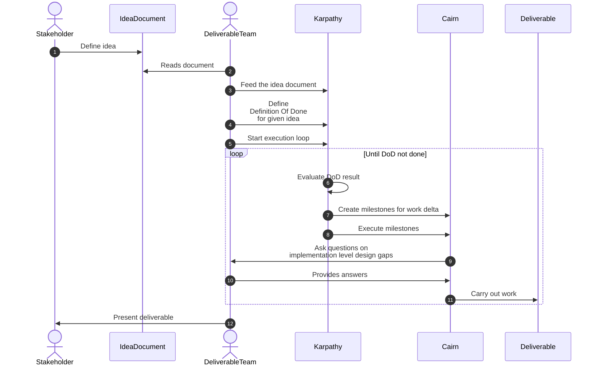
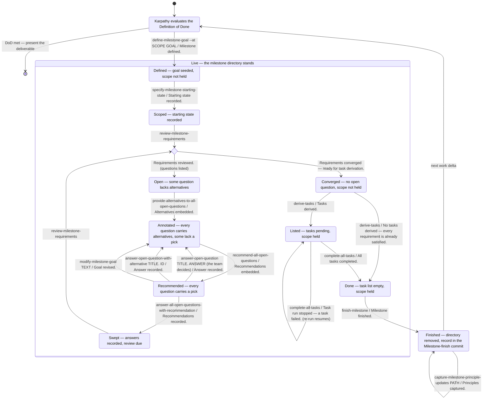

# Karpathy wrapped Cairn multisprint orchestration

## Flow

## Handling transitions

It seems to me that the "Karpathy" should be an orchestrator that runs Cairn through CLI commands (as per ways-of-using-cairn). Specifically it shouldn't drive them in his own context.

The diagram below is what Karpathy sees from outside: one state per situation it can tell apart without holding any Cairn context, and one edge per skill it can run from there. An edge reads `skill / fixed first line that confirms the move`; every skill after the definition takes `--milestone PATH`, left out of the labels. The shape follows milestone 54 (a milestone addressed by path, the scope gate, finish as removal of the directory), which is still landing: today's tree has `finish-current-milestone` and no gate yet.

How the state is read, with no context carried between runs:

- **Coarse state from the milestones tool.** `python3 tools/milestones.py live` prints every live milestone as `defined` (its task list never written) or `started` (written at least once, so it holds its scope), and `milestones .` lists the finished ones with their finish dates. `Finished` is the directory being gone.
- **Fine state from the last fixed line.** Inside `Live` the state is whatever the previous run's first console line confirmed. A no-op line (`No alternatives embedded — every question already carries a set.`, `Nothing embedded or reordered — every question already carries a recommendation.`) confirms the state already held, so the three-step loop `provide-alternatives`, `recommend-all`, `answer-all` can be re-run from any point between `Open` and `Swept` without harm, and only the review's verdict line leaves the loop.
- **Where the team comes in.** The sequence diagram's "ask questions on implementation level design gaps" is the `Recommended` state: Karpathy reads the picked set (`open_questions.py list --with-question` plus each pick's `lift`) and either records every pick with the sweep or routes some questions to the DeliverableTeam first. A hand answer strips the picks it undermines, which is why its edge lands back in `Annotated` and `recommend-all` runs again before the sweep.

Stop lines that leave the state unchanged, and what Karpathy does on each:

| Stop line | Meaning | Move |
|---|---|---|
| `No milestone resolved — pass --milestone with a live milestone's path.` | the path is wrong; the live paths are printed beneath | retry with a printed path |
| `Cannot derive tasks: the following open questions must be resolved first:` | still between `Open` and `Swept` | run the loop until the verdict line |
| `Recommendation pass stopped — some questions lack alternatives.` | in `Open`, not `Annotated` | run `provide-alternatives` first |
| the gate line (milestone 54's last task fixes its text) | another started milestone holds the same, an enclosing, or an enclosed scope; the holders are printed beneath | run `finish-milestone` on the holder, then retry |
| `Sweep stopped — the milestone files already held changes.` | a stopped run left an uncommitted fold or a hand edit | commit or revert it by hand, then re-run |
| `Task run stopped — a task failed.` | partial work left in the tree, resumable | re-run `complete-all-tasks` (the self-loop) |
| `Cannot finish the milestone: tasks remain to be completed.` | still in `Listed` | run `complete-all-tasks` |

## Here and now halfway approach

This would be to get the idea document, and split it into multiple milestones with execution order graph defined. The execution graph should prefer parallel execution to provide a short critical execution path.
From there the milestones are worked out manually (starting state -> review -> tasks execution) according to the graph definition (including parallel execution).

