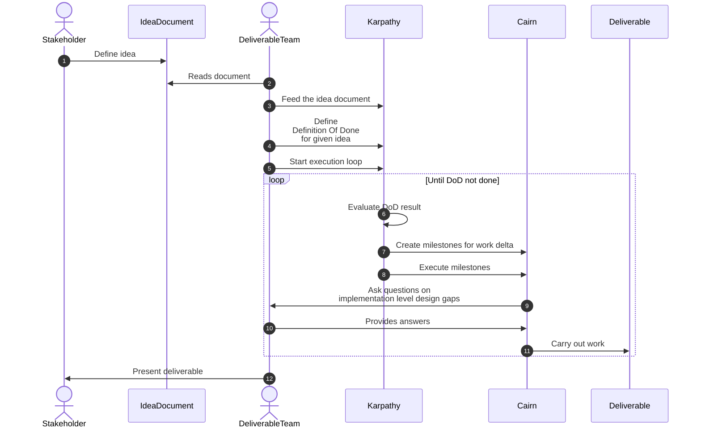

# Karpathy wrapped Cairn multisprint orchestration

## Flow

## Handling transitions

It seems to me that the "Karpathy" should be an orchestrator that runs Cairn through CLI commands (as per ways-of-using-cairn). Specifically it shouldn't drive them in his own context.