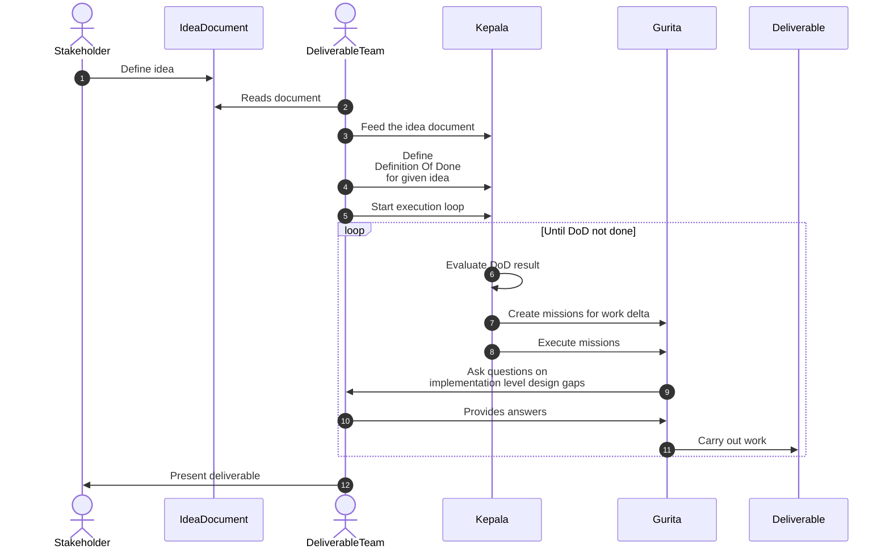
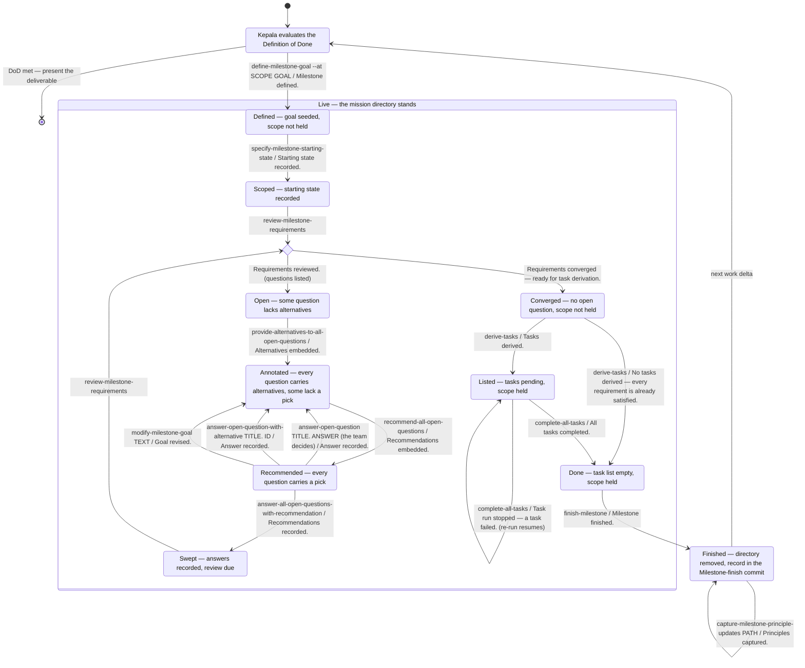

# Kepala

A draft of the orchestrator's name and of the work it might do, in two parts with two histories. The naming part was split on 2026-11-10 from the draft written 2026-10-30 that named the plugin and the orchestrator together; the plugin's half is `ideas/gurita.md`. The outline was merged in the same day from `ideas/karpathy.md`, the sketch of a multi-mission orchestrator kept until then under the working name Karpathy. The draft names that orchestrator **Kepala**, the head of the octopus whose arms are the plugin, Gurita, and the pair written as one word, **Kepalagurita**, names the whole. The orchestrator itself is still being worked out, so the naming part holds what is settled, why the image holds, which names it rules out, and what was checked for collisions and when, while the outline is a potential shape of the work, not a plan. The draft uses `ideas/gurita.md`'s words throughout, Gurita for the plugin and mission for the unit it works on, a milestone today, and it waits on that draft, which is carried out first.

## Why a name of its own

`Karpathy` was the working name of the orchestrator outlined below, and it says nothing about the plugin it runs. The orchestrator makes the plugin's naming problem worse rather than better: it is a second product, optional and sitting on top of the plugin, and it needs a name that says how it relates to the first. One image for both, with two names that join into one word, says that relation without a sentence.

## The image

An octopus has about 500 million neurons and two thirds of them sit in the arms, grouped in ganglia along each arm. An arm senses and starts actions on its own; the central brain sets the goal and does not track each sucker. That is the design the outline below already states: the head runs the mission skills through the CLI, holds no mission context of its own, and reads each run only by the fixed first line it prints, while every mission resolves its own implementation-level questions, through the open-question loop, before its tasks are derived. The arms' side of the image, their working in parallel under the scope gate, is in `ideas/gurita.md`, with the two corrections that bear on the plugin's name: an octopus has arms, not tentacles, and Octopus Deploy owns the English vocabulary, its per-machine agent Tentacle being this same head-and-arms split, already named, in developer tooling.

One correction bears on the head:

- **The bulb is the mantle.** What people call the octopus's head is its mantle, the body; the head proper is the small part holding the eyes and the brain, between mantle and arms. This matters only if a `Mantle` name tempts anyone, and Mantle is taken.

## The names

**Kepala** is Indonesian and Malay for head, and by extension chief: `kepala sekolah` is a headmaster, `kepala desa` a village head. Pronounced ke-PA-la. The orchestrator is the head in both senses, the part that holds the brain and the one that gives direction.

**Kepalagurita** is the two written as one word. In Indonesian `kepala gurita` is simply the phrase "octopus head", so the merged form is a real compound rather than a portmanteau, read head first as cephalopod itself is built (head, then foot). It is long, twelve letters, and that is accepted: it names the whole and is typed rarely, as an organisation or umbrella name, while the two short names are the ones in daily use.

The plugin's word for its unit of work, mission, is `ideas/gurita.md`'s. In Kepala's loop the word reads as it should: the head creates missions for the work still missing and hands each to the arms.

Kepala says nothing to most English speakers, as Gurita says nothing; the meaning is one sentence away on the landing page. It carries no cultural-use expectation of the kind that ruled out the Māori word `ideas/gurita.md` records.

### Collision check

Checked on 2026-10-30 through web search of GitHub, npm, PyPI, and crates.io: no package, tool, or framework named `kepala` or `kepalagurita` was found. The check is a search, not a registry query, so it is repeated by looking each slug up on the registries directly and on GitHub before anything is published under either name.

The one near use found for mission, Factory's Missions, sits at Kepala's level rather than the plugin's: a Factory Mission is the whole multi-day run, with an orchestrator, workers, and validators, which here is Kepala's loop. `ideas/gurita.md` records the check and its cost.

## How the names land

| Site | Today | After |
|---|---|---|
| The orchestrator | `Karpathy`, the outline's working name | `kepala`, its own repository |
| The whole | none | `kepalagurita`, organisation or umbrella |

In prose the names are capitalised, Kepala and Kepalagurita; as slugs they are lowercase.

## Checked and rejected

| Name | Why not |
|---|---|
| Argo, Argonaut | Argonauta is an octopus genus and ship-plus-crew would have been a perfect split, but Argo CD and Argo Workflows own the name in the same category |
| Capo | Italian for head and boss, with `da capo` naming the orchestrator's loop; a Rust coding-agent CLI for Claude-style models carries it, in this plugin's own niche, beside capo.js |
| Mantle | Mantle Network and several libraries |
| Rosh | Hebrew for head and chief; a ROS shell and a router shell carry it |

The octopus words that were ruled out are in `ideas/gurita.md`.

### Alternatives kept on record

Pairs that merge, in case the chosen one fails a later check. They replace both names, so they are an alternative only until the Gurita rename is released; after that the plugin's half is fixed and only the head word can still change:

- **Capo and Pulpo, merged Capulpo.** Romance words, the most euphonic merge of all those tried, the two sharing their `p`. Pulpo's collisions are stale. Capo's is live and in-niche, which is why the pair is second.
- **Rosh and Tamnun, merged Roshtamnun.** Hebrew; `tamnun` is clean, `rosh` nearly so, the merged form clunky.
- **Kefalo and Podo, merged Kefalopodo.** The Greek word for cephalopod, the actual head-foot compound; its halves are weak alone and `podo` reads as a Kubernetes pod.

## Potential work outline

What follows is the sketch that stood in `ideas/karpathy.md`, carried over under the new names. It is one possible shape of the work, recorded so the design has a starting point, and none of it is decided. Skill names, flags, commit markers, and console lines are quoted as they stand today, under the current word; the Gurita rename changes every one that carries milestone, and the outline follows it.

### Flow

### Handling transitions

Kepala should be an orchestrator that runs Gurita through CLI commands, as `docs/ways-of-using-cairn.md` describes for headless chains. Specifically, it should not drive the skills in its own context.

The diagram below is what Kepala sees from outside: one state per situation it can tell apart without holding any Gurita context, and one edge per skill it can run from there. An edge reads `skill / fixed first line that confirms the move`; every skill after the definition takes `--milestone PATH`, left out of the labels. The shape is the path-addressed one that stands on `main` today: a mission addressed by its path, the scope gate, and finish as removal of the directory.

How the state is read, with no context carried between runs:

- **Coarse state from the milestones tool.** `python3 tools/milestones.py live` prints every live mission as `defined` (its task list never written) or `started` (written at least once, so it holds its scope), and `milestones .` lists the finished ones with their finish dates. `Finished` is the directory being gone.
- **Fine state from the last fixed line.** Inside `Live` the state is whatever the previous run's first console line confirmed. A no-op line (`No alternatives embedded — every question already carries a set.`, `Nothing embedded or reordered — every question already carries a recommendation.`) confirms the state already held, so the three-step loop `provide-alternatives`, `recommend-all`, `answer-all` can be re-run from any point between `Open` and `Swept` without harm, and only the review's verdict line leaves the loop.
- **Where the team comes in.** The sequence diagram's "ask questions on implementation level design gaps" is the `Recommended` state: Kepala reads the picked set (`open_questions.py list --with-question` plus each pick's `lift`) and either records every pick with the sweep or routes some questions to the DeliverableTeam first. A hand answer strips the picks it undermines, which is why its edge lands back in `Annotated` and `recommend-all` runs again before the sweep.

Stop lines that leave the state unchanged, and what Kepala does on each:

| Stop line | Meaning | Move |
|---|---|---|
| `No milestone resolved — pass --milestone with a live milestone's path.` | the path is wrong; the live paths are printed beneath | retry with a printed path |
| `Cannot derive tasks: the following open questions must be resolved first:` | still between `Open` and `Swept` | run the loop until the verdict line |
| `Recommendation pass stopped — some questions lack alternatives.` | in `Open`, not `Annotated` | run `provide-alternatives` first |
| `Scope gate closed — the scope is held or could not be checked.` | another started mission holds the same, an enclosing, or an enclosed scope, the holders printed beneath, or the gate could not be read, the tool's `Error:` line printed beneath | run `finish-milestone` on the holder, then retry |
| `Sweep stopped — the milestone files already held changes.` | a stopped run left an uncommitted fold or a hand edit | commit or revert it by hand, then re-run |
| `Task run stopped — a task failed.` | partial work left in the tree, resumable | re-run `complete-all-tasks` (the self-loop) |
| `Cannot finish the milestone: tasks remain to be completed.` | still in `Listed` | run `complete-all-tasks` |

### A halfway approach, available now

Before any orchestrator exists, the idea document can be split by hand into several missions with an execution-order graph. The graph should prefer parallel execution, so that the critical path is short. From there the missions are worked manually (starting state, review, task execution) in the order the graph gives, parallel branches included.

## What waits

Nothing here is carried out yet. The plugin's rename lands first and on its own (`ideas/gurita.md`), so that Kepala is born under its name, never refers to the plugin as Cairn, and matches fixed console lines that already say mission. The outline above is where the orchestrator's design starts, and it is settled in the work itself, not in this draft.

## Open questions

- **Where Kepalagurita lands.** The table says organisation or umbrella and does not choose between them. The Gurita rename keeps the distribution repositories under `uHappyLogic`, so an organisation created afterwards moves them a second time, their redirects and the traffic token's repository list with them, while an umbrella that is only a name moves nothing.
- **Whether the head word survives Gurita going first.** Once the plugin is released as Gurita the pairs above are closed, and a Kepala that fails its repeated collision check is replaced by another head word that joins Gurita, of which none is on record.

## Sources

- Octopus neuron distribution and arm autonomy: https://www.sciencealert.com/here-s-how-octopus-arms-make-decisions-without-input-from-the-brain
- Octopus Deploy's Tentacle agent: https://docs.octopusdeploy.com
- Capo collision: https://packages.ecosyste.ms/api/v1/registries/crates.io/packages/capo-cli/codemeta
- Rosh collisions: https://pypi.org/project/rosh/ , https://index.ros.org/p/rosh_core/
